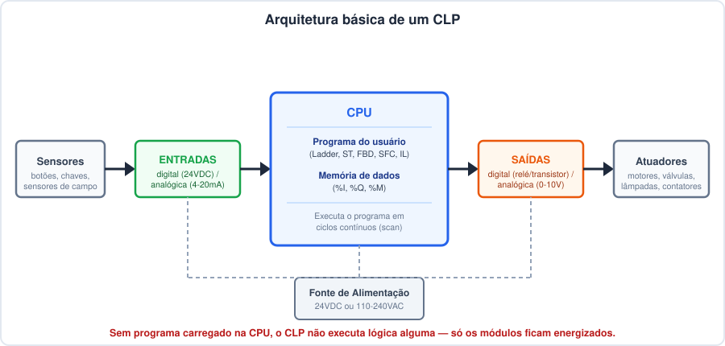
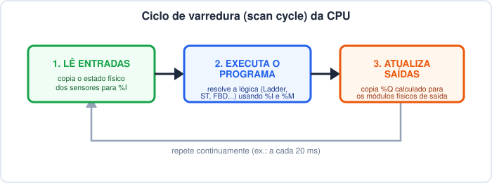
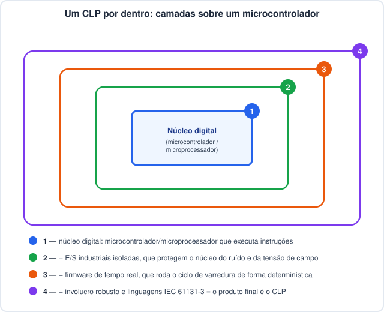

# CLP: Entradas, Saídas e Programa — Relação com Microcontroladores

## 1. Ideia geral do controlador

- Um **CLP (Controlador Lógico Programável)** é um computador industrial
  dedicado a **ler sinais do mundo físico**, **decidir** o que fazer com eles
  (de acordo com um programa) e **acionar** dispositivos de saída.
- Em termos simples: **CLP = Entradas + Programa + Saídas**, repetido em loop,
  o tempo todo, enquanto estiver em modo RUN.
- Ele não "pensa" sozinho — ele só executa, ciclo após ciclo, a lógica que foi
  carregada nele.
- É o mesmo papel que um relé, um contator ou um técnico apertando botões
  faria manualmente — só que automatizado, programável e muito mais rápido.

---

## 2. Arquitetura básica: entradas → CPU → saídas

- **Entradas (%I):** recebem sinais dos sensores/botões de campo e os
  convertem para algo que a CPU entende.
- **CPU:** onde o **programa do usuário** fica armazenado e é executado.
- **Saídas (%Q):** recebem o resultado calculado pela CPU e acionam os
  dispositivos físicos (motores, válvulas, lâmpadas...).
- **Fonte de alimentação:** energiza todos os módulos — mas **não** energiza
  a lógica; ela só liga o hardware.

---

## 3. Tipos de entradas e saídas

| Tipo | Exemplo de sinal | Uso típico |
|---|---|---|
| Entrada digital | 0V / 24VDC (aberto/fechado) | Botões, chaves fim-de-curso, sensores de proximidade |
| Entrada analógica | 4-20mA, 0-10V | Sensores de temperatura, pressão, nível |
| Saída digital | Relé ou transistor (liga/desliga) | Contatores, lâmpadas, eletroválvulas |
| Saída analógica | 0-10V, 4-20mA | Inversores de frequência, válvulas proporcionais |

- Entradas e saídas **digitais** só têm dois estados: `0` ou `1`.
- Entradas e saídas **analógicas** representam uma faixa contínua de valores
  (convertida internamente para um número inteiro, ex.: 0–27648 em muitos CLPs).

---

## 4. O programa é o que dá vida ao CLP

- **Um CLP sem programa carregado não executa nada.**
  - Os módulos ficam energizados, os LEDs acendem, mas **nenhuma lógica roda**.
  - Nenhuma saída liga sozinha — tudo depende do programa dizer o que fazer.
- O programa roda em **ciclos contínuos**, chamados de **ciclo de varredura**
  (*scan cycle*):

- Esse ciclo se repete indefinidamente, tipicamente a cada poucos
  milissegundos (no projeto deste repositório, por exemplo, a tarefa `task0`
  está configurada para rodar a cada `T#20ms` — veja
  [`project.json`](../project.json)).
- É esse loop constante que dá a impressão de "tempo real": o CLP está sempre
  olhando as entradas e reagindo quase instantaneamente.

---

## 5. Relação com um microcontrolador

- Por dentro, a **CPU de um CLP normalmente é construída em cima de um
  microcontrolador ou microprocessador** — o mesmo tipo de chip usado em uma
  placa Arduino, ESP32, STM32, etc.
- A diferença não está no "cérebro" em si, mas em **tudo que foi construído
  ao redor dele** para uso industrial.

- Um microcontrolador "nu" vira um CLP quando ganha:
  1. **E/S industriais isoladas** (proteção contra ruído, surto, curto);
  2. **Firmware de tempo real** que implementa o ciclo de varredura de forma
     confiável e determinística;
  3. **Invólucro robusto** (trilho DIN, ampla faixa de temperatura, resistência
     a vibração);
  4. **Linguagens padronizadas pela IEC 61131-3** (Ladder, ST, FBD, SFC, IL),
     em vez de C/C++ "cru".

---

## 6. Diferenças entre CLP e microcontrolador

| Critério | CLP | Microcontrolador |
|---|---|---|
| Finalidade | Automação industrial dedicada | Uso geral / projetos embarcados customizados |
| Forma física | Caixa fechada, montagem em trilho DIN | Placa nua ou circuito customizado |
| Entradas/Saídas | Isoladas opticamente, prontas para 24VDC, relé, 4-20mA | GPIO direto; precisa de circuito extra para proteção |
| Ambiente | Resistente a vibração, ruído elétrico, faixa ampla de temperatura | Geralmente uso comercial/de bancada, mais sensível |
| Programação | Linguagens da norma IEC 61131-3 (Ladder, ST, FBD, SFC, IL) | C/C++, MicroPython, Arduino IDE, entre outras |
| Execução | Ciclo de varredura determinístico, muitas vezes com SO de tempo real | Depende do firmware; geralmente não determinístico por padrão |
| Diagnóstico | LEDs de status, protocolos industriais (Modbus, OPC-UA...), troca a quente de módulos | Depende do projeto; normalmente exige debug via cabo/serial |
| Custo | Mais caro, já homologado (UL, CE etc.) | Mais barato, sem certificação industrial embutida |
| Manutenção | Pensado para troca por técnico, sem programação de baixo nível | Geralmente exige conhecimento de eletrônica/firmware |

- Resumindo: **um microcontrolador é ótimo para prototipar rápido e barato**;
  **um CLP é feito para rodar 24/7 numa fábrica, com segurança e robustez**.
- Não é raro CLPs "de entrada" (ou soluções como o Autonomy Edge, vPLC etc.)
  usarem hardware baseado em microcontrolador/SoC por trás de uma camada de
  software que entrega a experiência clássica de CLP.

---

## 7. Quadro-resumo

| Pergunta | Resposta rápida |
|---|---|
| O que é um CLP? | Um computador industrial que lê entradas, roda um programa e aciona saídas, em loop |
| O que acontece sem programa? | Nada — o hardware liga, mas nenhuma saída é controlada |
| O que faz o ciclo rodar? | O ciclo de varredura: ler → executar → atualizar, repetidamente |
| Tem microcontrolador dentro? | Normalmente sim — o CLP é o microcontrolador + proteção + tempo real + IEC 61131-3 |
| Qual a maior diferença prática? | Robustez de hardware + linguagens padronizadas + determinismo de execução |
