# Linguagem Ladder e as Linguagens da Norma IEC 61131-3

## Introdução

A linguagem **Ladder** (ou Diagrama de Contatos, do inglês *Ladder Diagram* — LD) é uma
linguagem de programação gráfica amplamente utilizada na programação de
**Controladores Lógicos Programáveis (CLPs)**. Seu nome vem do formato visual do
programa, que se assemelha a uma escada: duas linhas verticais representam os
barramentos de energia (positivo e negativo/retorno), e entre elas são desenhados
os "degraus" (*rungs*), que contêm a lógica de controle.

A origem da linguagem Ladder está diretamente ligada à eletrônica de relés. Antes
do surgimento dos CLPs, os painéis de controle industrial eram construídos com
relés eletromecânicos, contatores, temporizadores e chaves fiadas fisicamente.
Quando os primeiros CLPs foram criados (final dos anos 1960, para a indústria
automobilística), a linguagem Ladder foi desenvolvida propositalmente para que
técnicos e engenheiros já habituados a ler diagramas elétricos a relés pudessem
migrar para a programação de CLPs sem precisar aprender uma linguagem de
programação tradicional. Por esse motivo, até hoje o Ladder é a linguagem mais
utilizada e ensinada em automação industrial.

### Elementos básicos do Ladder

<table>
<tr>
  <td>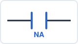</td>
  <td><b>Contato Normalmente Aberto (NA)</b><br>Conduz quando a variável associada está em <code>1</code> (verdadeiro).</td>
</tr>
<tr>
  <td>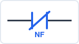</td>
  <td><b>Contato Normalmente Fechado (NF)</b><br>Conduz quando a variável associada está em <code>0</code> (falso).</td>
</tr>
<tr>
  <td>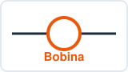</td>
  <td><b>Bobina</b><br>Energiza (atribui <code>1</code>) a variável de saída quando há continuidade lógica no rung.</td>
</tr>
<tr>
  <td>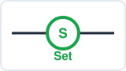</td>
  <td><b>Bobina Set (S)</b><br>Ativa e mantém a saída em <code>1</code> (memória), mesmo após a condição de entrada desaparecer.</td>
</tr>
<tr>
  <td>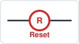</td>
  <td><b>Bobina Reset (R)</b><br>Desativa e mantém a saída em <code>0</code> (memória).</td>
</tr>
</table>

### Operações lógicas básicas: Ladder × Structured Text

Toda operação booleana pode ser escrita tanto em Ladder quanto em
Structured Text (ST) — são só duas notações para a mesma lógica. Os
exemplos abaixo usam sempre as mesmas três variáveis:

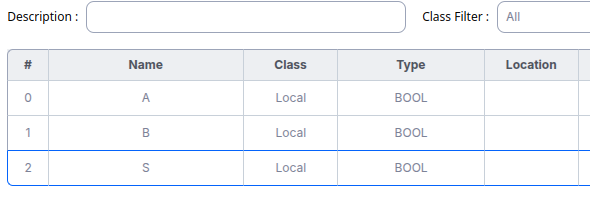

**Cópia direta — `S = A`**

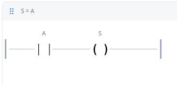

```pascal
S := A;
```

**E (AND) — `S = A and B`**

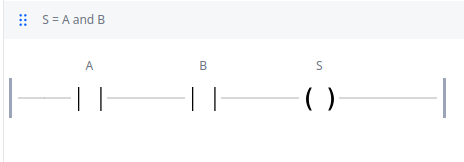

```pascal
S := A AND B;
```

**OU (OR) — `S = A or B`**

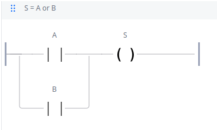

```pascal
S := A OR B;
```

**NÃO (NOT) — `S = not A`**

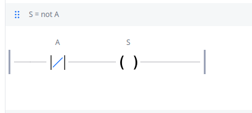

```pascal
S := NOT A;
```

**NAND — `S = A nand B`**

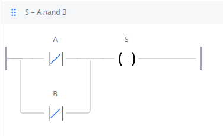

```pascal
S := NOT (A AND B);
```

**NOR — `S = A nor B`**

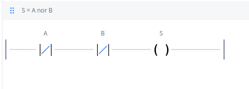

```pascal
S := NOT (A OR B);
```

**XOR (OU exclusivo) — `S = A xor B`**

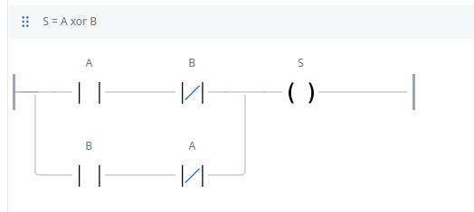

```pascal
S := A XOR B;
```

**XNOR — `S = A xnor B`**

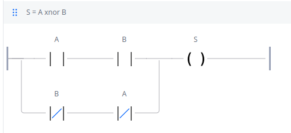

```pascal
S := NOT (A XOR B);
```

### Contato de borda e bobinas Set/Reset

Além dos contatos e bobinas comuns, o Ladder também tem versões que
reagem só à **transição** de um sinal (borda) e versões que **guardam**
um estado (memória):

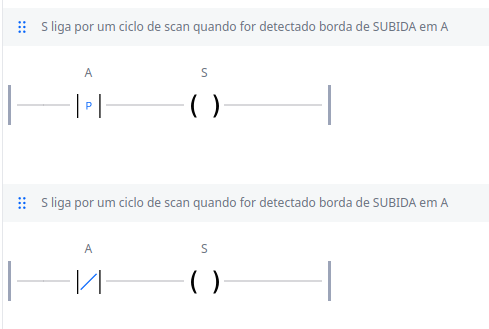

```pascal
R_TRIG1(CLK := A);
S := R_TRIG1.Q;      (* dispara 1 ciclo de scan na borda de subida de A *)

F_TRIG1(CLK := A);
S := F_TRIG1.Q;       (* dispara 1 ciclo de scan na borda de descida de A *)
```

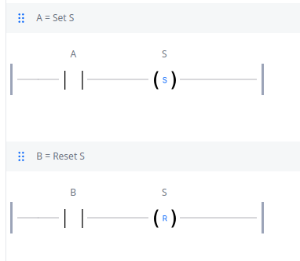

```pascal
IF A THEN S := TRUE;  END_IF;   (* equivalente à bobina Set *)
IF B THEN S := FALSE; END_IF;   (* equivalente à bobina Reset *)
```

O mesmo resultado de "ligar e manter ligado" também pode ser feito sem
bobina Set/Reset, só com um contato de selo (self-holding) em paralelo com
`A`, cortado por `B`:

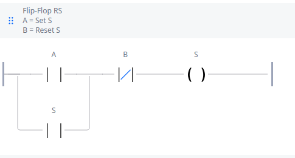

```pascal
S := (A OR S) AND NOT B;
```

### Exemplo: circuito de selo (self-holding) Start/Stop

O exemplo abaixo é um dos circuitos mais clássicos da automação: um botão
**Start** (contato NA) aciona a saída `Q0.0`; um contato NA da própria saída,
ligado em paralelo com o Start, mantém o motor ligado mesmo depois que o botão
Start é solto (efeito de "selo" ou "memória"); e um botão **Stop** (contato NF)
em série interrompe o circuito a qualquer momento.

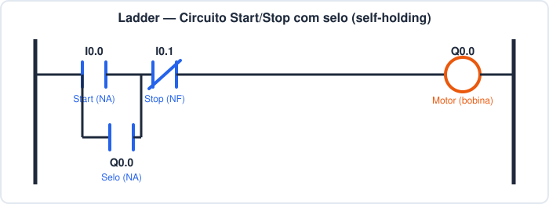

Em pseudocódigo equivalente:

```
Q0.0 := (I0.0 OR Q0.0) AND NOT I0.1;
```

O mesmo circuito, agora com nomes de variável reais e endereçado a
entradas/saídas físicas (`%IX0.0`, `%IX0.1`, `%QX0.0`) no OpenPLC Editor:

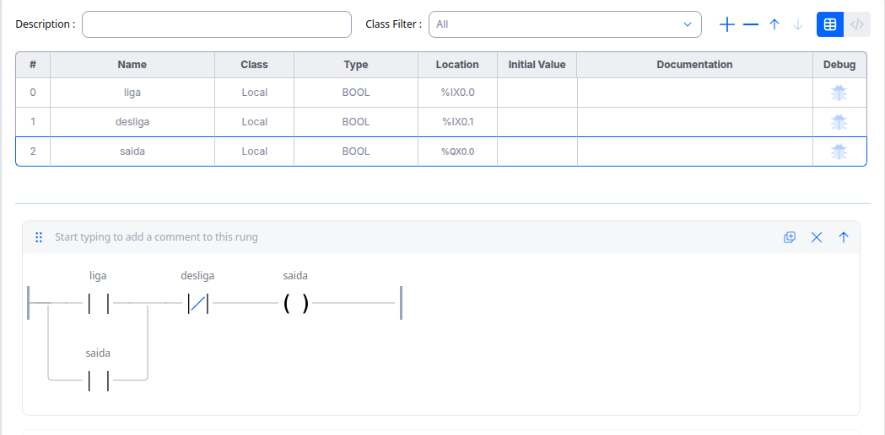

## As linguagens definidas pela norma IEC 61131-3

A norma **IEC 61131-3** (equivalente à norma brasileira **NBR IEC 61131-3**) é o
padrão internacional que define a programação de controladores industriais. Seu
principal objetivo é padronizar a forma como os programas de CLP são escritos,
permitindo portabilidade entre fabricantes e maior organização do software
através de POUs (*Program Organization Units*: programas, funções e blocos de
função).

A norma define **cinco linguagens de programação**, sendo duas textuais e três
gráficas:

| Linguagem | Sigla | Tipo |
|---|---|---|
| Ladder Diagram | LD | Gráfica |
| Function Block Diagram | FBD | Gráfica |
| Sequential Function Chart | SFC | Gráfica (estruturação) |
| Structured Text | ST | Textual |
| Instruction List | IL | Textual (removida na 3ª edição da norma) |

Um mesmo projeto pode combinar várias dessas linguagens: por exemplo, usar SFC
para estruturar as etapas de um processo sequencial e, dentro de cada etapa,
implementar a lógica em Ladder ou em Structured Text.

---

### 1. Ladder Diagram (LD)

Linguagem gráfica baseada em contatos e bobinas, conforme já apresentado na
introdução. É a mais indicada para lógicas combinacionais simples,
intertravamentos e lógica de partida/parada de motores, por sua semelhança com
diagramas elétricos.


---

### 2. Function Block Diagram (FBD)

Linguagem gráfica em que a lógica é representada por **blocos funcionais**
interligados por linhas de sinal, de forma semelhante a um diagrama de blocos
de eletrônica digital. Cada bloco pode representar uma porta lógica (AND, OR,
NOT), um temporizador (TON, TOF), um contador (CTU, CTD) ou qualquer bloco de
função definido pelo usuário.

É muito utilizada quando a lógica é naturalmente descrita como fluxo de sinal
entre blocos, como em malhas de controle contínuo e lógicas com muitos blocos
de função reutilizáveis.

**Exemplo:** duas entradas passam por uma porta `AND` e o resultado aciona um
temporizador `TON` (retardo na energização) de 2 segundos, que por sua vez
aciona a saída `Q0.0`.

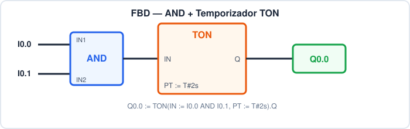

Equivalente em texto:

```
Q0.0 := TON(IN := (I0.0 AND I0.1), PT := T#2s).Q;
```

**Outro exemplo:** o mesmo circuito de selo Start/Stop desta introdução,
agora montado em FBD com um bloco padrão **SR** (Set-Reset) — `S1` liga,
`R` desliga, `Q1` é a saída:

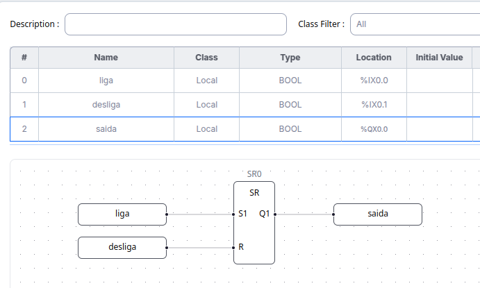

```pascal
SR1(S1 := liga, R := desliga);
saida := SR1.Q1;
```

- Repare que `SR` é **Set-dominante**: se `S1` e `R` estiverem verdadeiros
  ao mesmo tempo, quem vence é o Set. A norma também define o bloco `RS`
  (Reset-dominante), com o comportamento oposto em caso de empate.

---

### 3. Sequential Function Chart (SFC)

Linguagem gráfica voltada para a **estruturação de processos sequenciais**,
dividindo o programa em **etapas (steps)** e **transições**. Cada etapa contém
ações a serem executadas enquanto estiver ativa, e cada transição contém a
condição lógica (booleana) que precisa ser satisfeita para que o fluxo avance
para a próxima etapa. É a linguagem mais adequada para processos com fases bem
definidas, como sequenciamento de máquinas, processos em batelada e ciclos
automáticos.

**Exemplo:** ciclo automático de um cilindro pneumático — a partir do passo
inicial, o Start dispara o avanço do cilindro; ao atingir o sensor `S1`, o
cilindro recua; ao atingir o sensor `S0`, o ciclo retorna ao passo inicial.

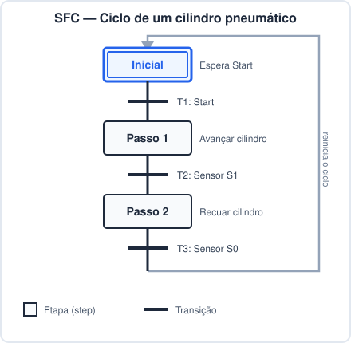

---

### 4. Structured Text (ST)

Linguagem textual de alto nível, com sintaxe semelhante a Pascal. É a
linguagem mais indicada para lógicas complexas, cálculos matemáticos,
manipulação de strings/arrays, estruturas condicionais (`IF`, `CASE`) e laços
de repetição (`FOR`, `WHILE`, `REPEAT`), tarefas que seriam difíceis de
representar graficamente em Ladder ou FBD.

**Exemplo:** o mesmo circuito de selo Start/Stop, agora inteiro em uma
única linha de ST:

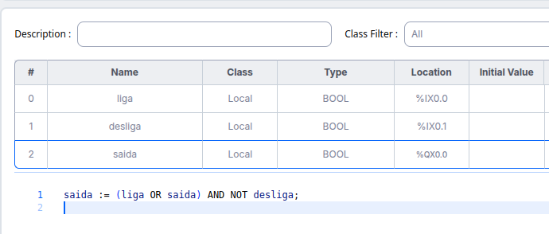

```pascal
saida := (liga OR saida) AND NOT desliga;
```

**Outro exemplo:** cálculo de média de três leituras analógicas e ativação
de um alarme caso o valor ultrapasse um limite — algo que já seria
trabalhoso de desenhar em Ladder ou FBD.

```pascal
PROGRAM main
VAR
    leitura1, leitura2, leitura3 : REAL;
    media                        : REAL;
    limite                       : REAL := 80.0;
    alarme                       : BOOL;
END_VAR

media := (leitura1 + leitura2 + leitura3) / 3.0;

IF media > limite THEN
    alarme := TRUE;
ELSE
    alarme := FALSE;
END_IF;

END_PROGRAM
```

---

### 5. Instruction List (IL)

Linguagem textual de baixo nível, semelhante a Assembly, baseada em uma lista
de instruções executadas sequencialmente sobre um "resultado atual" (registro
acumulador implícito). Foi muito usada nos primeiros CLPs por exigir pouco
processamento para ser interpretada, mas caiu em desuso por ser pouco legível
e de difícil manutenção. A 3ª edição da norma IEC 61131-3 (2013) **removeu o
IL** do padrão, embora diversos fabricantes ainda a suportem por
compatibilidade.

**Exemplo:** equivalente em IL ao circuito de selo Start/Stop apresentado na
introdução.

```
LD    I0.0        (* carrega Start *)
OR    Q0.0        (* OU com o selo da própria saída *)
ANDN  I0.1        (* E com o Stop negado *)
ST    Q0.0        (* armazena resultado na saída *)
```

---

## Resumo comparativo

| Linguagem | Melhor uso típico | Nível |
|---|---|---|
| LD  | Intertravamentos, partida/parada de motores | Gráfica |
| FBD | Malhas de controle, blocos reutilizáveis | Gráfica |
| SFC | Processos sequenciais e batelada | Gráfica (estruturação) |
| ST  | Cálculos, lógica complexa, manipulação de dados | Textual (alto nível) |
| IL  | Uso legado / compatibilidade | Textual (baixo nível) |

## Referências

- IEC 61131-3: *Programmable controllers — Part 3: Programming languages*.
- John, K.-H.; Tiegelkamp, M. *IEC 61131-3: Programming Industrial Automation
  Systems*.
