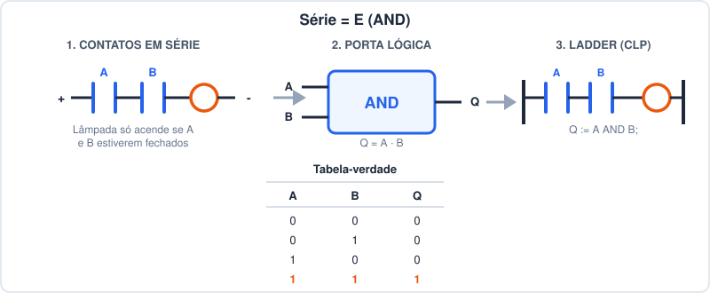
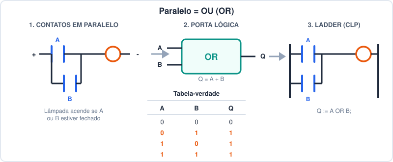
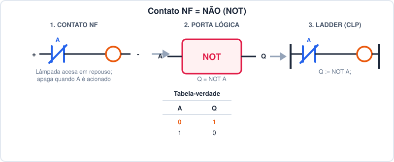

# Do Contato Elétrico ao Ladder — Roteiro de Aula

> Documento em formato de tópicos, pensado para apresentação em quadro/slide.
> Cada bloco pode ser um "slide" ou um bloco de quadro-negro.

---

## 1. O que é Ladder, em uma frase

- Ladder é uma **forma gráfica de escrever lógica booleana**, desenhada para
  parecer um circuito elétrico a relés.
- Duas linhas verticais = **barramentos de energia**.
- Cada linha horizontal = um **rung** (degrau) = uma equação lógica.
- Se houver "continuidade elétrica" da esquerda para a direita, a saída liga.

---

## 2. Linha do tempo (quadro 1)

| Período | Marco |
|---|---|
| Séc. XIX | George Boole cria a **álgebra booleana** (lógica com 0 e 1) |
| Início 1900s | Indústria usa **painéis de relés** para automatizar máquinas |
| 1937 | Claude Shannon prova que **circuitos de chaveamento = álgebra booleana** |
| 1968 | GM pede um substituto programável para os painéis de relés → nasce o **CLP** |
| 1970s+ | Ladder vira linguagem padrão de CLP, para reaproveitar o conhecimento dos técnicos de relés |
| 1993 | Norma **IEC 61131-3** padroniza o Ladder junto com outras 4 linguagens |

**Ideia-chave:** o Ladder não foi inventado do zero — ele é a **tradução direta**
de um circuito de relés para dentro do CLP.

---

## 3. A ideia central da aula

- Todo **circuito de contatos** (relé) representa uma **expressão booleana**.
- Toda **expressão booleana** pode ser desenhada como **porta lógica**.
- Toda **porta lógica** pode ser reescrita como um **rung de Ladder**.

```
Contato elétrico  ──►  Porta lógica (Boole)  ──►  Ladder (CLP)
   (hardware)            (matemática)             (software)
```

- As três formas descrevem **exatamente a mesma coisa**. Mudou só a
  representação, não o significado.

---

## 4. Equivalência 1 — Contatos em SÉRIE = função E (AND)



- Dois contatos **em série** só deixam a corrente passar se **os dois**
  estiverem fechados.
- Isso é exatamente a definição da porta **AND**: `Q = A · B`.
- Em Ladder, "série" vira **dois contatos um atrás do outro** no mesmo rung.
- Regra de bolso: **"série pensa como E"**.

---

## 5. Equivalência 2 — Contatos em PARALELO = função OU (OR)



- Dois contatos **em paralelo** deixam a corrente passar se **qualquer um**
  dos dois estiver fechado.
- Isso é a definição da porta **OR**: `Q = A + B`.
- Em Ladder, "paralelo" vira **dois ramos empilhados verticalmente** que se
  religam antes da bobina.
- Regra de bolso: **"paralelo pensa como OU"**.

---

## 6. Equivalência 3 — Contato NF = função NÃO (NOT)



- Um contato **Normalmente Fechado (NF)** já vem conduzindo em repouso e
  **abre** quando a entrada é acionada.
- Isso é a definição da porta **NOT**: `Q = NOT A`.
- Em Ladder, "inverter" um sinal é simplesmente **trocar o contato de NA
  para NF**.

---

## 7. Combinando as três regras

- Qualquer lógica de intertravamento é só **combinar série, paralelo e NF**.
- Exemplo clássico: **partida/parada de motor com selo**.
  - Start (NA) **em paralelo com** o próprio Q0.0 (selo) → função OU.
  - Esse conjunto **em série com** Stop (NF) → função E com um NÃO embutido.
  - Expressão booleana final:

```
Q0.0 := (I0.0 OR Q0.0) AND NOT I0.1;
        \_____ OU _____/      \_NÃO_/
              \_____________ E _____________/
```

- Essa é a mesma lógica detalhada em [linguagem-ladder.md](linguagem-ladder.md),
  agora vista pelo ângulo da álgebra booleana.

---

## 8. Quadro-resumo (para copiar no quadro)

| Circuito elétrico | Porta lógica | Operador Boole | Ladder |
|---|---|---|---|
| Contatos em série | AND | `·` (E) | Contatos em sequência no rung |
| Contatos em paralelo | OR | `+` (OU) | Ramos paralelos no rung |
| Contato NF | NOT | `¬` (NÃO) | Trocar NA por NF |
| Bobina de saída | — | `=` (atribuição) | `-( )-` |

---

## 9. Por que essa equivalência importa

- Ajuda a **ler** um Ladder de olho na física: cada rung "é" um circuito.
- Ajuda a **projetar**: primeiro pensa-se na expressão booleana, depois
  desenha-se o rung.
- Ajuda a **migrar** entre linguagens da norma: a mesma lógica série/paralelo/NF
  vira `AND`/`OR`/`NOT` em **Structured Text** ou em blocos **FBD** sem
  mudar o raciocínio — só a notação.
- É a base para entender por que Ladder continua sendo a linguagem mais
  ensinada em automação industrial até hoje.
