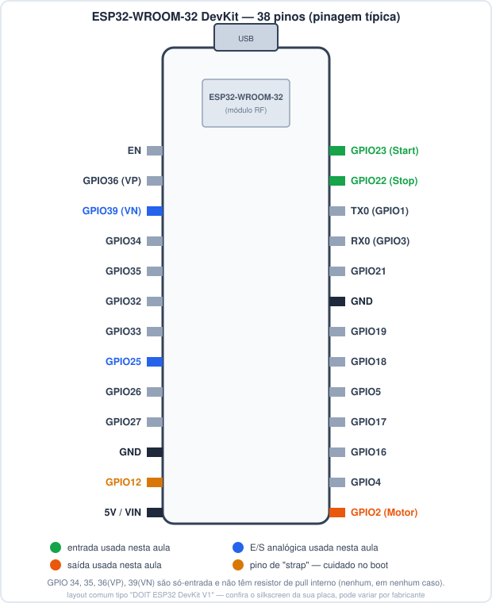
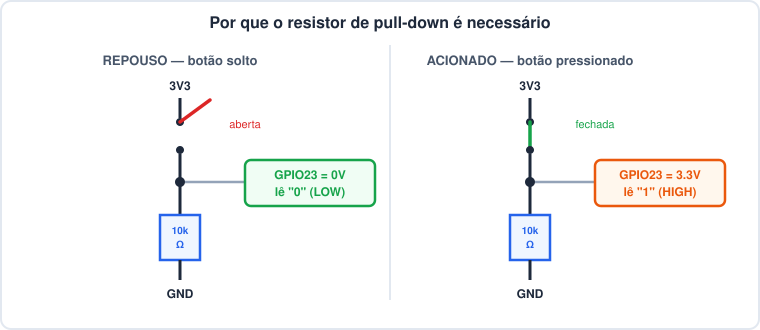
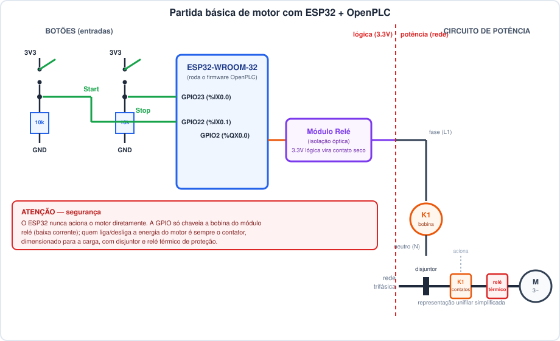

# Aula: Partida Básica de um Motor com ESP32-WROOM-32 + OpenPLC

## 1. Objetivo da aula

- Montar um circuito de **partida direta de motor com selo (Start/Stop)**,
  igual ao que já estudamos em [linguagem-ladder.md](linguagem-ladder.md) e
  [evolucao-ladder.md](evolucao-ladder.md), só que agora **rodando de
  verdade** em um **ESP32-WROOM-32 DevKit de 38 pinos** com firmware gerado
  pelo **OpenPLC**.
- Sair da aula sabendo: como ligar os botões com segurança, por que o
  resistor de pull-down é obrigatório, e como a lógica Ladder vira firmware
  rodando no microcontrolador.
- A apresentação completa do OpenPLC (Editor, Runtime, compilação) fica para
  a próxima aula — aqui o foco é **hardware + lógica**, já deixando tudo
  pronto para quando abrirmos o OpenPLC Editor.

---

## 2. Por que ESP32 + OpenPLC

- Como vimos em [clp-entradas-saidas-programa.md](clp-entradas-saidas-programa.md),
  um CLP normalmente **é** um microcontrolador por dentro, só que envolto em
  E/S industrial, firmware de tempo real e linguagens da IEC 61131-3.
- O OpenPLC faz exatamente essa "camada 4": você desenha a lógica em Ladder
  (ou ST, FBD...) e ele **gera o firmware Arduino/ESP-IDF** que roda no
  ESP32, implementando o ciclo de varredura (ler entradas → executar →
  atualizar saídas) automaticamente.
- Resultado: o ESP32 vira um CLP de verdade, programável pela norma, sem
  você escrever `pinMode`/`digitalRead` manualmente.

---

## 3. Materiais necessários

| Item | Observação |
|---|---|
| ESP32-WROOM-32 DevKit (38 pinos) | qualquer variante compatível (ex.: DOIT ESP32 DevKit V1) |
| 2x botão pulsador (NA) | Start e Stop |
| 2x resistor 10kΩ | pull-down dos botões (ver seção 5) |
| Módulo relé isolado (opto-acoplado) | nunca acionar o contator direto pela GPIO |
| Contator (K1) dimensionado para o motor | de acordo com a corrente do motor |
| Disjuntor motor + relé térmico | proteção do circuito de potência |
| Motor (trifásico ou monofásico, conforme disponível) | carga de demonstração |
| Protoboard, jumpers, cabo USB | montagem e programação |

---

## 4. Pinagem do ESP32 (38 pinos) usada nesta aula



- Esta aula reaproveita o **mapeamento de pinos que já está configurado no
  projeto** (`prj/devices/pin-mapping.json`, placa `ESP32 WROOM`):

| Sinal | GPIO | Endereço OpenPLC | Função |
|---|---|---|---|
| Start | GPIO23 | `%IX0.0` | entrada digital |
| Stop | GPIO22 | `%IX0.1` | entrada digital |
| Motor (relé) | GPIO2 | `%QX0.0` | saída digital |
| Entrada analógica (livre) | GPIO39 | `%IW0` | não usada nesta aula |
| Saída analógica (livre) | GPIO25 | `%QW0` | não usada nesta aula |

- **GPIO2** também costuma estar ligado ao LED azul de bordo da maioria das
  DevKits — útil para ver a saída piscando antes de conectar o relé de
  verdade.
- **GPIO34, 35, 36(VP) e 39(VN)** são pinos **só-entrada**: fisicamente não
  têm resistor de pull interno no chip, em nenhuma hipótese. Se um dia forem
  usados como entrada digital, resistor externo é obrigatório.

---

## 5. Pull-up/Pull-down: é necessário? **Sim — confirmado**

Fui conferir isso no firmware que o próprio OpenPLC gera para a placa
`ESP32 WROOM` deste projeto (`prj/build/ESP32 WROOM/src/arduino.cpp`):

```cpp
for (int i = 0; i < NUM_DISCRETE_INPUT; i++)
{
    pinMode(pinMask_DIN[i], INPUT);
}
```

- O firmware configura as entradas digitais como **`INPUT` puro** — não usa
  `INPUT_PULLUP` nem `INPUT_PULLDOWN`.
- Ou seja: **o OpenPLC não habilita nenhum resistor de pull interno por
  software.** Isso vale tanto para os pinos que têm pull interno disponível
  no hardware (a maioria dos GPIOs) quanto, claro, para os que nunca têm
  (GPIO 34-39).
- Consequência prática: **sem resistor externo, um botão solto deixa o pino
  flutuando** — ele capta ruído eletromagnético e pode ler `0`/`1`
  aleatoriamente. Num circuito de partida de motor, isso pode ser
  interpretado como um "Start" ou "Stop" fantasma.
- **Conclusão: resistor de pull (up ou down) é obrigatório em todo botão
  ligado ao ESP32 usado com OpenPLC.**



- Nesta aula usamos **pull-down** (botão para 3V3 + resistor 10kΩ para GND):
  - Repouso → pino em `0V` → PLC lê `0`.
  - Pressionado → pino em `3.3V` → PLC lê `1`.
  - Isso combina exatamente com o raciocínio "contato fechado = 1" que já
    usamos desde [evolucao-ladder.md](evolucao-ladder.md) — nenhuma inversão
    extra de lógica é necessária.
- (A alternativa — pull-up + botão para GND — também funciona, mas inverte a
  lógica: repouso = `1`, pressionado = `0`. Como o firmware não liga o pull
  interno, ela exigiria o mesmo resistor externo, só que ligado ao contrário.
  Pull-down é a opção mais direta para quem está começando.)

---

## 6. Ligação elétrica completa



- **Lado de lógica (3.3V):** botões Start/Stop com pull-down → GPIO23/GPIO22.
- **Isolamento:** GPIO2 aciona um **módulo relé opto-isolado** — a GPIO só
  chaveia a bobina desse módulo (baixíssima corrente), nunca a carga.
- **Lado de potência:** o contato seco do módulo relé energiza a **bobina do
  contator K1**; os contatos principais do K1 (dimensionados para o motor),
  em série com disjuntor e relé térmico, é que realmente ligam o motor.
- **Regra de ouro:** o ESP32 nunca encosta diretamente na tensão/corrente do
  motor. Ele só decide *quando* o contator liga — quem liga é o contator.

---

## 7. Passo a passo de montagem

1. Com o ESP32 **desligado da USB**, monte os botões na protoboard:
   - Perna 1 de cada botão → trilho de **3V3**.
   - Perna 2 → GPIO correspondente (23 para Start, 22 para Stop) **e** para
     um resistor de 10kΩ.
   - Outra ponta de cada resistor → trilho de **GND**.
2. Confira com um multímetro (modo contínuo) que, com o botão solto, há
   continuidade entre o pino e o GND **através do resistor** (não direto).
3. Só depois de validar a parte de baixa tensão, conecte o módulo relé:
   - `IN` do módulo relé → **GPIO2**.
   - `VCC`/`GND` do módulo relé → alimentação apropriada (conforme o
     módulo: 3.3V ou 5V).
4. Com o circuito de potência **desenergizado** (disjuntor desligado),
   conecte o contator, o relé térmico e o motor conforme o diagrama.
5. Feche o painel, religue o disjuntor e só então energize o ESP32 pela USB.

---

## 8. Lógica do programa (o que o ESP32 vai executar)

A mesma lógica de selo (self-holding) que já vimos, agora com endereços
reais desta placa:


```
Q0.0 := (I0.0 OR Q0.0) AND NOT I0.1;
```

| Variável Ladder | Endereço | Sinal físico |
|---|---|---|
| `I0.0` (Start) | `%IX0.0` | GPIO23 |
| `I0.1` (Stop) | `%IX0.1` | GPIO22 |
| `Q0.0` (Motor) | `%QX0.0` | GPIO2 → relé → K1 |

---

## 9. No OpenPLC (prévia — aula completa em breve)

- O projeto já está configurado para essa placa: `prj/devices/configuration.json`
  tem `"deviceBoard": "ESP32 WROOM"` e `"communicationPort": "/dev/ttyUSB0"`.
- O `pin-mapping.json` já reserva exatamente os pinos desta aula
  (23 = entrada, 22 = entrada, 2 = saída) — é só abrir o **OpenPLC Editor**,
  desenhar/confirmar o rung de selo em Ladder com esses endereços, compilar
  para `ESP32 WROOM` e gravar via USB na porta configurada.
- Isso fica com mais detalhe (Editor, Runtime, upload) na próxima aula, que
  vai apresentar o OpenPLC do zero.

---

## 10. Checklist de segurança antes de energizar

- [ ] Testei os botões com multímetro **antes** de ligar qualquer coisa no motor.
- [ ] Conferi que a GPIO nunca está ligada diretamente à bobina do contator
      (sempre passando pelo módulo relé isolado).
- [ ] Disjuntor motor e relé térmico dimensionados para a corrente do motor.
- [ ] Fiação de potência (contator/motor) fisicamente separada da fiação de
      lógica (ESP32/botões).
- [ ] Testei o Stop **antes** de testar o Start.

---

## 11. Quadro-resumo

| Pergunta | Resposta |
|---|---|
| Pull-up/down é necessário no ESP32 com OpenPLC? | **Sim** — o firmware gerado usa `pinMode(pin, INPUT)` puro, sem pull interno habilitado |
| Qual resistor usar nesta aula? | Pull-down de 10kΩ (botão para 3V3, resistor para GND) |
| Quais pinos têm zero pull interno em hardware? | GPIO34, 35, 36(VP), 39(VN) — sempre precisam de resistor externo |
| O ESP32 liga o motor diretamente? | **Nunca** — só aciona um relé isolado, que aciona o contator |
| Onde já está configurado o pin mapping? | `prj/devices/pin-mapping.json`, placa `ESP32 WROOM` |
