# Tutorial: Criando um Projeto no OpenPLC Editor para ESP32

> Passo a passo com prints reais do OpenPLC Editor, do projeto novo até o
> programa rodando e sendo depurado (*debug*) dentro do ESP32-DOIT DEVKIT V1
> físico.
>
> O programa é um circuito clássico de selo Start/Stop, com as variáveis
> nomeadas em português: `liga` (Start), `desliga` (Stop) e `motor` (saída).

---

## 1. Criar o projeto

Abra o OpenPLC Editor. A tela inicial lista os projetos recentes e, no canto
inferior esquerdo, o botão **New Project**.

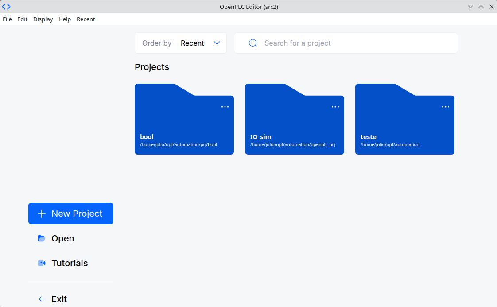

Clique em **New Project** e siga o assistente de 3 passos:

**Passo 1 — tipo de projeto:** escolha **PLC Project** (a outra opção,
*Library*, é para criar bibliotecas de blocos reutilizáveis, não um programa).

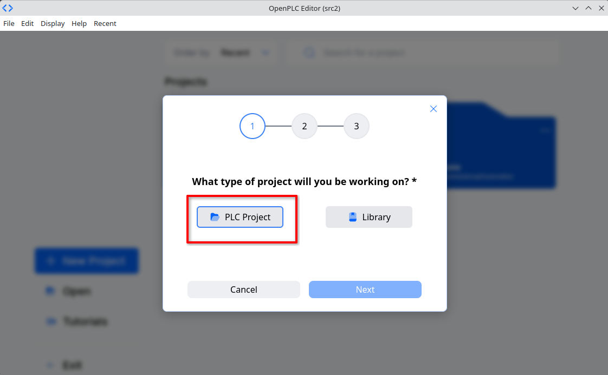

**Passo 2 — nome e pasta:** dê um nome ao projeto e escolha um **diretório
vazio** para ele.

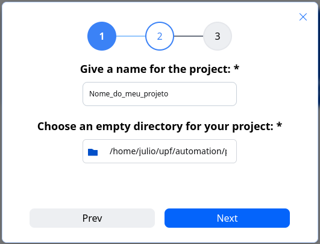

**Passo 3 — linguagem base:** escolha a linguagem do programa principal. O
Ladder é o mais indicado para lógica de intertravamento simples — selecione
**Ladder Diagram**.

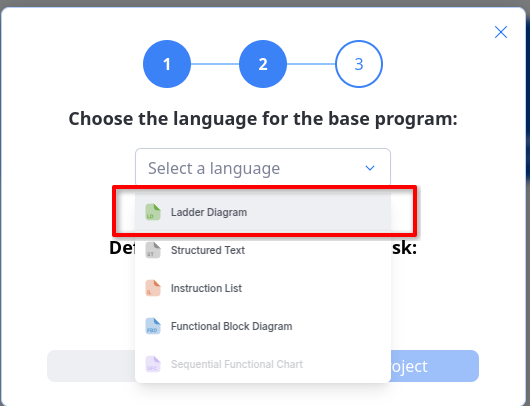

Ao concluir, o Editor abre o programa `main` vazio, pronto para receber a
lógica.

---

## 2. Acrescentar o programa (montar a lógica Ladder)

A tela do programa tem duas áreas: a **tabela de variáveis** (em cima) e a
área de **rungs** (embaixo), com o botão **Create new rung** para adicionar
um novo degrau.

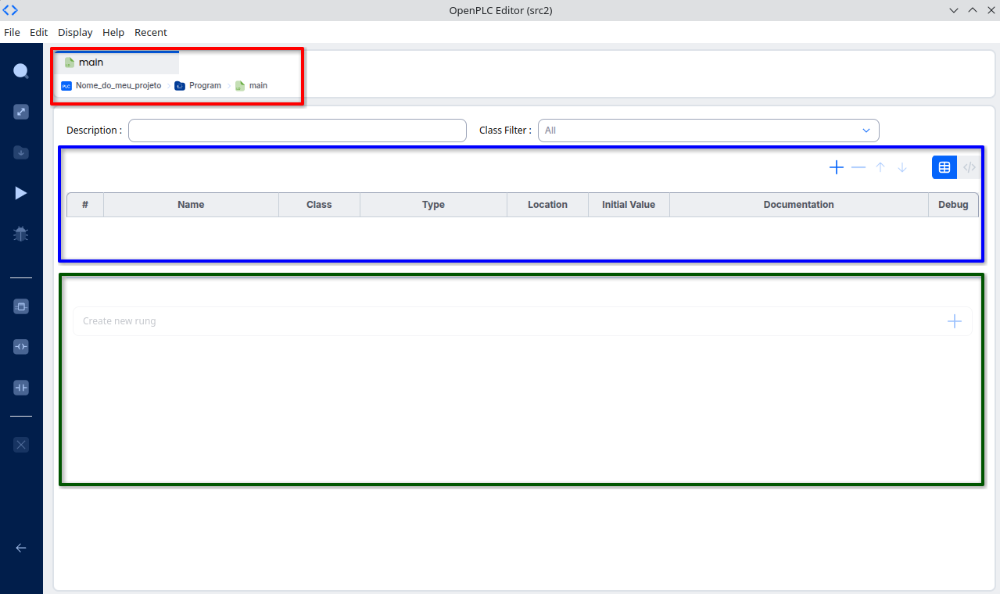

Ao criar um rung novo, o Editor insere um contato, um contato negado e uma
bobina como modelo (todos com nome `???`, ainda não definidos) — é só
arrastar/clicar para ajustar:

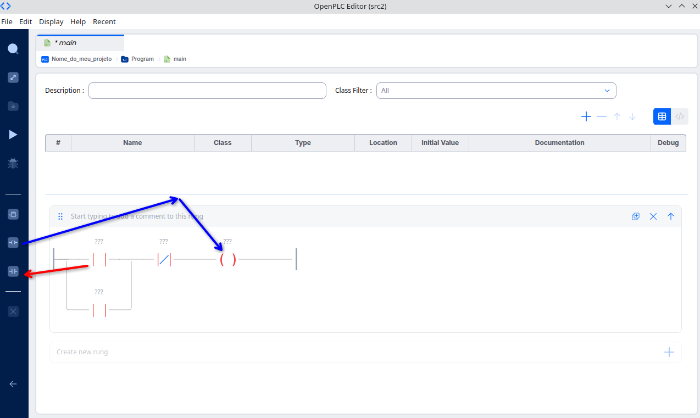

- Clique duas vezes num contato para abrir **Edit Contact Values** e escolher
  o *Modifier*: `Default` (contato NA), `Negated` (contato NF), `Rising Edge`
  ou `Falling Edge`. Aqui escolhemos **Negated** para o contato de `desliga`:

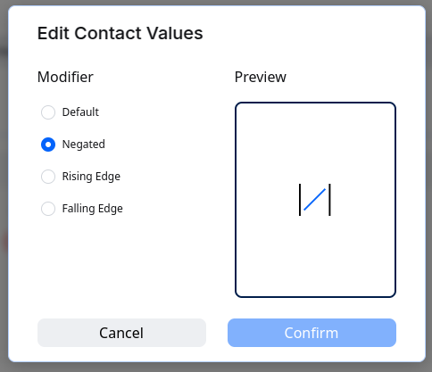

- Na bobina, **Edit Coil Values** oferece `Default`, `Negated`, `Rising Edge`,
  `Falling Edge`, `Set` e `Reset`. Para a saída `motor` usamos **Default**
  (bobina simples):

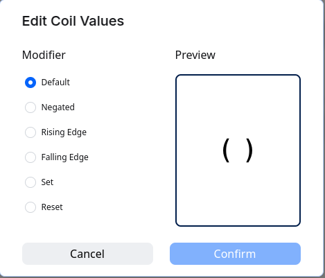

- Clique em cada `???` para digitar o nome da variável. Ao nomear uma
  variável nova, o Editor mostra **Add variable** para criá-la na hora:

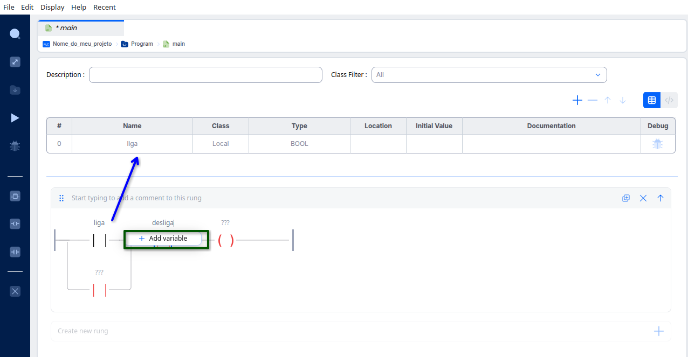

Resultado: o mesmo circuito de selo Start/Stop, agora com `liga` (NA) em
paralelo com `motor` (contato de selo), em série com `desliga` (NF),
acionando a bobina `motor`:

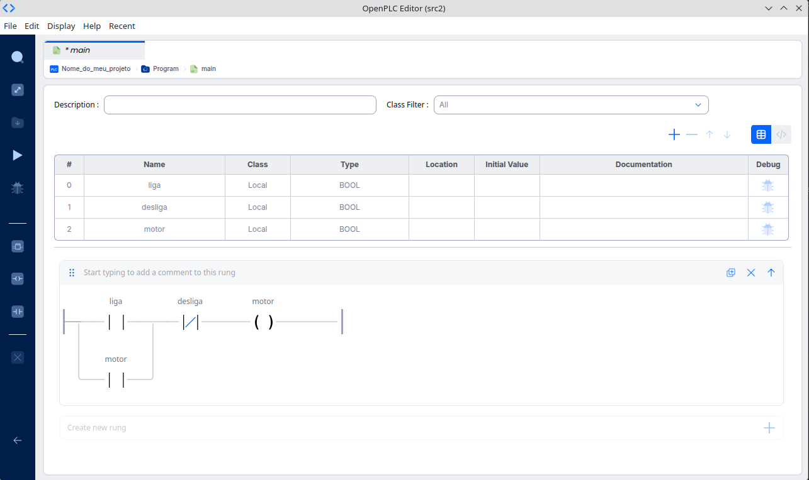

---

## 3. Definir as variáveis

Cada variável criada no passo anterior aparece na tabela no topo da tela,
com **Name**, **Class** (aqui `Local`), **Type** (`BOOL`) e a coluna
**Location**, que ainda vamos preencher na próxima seção:

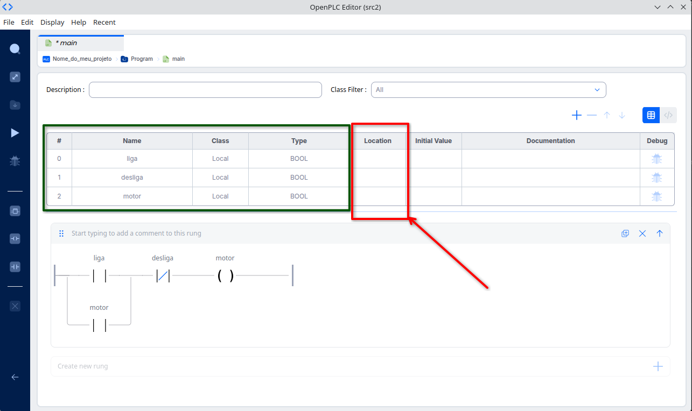

Dica: o ícone `</>` no canto superior direito da área de edição alterna para
a visão em texto (Structured Text). É uma boa forma de conferir a
declaração das variáveis gerada automaticamente:

```pascal
VAR
    liga : BOOL;
    desliga : BOOL;
    motor : BOOL;
END_VAR
```

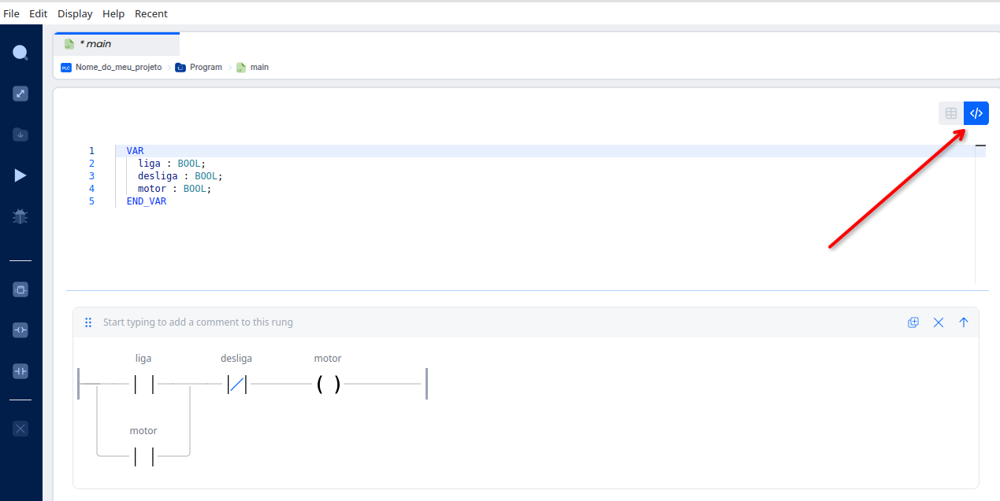

---

## 4. Escolher a placa (ESP32) e configurar a porta serial no Linux

Para configurar o hardware, mude de tela: menu **Display → Switch
Perspective** (atalho `F12`).

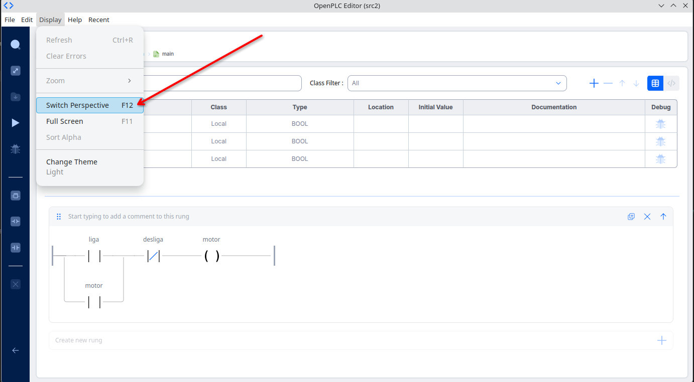

Essa troca abre a árvore do projeto à esquerda. Em **Device → Configuration**
ficam as **Board Settings** — por padrão vem `OpenPLC Simulator`:

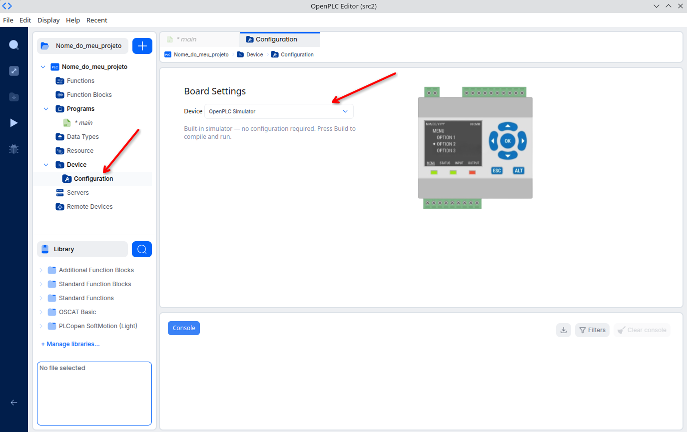

No dropdown **Device**, procure a seção **ESPRESSIF** e escolha a placa
correspondente ao seu hardware. Este projeto usa a
**ESP32-DOIT DEVKIT V1** (variante de 38 pinos):

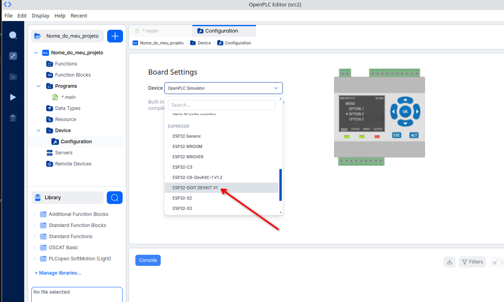

Em seguida, abra o dropdown **Communication Port** para escolher a porta
serial. O Linux identifica a DevKit como `/dev/ttyUSB0 (Silicon Labs)`
(chip conversor USB-serial CP210x, comum nessas placas):

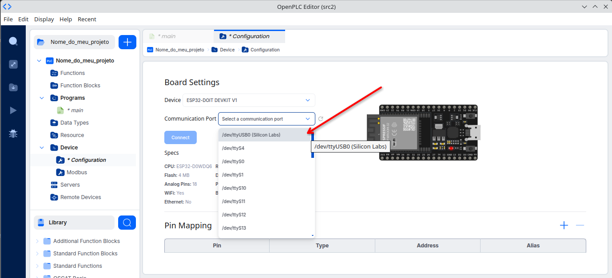

### Permissão da porta serial no Linux

Por padrão, no Linux **só o usuário `root` e o grupo `dialout` têm acesso**
ao dispositivo `/dev/ttyUSB0`. Se o seu usuário não estiver nesse grupo, o
Editor não consegue conectar. É possível liberar o acesso temporariamente
com `chmod`:

```bash
ls -la /dev/ttyUSB0
sudo chmod a+w /dev/ttyUSB0
ls -la /dev/ttyUSB0
```

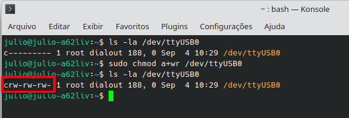

- Antes: `c--------- 1 root dialout ...` (ninguém além do root lê/escreve).
- Depois do `chmod a+w`: `crw-rw-rw- 1 root dialout ...` (qualquer usuário
  pode escrever).

> `chmod a+w` funciona, mas precisa ser refeito a cada reconexão do cabo.
> Para uma solução permanente, adicione seu usuário ao grupo `dialout`:
> `sudo usermod -aG dialout $USER` e faça logout/login uma vez.

Com a permissão ajustada, a placa e a porta ficam prontas: o painel mostra
as **Specs** da ESP32-DOIT DEVKIT V1 (34 pinos digitais, 18 analógicos, Wi-Fi,
Bluetooth) e a seção **Pin Mapping**, onde os pinos serão associados às
variáveis:

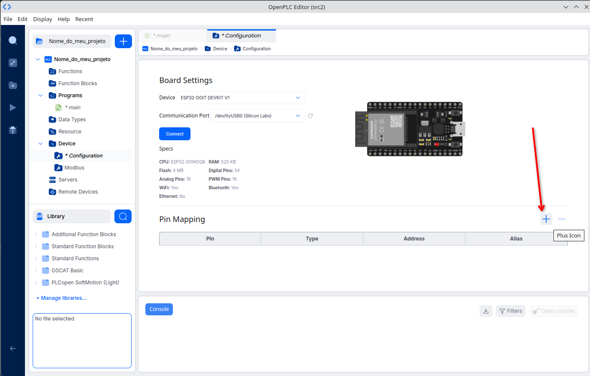

---

## 5. Linkar as variáveis a um pino físico

Antes de preencher o *Pin Mapping*, é preciso decidir **qual GPIO físico**
vai representar cada variável. Use um diagrama de pinagem da placa como
referência (nesta ESP32-DOIT DEVKIT V1, a referência abaixo é de
[mischianti.org](https://mischianti.org), CC BY-NC-ND):

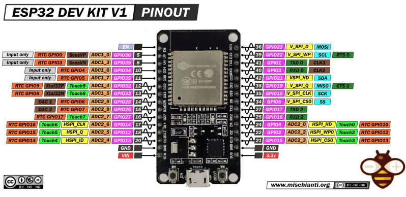

Os pinos escolhidos para este projeto foram **GPIO23** (`liga`),
**GPIO22** (`desliga`) e **GPIO2** (`motor`):

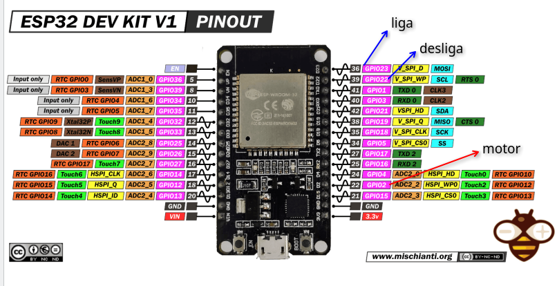

De volta ao **Pin Mapping**, clique no **+** e cadastre cada pino, indicando
o número do GPIO e o **Type** (`Digital Input` ou `Digital Output`):

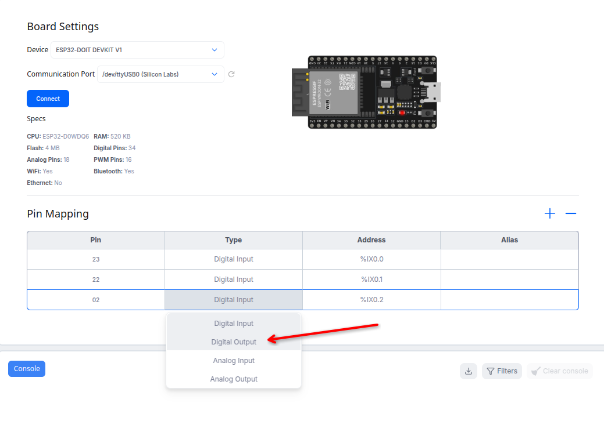

Resultado — os três pinos mapeados, cada um com seu endereço OpenPLC gerado
automaticamente (`%IX`/`%QX`):

| Pin | Type | Address |
|---|---|---|
| 23 | Digital Input | `%IX0.0` |
| 22 | Digital Input | `%IX0.1` |
| 02 | Digital Output | `%QX0.0` |

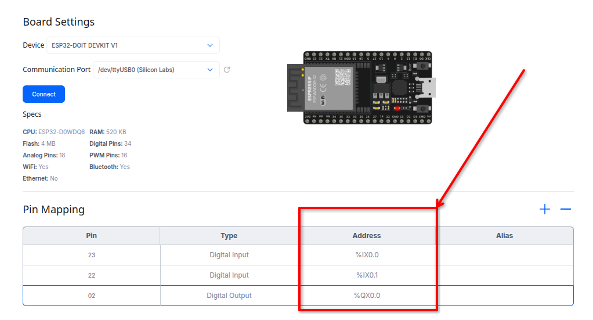

Por fim, volte ao programa `main` e, na tabela de variáveis, clique na
coluna **Location** de cada variável — o Editor já sugere os endereços que
foram mapeados no passo anterior, agrupados em **Digital Inputs** e
**Digital Outputs**:

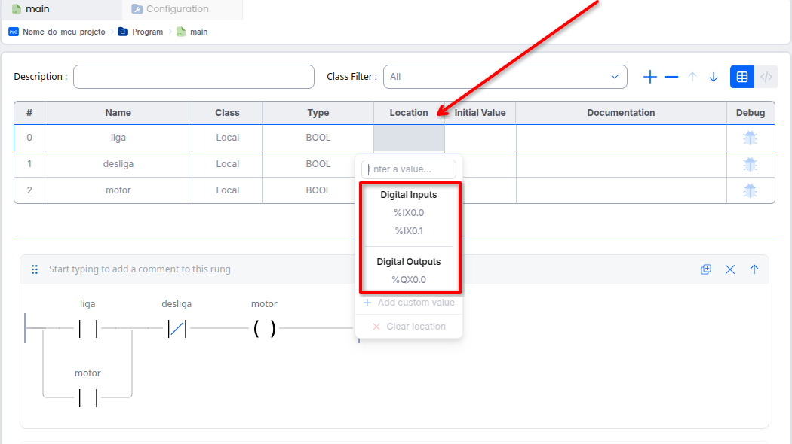

Com isso, `liga`, `desliga` e `motor` ficam **linkadas aos pinos físicos**
(`%IX0.0`, `%IX0.1` e `%QX0.0`), exatamente como no rung montado antes:

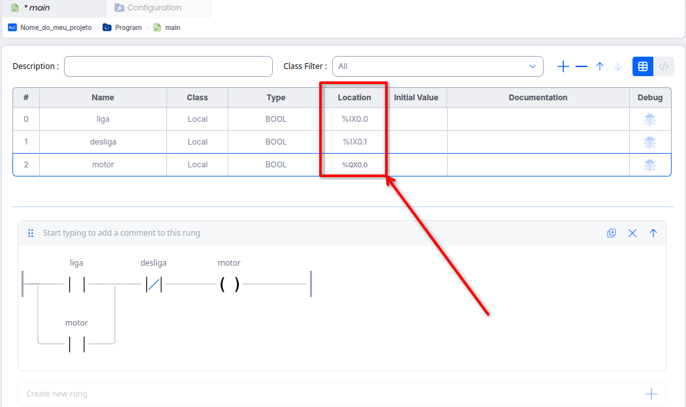

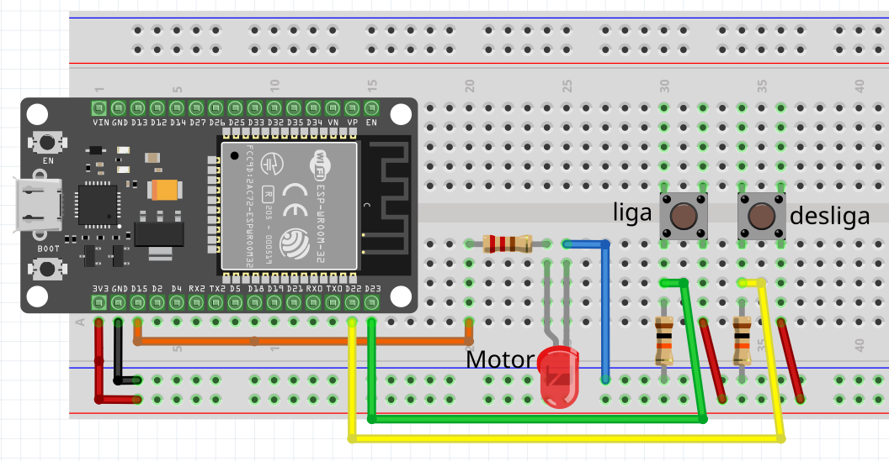

### Montagem física

A ligação em protoboard usa os botões `liga`/`desliga` em GPIO23/GPIO22
(com resistor de pull-down) e um LED representando o `motor` em GPIO2 (no
lugar do relé/contator, só para teste de bancada):

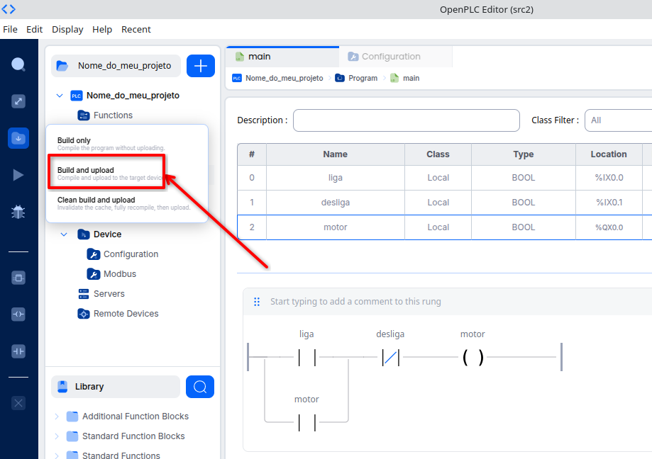

---

## 6. Transferir (compilar e gravar)

Com a placa conectada por USB, clique no ícone de **build** (seta para
baixo, na barra lateral) e escolha **Build and upload** — compila o
programa e grava direto na ESP32 pela porta serial configurada:

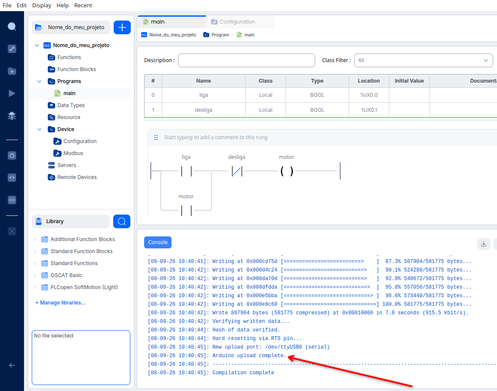

O console mostra o progresso da gravação em tempo real e confirma o
resultado ao final:

```
[...] Wrote 887904 bytes (581775 compressed) at 0x00010000 in 7.8 seconds (915.5 kbit/s).
[...] Verifying written data...
[...] Hash of data verified.
[...] Hard resetting via RTS pin...
[...] New upload port: /dev/ttyUSB0 (serial)
[...] Arduino upload complete.
[...] Compilation complete
```

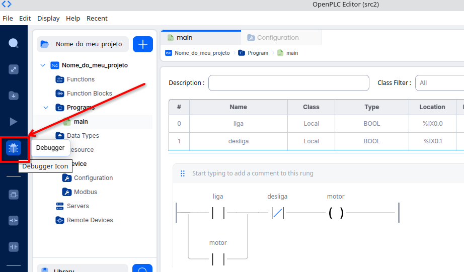

---

## 7. Debugar

Com o firmware gravado, o ícone de **Debugger** (raio) na barra lateral
abre o painel de depuração:

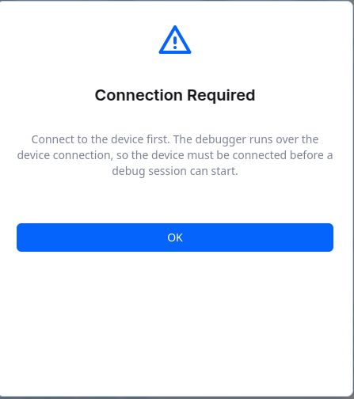

Se a placa ainda não estiver conectada, o Editor avisa antes de liberar o
debug — **o debugger roda em cima da conexão com o dispositivo**, então é
preciso conectar primeiro:

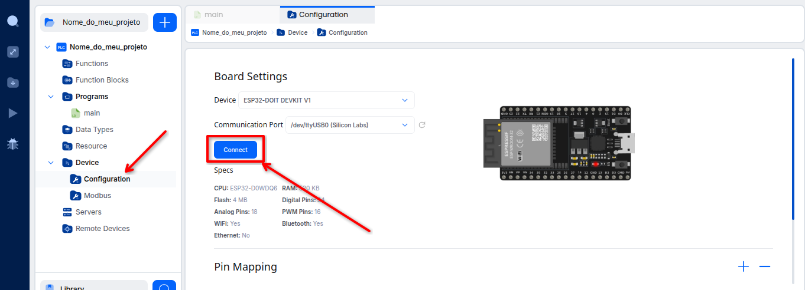

Volte em **Device → Configuration** e clique **Connect**. O console
confirma a sessão de debug:

```
[connection] debug session requested for ESP32-DOIT DEVKIT V1; session is "disconnected"
[connection] resolved 1 candidate(s) for ESP32-DOIT DEVKIT V1: rtu /dev/ttyUSB0
[connection] connect requested with 1 candidate(s): rtu /dev/ttyUSB0
[connection] status -> connected (rtu /dev/ttyUSB0)
```

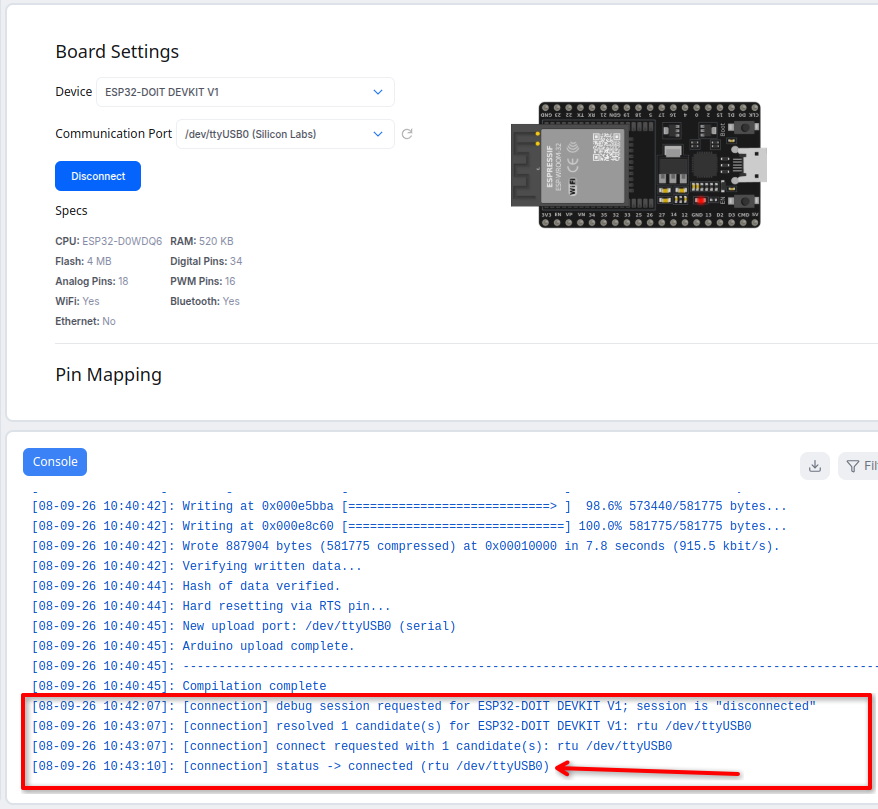

Com a conexão ativa, volte ao programa `main` e abra a aba **Debugger**
(ao lado de **Console**). O rung passa a mostrar o **estado real das
variáveis ao vivo** — os elementos em **verde** indicam contato/bobina
energizados (`TRUE`) naquele instante, atualizados a partir do ESP32 físico:

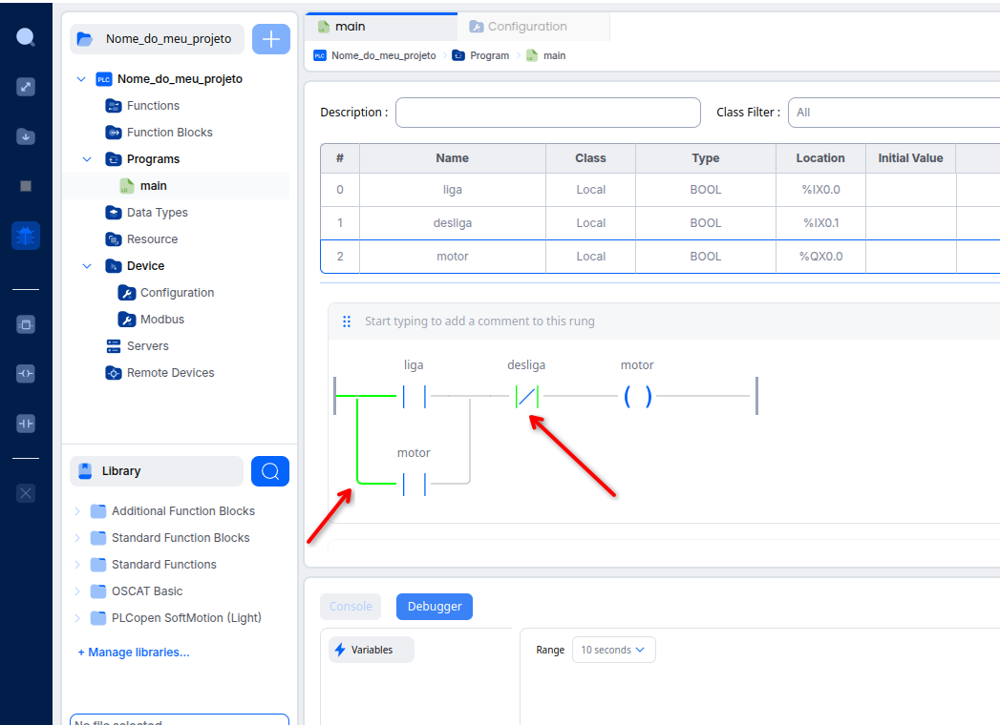

---

## Quadro-resumo

| Etapa | O que fazer | Onde |
|---|---|---|
| Criar projeto | New Project → PLC Project → nome/pasta → Ladder Diagram | tela inicial |
| Montar o programa | Create new rung → editar contatos/bobina → nomear variáveis | tela do `main` |
| Definir variáveis | criadas ao nomear os contatos/bobina (Class Local, Type BOOL) | tabela de variáveis |
| Escolher a placa | Display → Switch Perspective → Device → Configuration → ESP32-DOIT DEVKIT V1 | árvore do projeto |
| Configurar porta serial (Linux) | `sudo chmod a+w /dev/ttyUSB0` (ou grupo `dialout`) | terminal |
| Linkar variável ↔ pino | Pin Mapping (placa) + coluna Location (variável) | Device → Configuration e tabela de variáveis |
| Transferir | ícone de build → Build and upload | barra lateral |
| Debugar | Connect → ícone Debugger → aba Debugger | Device → Configuration e tela do `main` |
