# Aula: Contatos de Borda, Bobinas Set/Reset e Temporizadores (TON/TOF)

## 1. Introdução

Até agora os elementos de Ladder que vimos reagem **no mesmo instante** em
que a condição de entrada é verdadeira, e **esquecem** esse estado assim
que a condição deixa de ser verdadeira. Esta aula cobre três recursos que
quebram essa regra:

- **Contatos de borda** — reagem só no **instante da transição** do sinal,
  não enquanto ele fica ligado.
- **Bobinas Set/Reset** — **guardam** um estado (memória/latch), mesmo
  depois que a condição de entrada desaparece.
- **Temporizadores (TON/TOF)** — introduzem **tempo** na lógica, atrasando
  quando uma saída liga ou desliga.

---

## 2. Contatos de detecção de borda (Rising Edge / Falling Edge)

- Um contato normal (NA) fica em `1` **enquanto** a variável associada
  estiver em `1`.
- Um contato de borda fica em `1` por **apenas um ciclo de varredura**,
  exatamente no instante em que o sinal muda de estado:
  - **Rising Edge (P — Positive)**: pulso único quando o sinal vai de `0`
    para `1`.
  - **Falling Edge (N — Negative)**: pulso único quando o sinal vai de `1`
    para `0`.

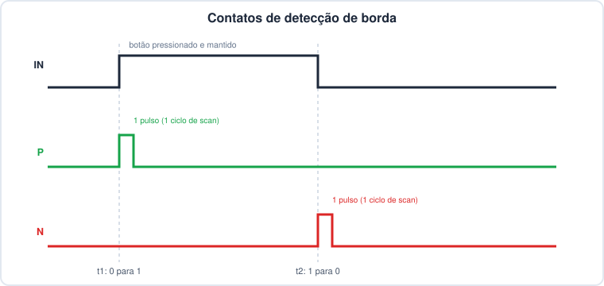

- Repare: mesmo com o botão **pressionado e mantido** por um bom tempo, o
  contato de borda dispara **uma única vez** — diferente do contato normal,
  que ficaria em `1` durante todo o tempo em que o botão estiver pressionado.

No OpenPLC Editor, isso é só um *modifier* do contato — `P` para borda de
subida, `N` para borda de descida:

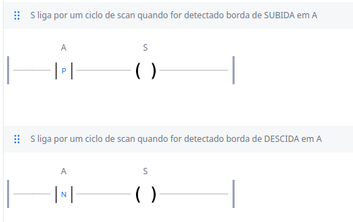

### Quando usar

- Contar quantas vezes um botão foi pressionado, sem contar várias vezes
  enquanto ele fica pressionado.
- Disparar uma ação pontual (por exemplo, incrementar um contador ou
  alternar um estado) a partir de um evento, e não de um nível de sinal.
- Detectar o exato momento em que um sensor perde o sinal (falling edge),
  útil em lógicas de segurança e diagnóstico.

### Equivalente em Structured Text

Em Ladder, o contato já resolve a borda visualmente. Em ST, o mesmo
comportamento vem de blocos de função padrão da norma:

```pascal
R_TRIG1(CLK := botao);
pulso_subida := R_TRIG1.Q;

F_TRIG1(CLK := botao);
pulso_descida := F_TRIG1.Q;
```

---

## 3. Bobinas Set (S) e Reset (R)

- Uma bobina normal `-( )-` **segue** o estado do rung: liga quando a
  lógica de entrada é verdadeira, desliga assim que deixa de ser.
- Uma bobina **Set** `-(S)-` **liga e trava** a variável em `1` quando o
  rung é verdadeiro — e ela **continua em `1`** mesmo depois que a condição
  de entrada voltar a `0`.
- Uma bobina **Reset** `-(R)-` faz o oposto: **desliga e trava** a
  variável em `0`, e ela continua em `0` até um novo Set.

No Ladder, cada uma vira um rung simples, sem precisar de contato de
realimentação:

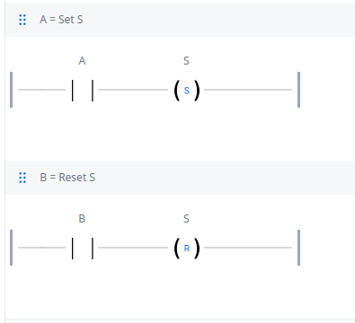

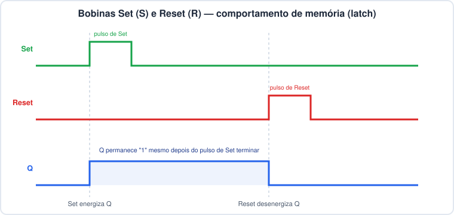

- Note que o pulso de Set dura pouco, mas `Q` permanece em `1` **até** o
  pulso de Reset aparecer — esse é o comportamento de memória (*latch*).

### Prioridade quando Set e Reset estão ativos ao mesmo tempo

- Set e Reset normalmente ficam em **rungs separados** no programa.
- Se, no mesmo ciclo de varredura, as duas condições forem verdadeiras, quem
  "vence" é **o rung que for executado por último** (o CLP resolve os rungs
  de cima para baixo, na ordem em que aparecem no programa).
- Por isso é comum falar em **"Reset dominante"**: se o rung de Reset vier
  depois do rung de Set no programa, o Reset sempre vence em caso de
  empate. Vale a pena decidir isso conscientemente ao montar a lógica, e
  não deixar por acaso.

### Equivalente em Structured Text

```pascal
IF condicao_liga THEN
    motor := TRUE;   (* equivalente à bobina Set *)
END_IF;

IF condicao_desliga THEN
    motor := FALSE;  (* equivalente à bobina Reset — vem depois, então é dominante *)
END_IF;
```

### Comparando com o circuito de selo

O mesmo resultado prático de "ligar e manter ligado" também pode ser obtido
sem bobina Set/Reset nenhuma, só com um contato de selo (self-holding) em
paralelo com o botão de partida — um flip-flop RS "montado na mão":

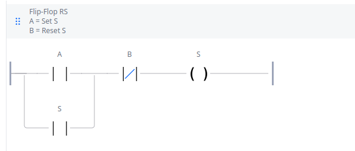

- `A` (NA) em paralelo com `S` (contato de selo da própria saída) mantém a
  bobina `S` energizada mesmo depois que `A` for solto.
- `B` (NF) em série corta essa realimentação e desliga `S`.
- É exatamente o mesmo circuito de partida/parada com selo já visto antes,
  só que aqui pensado como "Set = A, Reset = B".

A diferença para usar as bobinas `-(S)-`/`-(R)-` diretamente é mais de
forma do que de resultado: com Set/Reset não é preciso desenhar o contato
de realimentação, mas em compensação a prioridade em caso de empate passa a
depender da ordem dos rungs no programa — no circuito de selo essa
prioridade já fica explícita na própria lógica booleana do rung.

---

## 4. Temporizadores: TON e TOF

- **TON (Timer On-Delay)**: atrasa a **energização** da saída. `Q` só vai
  para `1` depois que `IN` ficar em `1` por um tempo `PT`. Quando `IN`
  volta a `0`, `Q` desliga **imediatamente**.
- **TOF (Timer Off-Delay)**: atrasa a **desenergização** da saída. `Q` vai
  para `1` **imediatamente** junto com `IN`. Quando `IN` volta a `0`, `Q`
  só desliga depois do tempo `PT`.

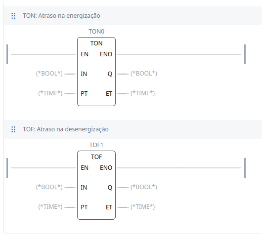

### Entradas e saídas

| Pino | Tipo | Significado |
|---|---|---|
| `EN` | `BOOL` | *Enable* — habilita a execução do bloco (opcional, ver abaixo) |
| `IN` | `BOOL` | sinal de disparo do temporizador |
| `PT` | `TIME` | *Preset Time* — duração do atraso configurado |
| `Q` | `BOOL` | saída do temporizador |
| `ET` | `TIME` | *Elapsed Time* — tempo decorrido desde o disparo |
| `ENO` | `BOOL` | *Enable Output* — eco de `EN`, cai para `0` se o bloco tiver erro |

- `EN`/`ENO` são comuns a **qualquer** bloco de função na norma, não só aos
  temporizadores — eles ficam ocultos por padrão e só aparecem quando a
  opção **Execution Control** é ativada nas propriedades do bloco.

### O tipo de variável TIME

- `PT` e `ET` usam o tipo elementar **`TIME`** da norma IEC 61131-3 — não é
  `BOOL`, `INT` nem `REAL`. É um tipo próprio para representar **duração**.
- Os valores são escritos como literais no formato `T#...`, combinando
  dias (`d`), horas (`h`), minutos (`m`), segundos (`s`) e milissegundos
  (`ms`):

```pascal
T#5s        (* 5 segundos *)
T#500ms     (* 500 milissegundos *)
T#1h30m     (* 1 hora e 30 minutos *)
T#2s500ms   (* 2,5 segundos *)
```

- Por baixo dos panos o `TIME` costuma ser armazenado como um número
  inteiro de milissegundos, mas a formatação `T#...` evita ter que fazer
  essa conta na mão ao programar.

### Comparando TON x TOF ao longo do tempo

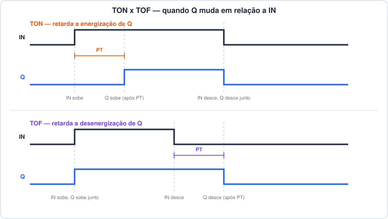

### Equivalente em Structured Text

```pascal
TON_1(IN := start, PT := T#5s);
motor := TON_1.Q;
tempo_decorrido := TON_1.ET;

TOF_1(IN := sensor_presenca, PT := T#10s);
luz := TOF_1.Q;
```

- No exemplo do `TON_1`: o motor só liga 5 segundos depois de `start` virar
  `TRUE` — útil, por exemplo, para dar tempo de um outro equipamento
  terminar de partir antes.
- No exemplo do `TOF_1`: a luz continua acesa por 10 segundos depois que o
  sensor de presença deixar de detectar alguém — evita que a luz apague
  assim que a pessoa se afasta momentaneamente do sensor.

### Passo a passo no OpenPLC Editor

Montagem prática de um TON e um TOF controlando um LED a partir de um botão
`liga`, do zero até rodando em modo debug.

**1. Crie as variáveis e o contato de entrada.** Com `led` (saída) e `liga`
(entrada) já criadas, monte o contato `liga` no rung e abra a biblioteca de
blocos pelo ícone de busca (lupa azul) na barra lateral:

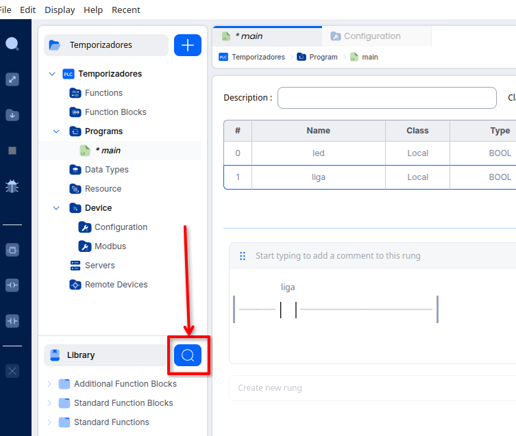

**2. Busque o bloco TON.** Digite `ton` no campo de busca — o bloco `TON`
aparece em **Standard Function Blocks**:

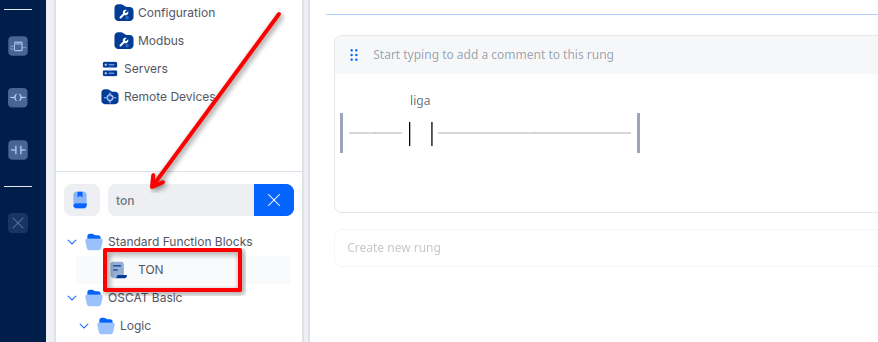

**3. Insira o bloco no rung.** Ele entra como `TON0` (a tabela de variáveis
ganha uma linha com **Type** `TON`), com os pinos `IN`/`Q`/`PT`/`ET` ainda
sem tipo definido:

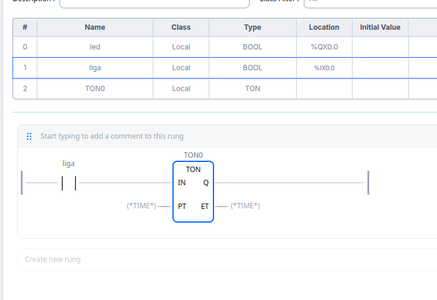

**4. Configure o bloco.** Duplo clique sobre o bloco abre **Block
Properties**: dá para trocar o tipo, renomear a instância, definir a ordem
de execução e ativar **Execution Control** — é essa opção que expõe os
pinos `EN`/`ENO`:

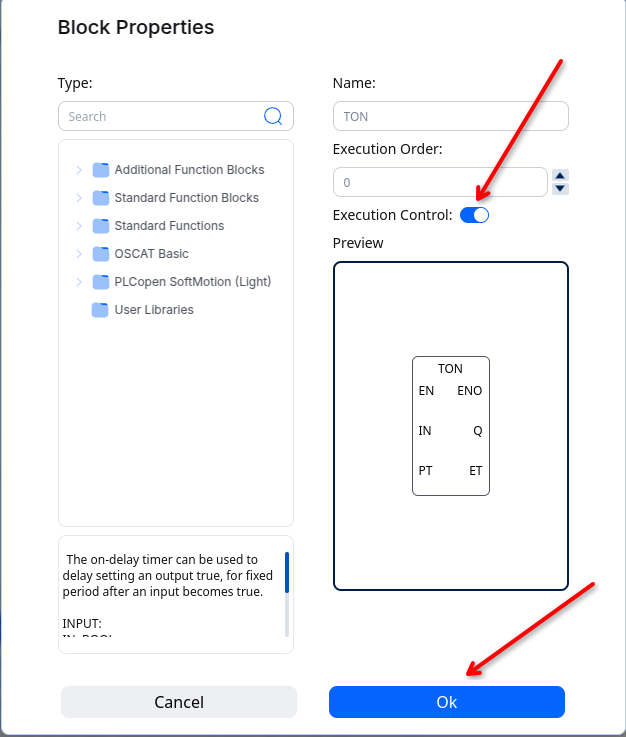

Com `EN`/`ENO` visíveis, o bloco fica assim (ainda com os tipos `BOOL`/
`TIME` genéricos, antes de ligar qualquer fio):

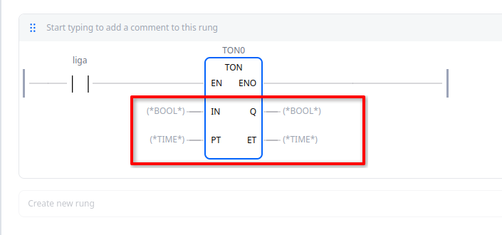

**5. Ligue os fios.** `liga` → `IN`, o literal `T#2s` → `PT`, e `Q` → `led`:

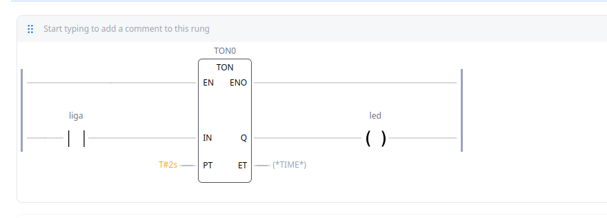
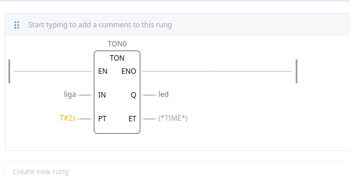

**6. Rode em modo debug.** Com `liga` pressionado (fios em verde), o painel
mostra `ET` contando ao vivo — aqui em `1s240ms`, ainda antes de completar
os `T#2s` programados em `PT`:

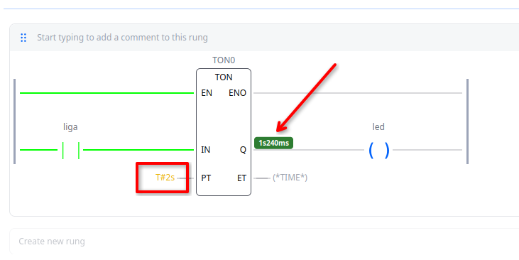

**7. Documente o rung.** Um comentário no rung deixa a lógica clara para
quem for ler depois — boa prática em qualquer programa Ladder:

> Temporização para acionamento do LED: quando o sinal liga é ativado, o
> temporizador TON0 inicia a contagem de 2 segundos. Após o tempo
> programado, a saída Q do temporizador é ativada, energizando o led. Ao
> desativar liga, o temporizador é resetado e o LED é desligado.

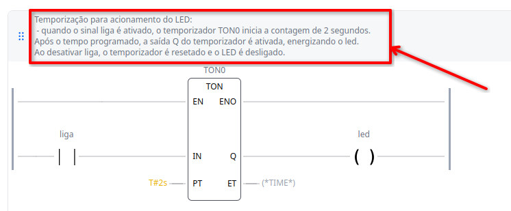

**8. Repita para o TOF.** Mesmo processo, agora com um bloco `TOF0` e
`PT := T#1s`:

> Temporização no desligamento do LED: quando o sinal liga é ativado, o LED
> liga imediatamente. Ao desativar liga, o temporizador TOF0 inicia a
> contagem de 1 segundo, mantendo o LED ligado durante esse período. Após 1
> segundo, o LED é desligado.

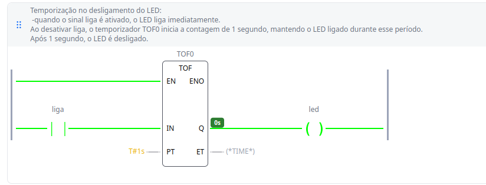

**9. Debug ao vivo do TOF.** Ao soltar `liga`, `led` continua aceso e `ET`
começa a contar a partir de `0s`, subindo (aqui em `580ms`) até completar
`T#1s` e só então desligar o LED — exatamente o comportamento de
*off-delay* visto no diagrama da seção anterior:

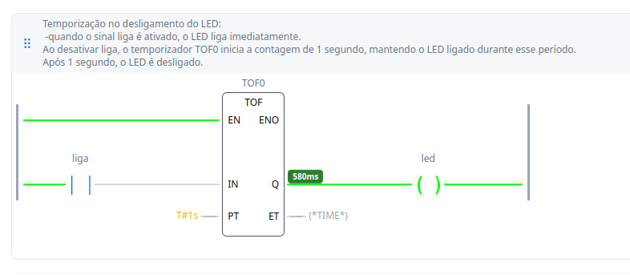

**10. Conferindo na tabela de variáveis.** `TOF0` aparece com **Type**
`TOF`, junto de `led` e `liga`:

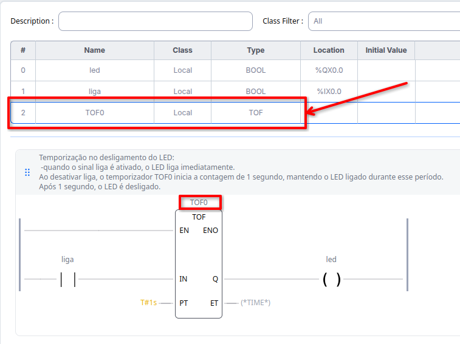

---

## 5. Quadro-resumo

| Elemento | Reage a | Mantém estado sozinho? | Introduz atraso de tempo? |
|---|---|---|---|
| Contato NA/NF | nível do sinal | não | não |
| Rising Edge (P) | transição 0→1 | não (pulso de 1 scan) | não |
| Falling Edge (N) | transição 1→0 | não (pulso de 1 scan) | não |
| Bobina normal | nível do rung | não | não |
| Bobina Set (S) | rung verdadeiro | **sim**, até um Reset | não |
| Bobina Reset (R) | rung verdadeiro | **sim**, até um Set | não |
| TON | `IN` = 1 | não | **sim**, atrasa o `1` |
| TOF | `IN` = 0 | não | **sim**, atrasa o `0` |

| Pergunta | Resposta rápida |
|---|---|
| Contato de borda fica quanto tempo em 1? | Só 1 ciclo de varredura |
| O que acontece se Set e Reset ficam verdadeiros juntos? | Vence quem for resolvido por último na ordem dos rungs |
| Que tipo de variável um temporizador usa em PT/ET? | `TIME`, com literais no formato `T#...` |
| TON atrasa o quê? | A energização (o `1`) de `Q` |
| TOF atrasa o quê? | A desenergização (o `0`) de `Q` |
