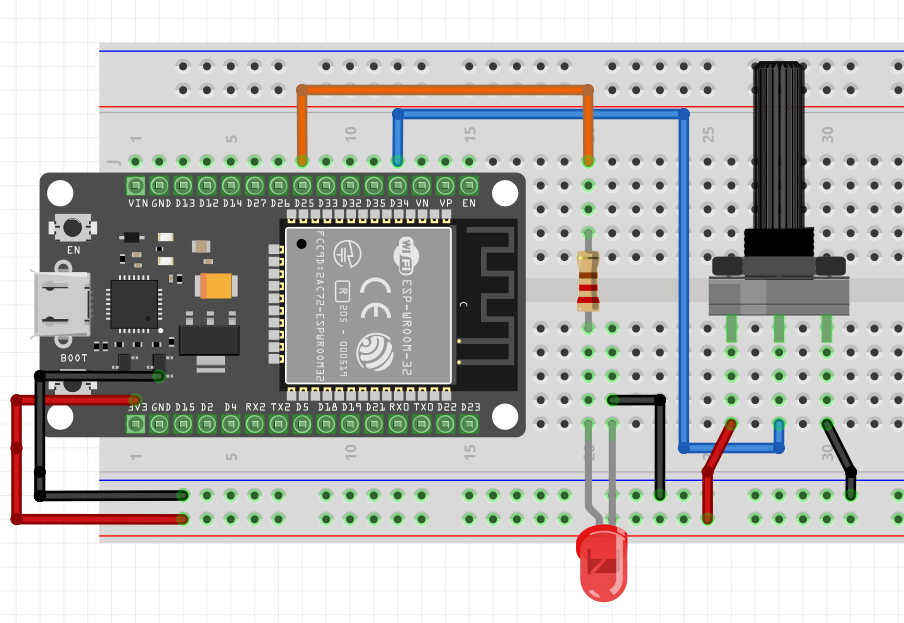
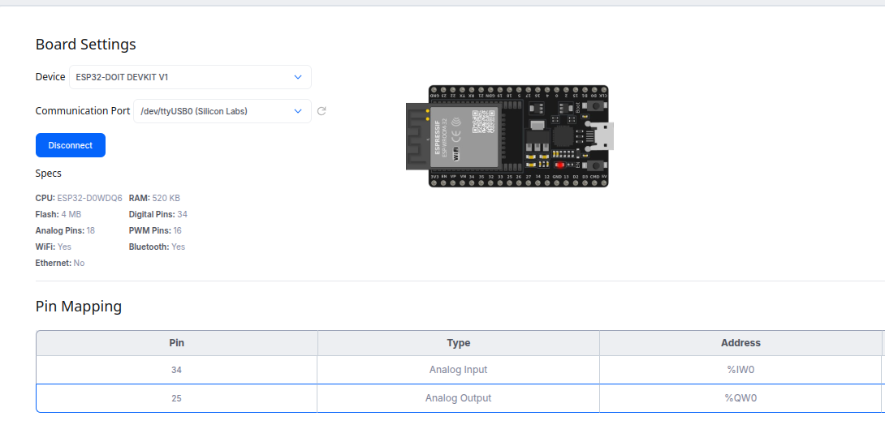
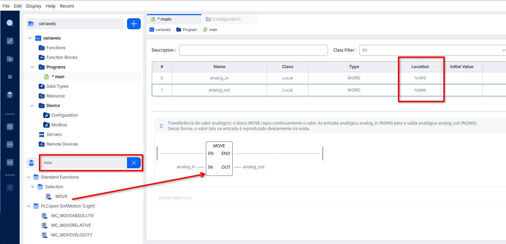
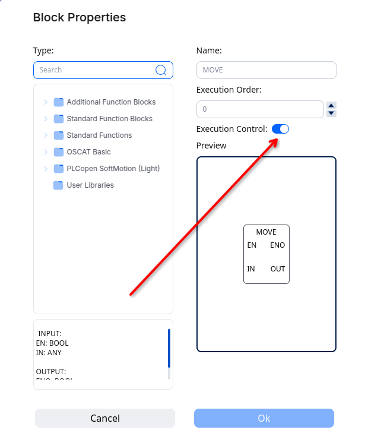
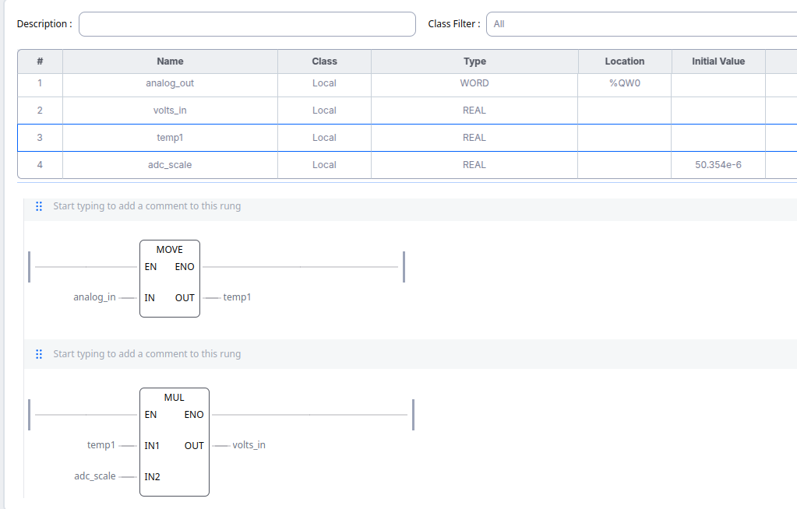
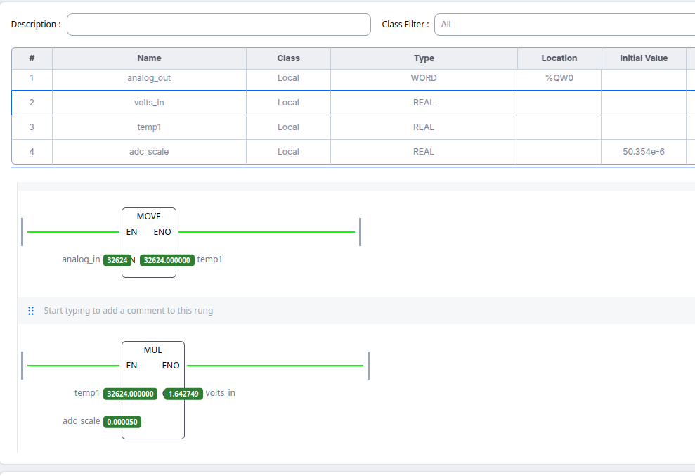
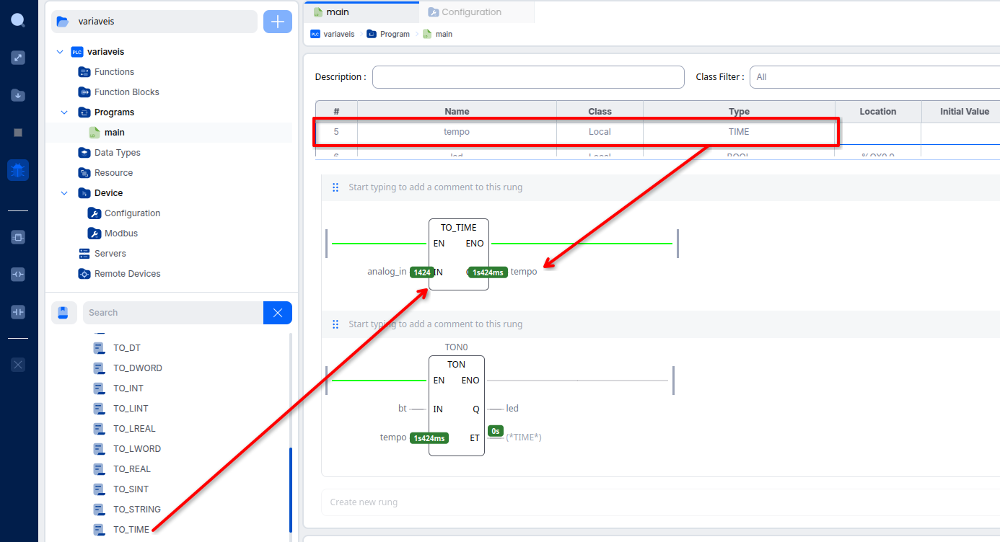

# Aula: Variáveis no OpenPLC

## 1. O que é uma variável, no OpenPLC

- Uma variável é o **nome** que o programa usa para ler ou escrever um
  valor — seja ele um bit físico de uma entrada, um bit interno de
  memória, ou o resultado de um cálculo.
- No OpenPLC Editor, toda variável de um programa aparece numa única
  **tabela de variáveis**, no topo da tela de edição, com estas colunas:

| Coluna | Para que serve |
|---|---|
| `#` | índice sequencial (gerado automaticamente) |
| `Name` | o nome usado no programa (ex.: `liga`, `analog_in`) |
| `Class` | onde a variável "vive" (ver seção 2) |
| `Type` | o tipo de dado (ver seção 3) |
| `Location` | o endereço físico direto, se houver (ver seção 4) |
| `Initial Value` | valor de partida ao ligar o CLP |
| `Documentation` | comentário/descrição livre |
| `Debug` | inclui/exclui a variável do monitoramento em tempo real |

- Uma variável só precisa de **Name** e **Type** para existir. `Class`,
  `Location`, `Initial Value` e `Documentation` são preenchidos conforme a
  necessidade.

---

## 2. Classe da variável

- **Local**: existe só dentro daquele programa/POU. É a classe mais comum
  — praticamente toda variável criada ao nomear um contato ou uma bobina
  no rung vira `Local` automaticamente.
- Outras classes (Global, Input, Output, In/Out, External) existem na
  norma para POUs que trocam dados entre si (funções e blocos de função
  reutilizáveis) — úteis quando o projeto cresce e passa a ter vários
  programas ou blocos próprios, mas fora do escopo desta aula introdutória.

---

## 3. Tipo de dado (Type)

Cada variável precisa de um tipo, que define **quanto espaço** ela ocupa e
**que operações** são válidas nela:

| Tipo | Tamanho | Faixa / uso típico |
|---|---|---|
| `BOOL` | 1 bit | `TRUE`/`FALSE` — botões, sensores digitais, saídas liga/desliga |
| `BYTE` | 8 bits | grupo de 8 bits, sem sinal |
| `WORD` | 16 bits | valor bruto de entrada/saída **analógica** (0–65535) |
| `DWORD` | 32 bits | grupos maiores de bits |
| `INT` | 16 bits | inteiro com sinal (-32768 a 32767) |
| `DINT` | 32 bits | inteiro com sinal, faixa maior |
| `REAL` | 32 bits | ponto flutuante — cálculos, valores em unidades de engenharia (volts, °C...) |
| `TIME` | — | duração, ex.: `T#5s` (usado em temporizadores) |
| `STRING` | — | texto |

- **Regra prática:** entradas/saídas **digitais** quase sempre são
  `BOOL`; entradas/saídas **analógicas** chegam cruas como `WORD`, e
  geralmente precisam ser convertidas para `REAL` antes de fazer contas
  com elas (ver o exercício na seção 5).

---

## 4. Endereçamento direto (Location)

- Quando uma variável representa uma entrada ou saída física, ela ganha
  um endereço direto no formato `%<letra><tamanho><posição>`:

| Prefixo | Significado |
|---|---|
| `%I` | entrada (*Input*) |
| `%Q` | saída (*Output*) |
| `%M` | memória interna |
| `X` | um único bit (ex.: `%IX0.0`, `%QX0.0`) |
| `W` | uma palavra de 16 bits (ex.: `%IW0`, `%QW0`) |

- Exemplos: `%IX0.0` é o **primeiro bit** da primeira entrada digital;
  `%IW0` é a **primeira palavra** de entrada — usada por um canal
  analógico inteiro.
- No OpenPLC Editor, você não digita esse endereço de cabeça: ele é
  sugerido automaticamente a partir do **Pin Mapping** configurado para a
  placa (`Device → Configuration`), bastando escolher o endereço já
  mapeado na coluna `Location` da variável.

---

## 5. Exercício: entrada e saída analógica (potenciômetro + LED)

Vamos aplicar os dois tipos de variável — `WORD` (bruto) e `REAL`
(convertido) — num circuito simples: um potenciômetro controla, ao vivo,
o brilho de um LED.

### Hardware

Um potenciômetro alimenta um pino de entrada analógica; o LED é ligado a
um pino de saída **analógica de verdade** (DAC), não PWM:



- O cursor do potenciômetro vai para o **GPIO34** (entrada, canal ADC).
- O LED (com resistor em série) é acionado pelo **GPIO25** — um dos dois
  únicos pinos do ESP32 com **DAC real de 8 bits**, ou seja, ele entrega
  uma tensão analógica de verdade, proporcional ao valor escrito, sem
  precisar simular com PWM.

### Configurando os pinos no OpenPLC

Em `Device → Configuration`, o pino 34 é mapeado como **Analog Input**
(`%IW0`) e o pino 25 como **Analog Output** (`%QW0`):



### As variáveis e o rung

Duas variáveis `WORD`, uma para cada canal, ligadas por um bloco
**MOVE** (que simplesmente copia o valor de `IN` para `OUT`):



> Transferência do valor analógico: o bloco MOVE copia continuamente o
> valor da entrada analógica `analog_in` (`%IW0`) para a saída analógica
> `analog_out` (`%QW0`). Dessa forma, o valor lido na entrada é
> reproduzido diretamente na saída.

O bloco `MOVE` fica em **Standard Functions → Selection**, e — como todo
bloco de função — pode ter `EN`/`ENO` expostos via **Execution Control**
nas suas propriedades:



Equivalente em Structured Text:

```pascal
MOVE1(EN := TRUE, IN := analog_in, ENO => moveu);
IF moveu THEN
    analog_out := analog_in;
END_IF;
```

### Indo além: convertendo o valor bruto para volts

O canal analógico chega como `WORD` (0 a 65535), representando 0 a
~3,3V. Para usar esse valor num cálculo de engenharia — como exibir a
tensão real — ele precisa virar `REAL`. Isso é feito com dois blocos em
sequência: `MOVE` (que aqui também converte `WORD` → `REAL` na
atribuição) e `MUL`:



- `temp1 := analog_in` (via `MOVE`) faz a **conversão de tipo**: de
  `WORD` (contagem bruta) para `REAL`.
- `volts_in := temp1 * adc_scale` (via `MUL`) aplica o fator de escala:
  `3,3V ÷ 65535 ≈ 0,000050354`.

Em modo debug, dá pra ver os dois blocos convertendo o valor em tempo
real — aqui, a contagem bruta `32624` virou `1,642749 V`:



Equivalente em Structured Text:

```pascal
temp1    := analog_in;             (* WORD → REAL *)
volts_in := temp1 * adc_scale;     (* aplica o fator de escala, em volts *)
```

- `volts_in` já pode ser usado, por exemplo, para acionar um alarme
  (`IF volts_in > 2.5 THEN ...`) ou para converter numa grandeza física
  (temperatura, pressão) usando a curva de calibração do sensor.

### Funções de conversão de tipo (`TO_xxx`)

`MOVE` converte implicitamente na atribuição, mas a norma também define
uma família de **funções de conversão explícita**, todas com o padrão de
nome `TO_<tipo destino>`. No Editor, elas aparecem ao buscar `to_` na
biblioteca: `TO_DT`, `TO_DWORD`, `TO_INT`, `TO_LINT`, `TO_LREAL`,
`TO_LWORD`, `TO_REAL`, `TO_SINT`, `TO_STRING`, `TO_TIME`, entre outras —
inclusive conversão para **texto** (`TO_STRING`), útil para montar
mensagens/logs a partir de um valor numérico.

O exemplo abaixo usa `TO_TIME` para transformar a leitura bruta do
potenciômetro (`WORD`) diretamente num valor `TIME`, usado como `PT` de
um temporizador `TON` — ou seja, **o potenciômetro passa a controlar o
tempo de atraso do temporizador, ao vivo**:



- Em debug, `analog_in = 1424` (contagem bruta) virou `tempo = 1s424ms` —
  o `TO_TIME` está interpretando o número como milissegundos.
- Esse `tempo` alimenta `PT` do `TON0`: girar o potenciômetro muda, na
  hora, quanto tempo `led` demora para acender depois que `bt` é
  pressionado.

```pascal
tempo := TO_TIME(analog_in);
TON0(IN := bt, PT := tempo);
led := TON0.Q;
```

---

## 6. Exercício: pesquise a função `SCALE`

Os blocos `MOVE` + `MUL` da seção anterior fazem o trabalho, mas exigem
calcular o fator de escala (`adc_scale`) na mão. A biblioteca padrão do
OpenPLC tem uma função pronta pra isso: **`SCALE`**.

**Tarefa:**

1. No OpenPLC Editor, busque `scale` na biblioteca de blocos e localize a
   função `SCALE`.
2. Descubra quais são as suas entradas e saídas (dica: assim como o
   `MOVE`, ela tem `EN`/`ENO` — mas também parâmetros próprios para
   definir a faixa de entrada e a faixa de saída desejada).
3. Refaça a conversão de `analog_in` para volts **usando `SCALE` no lugar
   de `MOVE` + `MUL`**, de forma que a saída já venha diretamente em
   volts (faixa 0,0 a 3,3), sem precisar declarar `adc_scale` manualmente.
4. Teste em modo debug e compare o valor obtido com o que a conta manual
   (`temp1 * adc_scale`) já dava.
5. **Para discutir em aula:** em que situação `SCALE` é mais vantajosa do
   que multiplicar por um fator fixo? E em que situação o fator fixo
   ainda pode ser mais simples?

---

## 7. Quadro-resumo

| Pergunta | Resposta rápida |
|---|---|
| O que toda variável precisa ter? | `Name` e `Type` |
| Que classe a maioria das variáveis usa? | `Local` |
| Que tipo uma entrada/saída digital usa? | `BOOL` |
| Que tipo um canal analógico bruto usa? | `WORD` (0–65535) |
| Como transformar o valor analógico bruto em algo útil? | Converter para `REAL` e multiplicar por um fator de escala |
| Como uma variável vira um pino físico? | Preenchendo `Location` com o endereço do Pin Mapping da placa |
| Como converter um tipo em outro explicitamente? | Funções `TO_<tipo>` (`TO_REAL`, `TO_TIME`, `TO_STRING`...) |
| Existe uma função pronta para escalar um valor analógico? | `SCALE` — ver exercício da seção 6 |
