# Aula: Funções e Blocos de Função (Function e Function Block)

## Pré-requisitos

Esta aula pressupõe que os conceitos abaixo já estão consolidados:

- **[Linguagem Ladder](../02-linguagem-ladder/linguagem-ladder.md)** (aula
  02) — contatos, bobinas, e a ideia de rung.
- **[Tutorial OpenPLC Editor](../05-tutorial-openplc-esp32/tutorial-openplc-esp32.md)**
  (aula 05) — criar projeto, montar um programa, transferir e rodar em
  modo debug (usado o tempo todo no passo a passo da seção 6).
- **[Bordas, Set/Reset e Temporizadores](../06-bordas-set-reset-temporizadores/bordas-set-reset-temporizadores.md)**
  (aula 06) — `TON`/`TOF`, `SR`/`RS`, `R_TRIG`/`F_TRIG`. Esta aula parte
  direto desses blocos como exemplos de Function Block já conhecidos.
- **[Variáveis no OpenPLC](../07-variaveis-openplc/variaveis-openplc.md)**
  (aula 07) — classes de variável, tipos (`BOOL`, `WORD`, `INT`, `TIME`) e
  endereçamento (`%IX`, `%IW`, `%QX`, `%QW`), usados sem reexplicar nos
  exemplos.

## 1. Introdução

Até aqui, a maior parte da lógica que montamos usou contatos, bobinas,
Set/Reset e temporizadores direto no Ladder. Mas alguns desses elementos já
eram, por trás dos panos, POUs (*Program Organization Units*) reutilizáveis
definidos pela norma IEC 61131-3 — só não tínhamos parado para nomear o
conceito:

- O bloco **TON** da aula 06 é um **Function Block**.
- Quando arrastamos um bloco **MOVE** para converter/copiar um valor, isso é
  uma **Function**.

Esta aula formaliza os dois conceitos:

- **Função (Function)** — recebe entradas, calcula, devolve **uma** saída,
  e **não guarda estado** entre execuções.
- **Bloco de Função (Function Block)** — recebe entradas, pode devolver
  **várias** saídas, e **guarda estado** (memória) entre ciclos de
  varredura, através de uma **instância** nomeada.

Essa diferença de memória é o ponto central da aula.

---

## 2. Funções (Functions)

- Uma função é **sem memória**: chamada com as mesmas entradas, ela sempre
  devolve a **mesma saída** — não importa quantas vezes já foi chamada
  antes, nem em qual ciclo de varredura estamos.
- Não existe "instância" com nome (como `TON0`): a função é usada
  diretamente, sem precisar declarar uma variável para guardá-la.
- Tem no máximo **uma saída** de dado (além do `ENO`, que é só um eco de
  erro/habilitação, igual visto com temporizadores).

### Exemplos padrão (biblioteca da norma / OpenPLC)

| Função | O que faz |
|---|---|
| `MOVE` | copia um valor de uma variável/literal para outra |
| `ADD`, `SUB`, `MUL`, `DIV` | operações aritméticas |
| `GT`, `LT`, `EQ`, `GE`, `LE` | comparações (*greater than*, *less than*, *equal*...) |
| `AND`, `OR`, `NOT`, `XOR` | operações lógicas/bit a bit |
| `SCALE` | reescala um valor de uma faixa para outra (ex.: contagem ADC → °C) |

### Exemplo prático: MOVE

No OpenPLC Editor, ao criar um novo POU dentro de uma pasta de projeto,
o editor oferece as duas categorias lado a lado — **Function** e
**Function Block** — já na tela de criação:

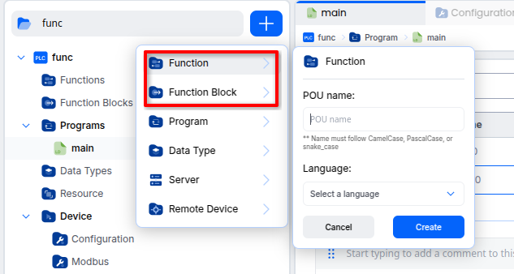

Um uso simples de `MOVE` em FBD: ler uma entrada analógica (`ain0`, tipo
`WORD`) e jogar o valor direto para uma saída analógica (`aout0`):

```
ain0 (WORD) ──▶ MOVE ──▶ aout0 (WORD)
```

- Chame o valor de `ain0` de `1234` em um ciclo: `aout0` vira `1234`.
- No ciclo seguinte, com `ain0` ainda em `1234`: `aout0` continua `1234`.
- Não há histórico nenhum guardado pelo `MOVE` — ele só olha a entrada
  **agora** e escreve a saída **agora**.

### Equivalente em Structured Text

```pascal
aout0 := ain0;   (* o compilador gera exatamente um MOVE por trás disso *)
```

- Isso mostra uma coisa importante: **toda atribuição simples em ST já é,
  por baixo, uma chamada de função** (`MOVE`). Funções aritméticas e de
  comparação (`ADD`, `GT`...) também aparecem escondidas atrás dos
  operadores comuns do ST (`+`, `>`...).

---

## 3. Blocos de Função (Function Blocks)

- Um bloco de função **guarda estado** (memória) entre execuções. Por
  isso, ele **precisa de uma instância nomeada** — uma variável própria
  (ex.: `TON0`, `SR0`, `CTU0`) que armazena esse estado de um ciclo de
  varredura para o outro.
- Pode ter **várias saídas** ao mesmo tempo (ex.: o `TON` tem `Q` **e**
  `ET`).
- A mesma entrada pode produzir **saídas diferentes**, dependendo do que
  já aconteceu antes — é exatamente esse histórico que o `TON`/`TOF` da
  aula 06 usa para saber "há quanto tempo `IN` está nesse estado".

### Exemplos padrão (biblioteca da norma / OpenPLC)

| Bloco | O que faz | Já visto? |
|---|---|---|
| `TON` / `TOF` | temporizador on-delay / off-delay | sim — aula 06 |
| `R_TRIG` / `F_TRIG` | detector de borda de subida/descida | sim (por trás do contato `P`/`N`) — aula 06 |
| `SR` / `RS` | latch Set/Reset (com prioridade fixa) | sim (por trás da bobina `-(S)-`/`-(R)-`) — aula 06 |
| `CTU` | contador crescente (*count up*) | novo nesta aula |
| `CTD` | contador decrescente (*count down*) | novo nesta aula |
| `CTUD` | contador crescente e decrescente | novo nesta aula |

### Exemplo prático: SR

O mesmo latch Set/Reset da aula 06, só que agora montado como um bloco de
função **explícito** em FBD, em vez da bobina `-(S)-`/`-(R)-` do Ladder:

```
liga    ──▶ S1 ┐
               SR0 ──▶ Q1 ──▶ saida
desliga ──▶ R  ┘
```

- `SR0` é a **instância**: aparece na tabela de variáveis com **Type**
  `SR`, do mesmo jeito que `TON0` aparecia com **Type** `TON` na aula 06.
- `SR0.Q1` **guarda** o estado ligado/desligado — é essa memória que faz
  `saida` continuar em `1` mesmo depois que `liga` volta a `0`.
- `SR` é *Set-dominante*: se `S1` e `R` ficarem verdadeiros ao mesmo
  tempo, `Q1` vai para `1` (o oposto do `RS`, que é *Reset-dominante*).

### Equivalente em Structured Text

```pascal
SR0(S1 := liga, R := desliga);
saida := SR0.Q1;
```

- Repare que `SR0` aparece **antes** dos parênteses, como uma variável —
  porque é uma variável: a instância do bloco. Isso não acontece com
  funções (`MOVE`, `ADD`...), que são chamadas sem precisar de uma
  variável de instância.

---

## 4. A diferença-chave: memória

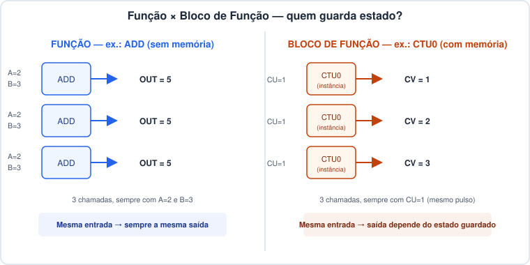

- À esquerda: uma função (`ADD`) chamada três vezes com as mesmas
  entradas sempre devolve a mesma saída.
- À direita: um bloco de função (`CTU0`) chamado três vezes com a mesma
  entrada (`CU=1`, um novo pulso de contagem) devolve uma saída
  **diferente** a cada vez — porque ele lembra quantas vezes já contou.

---

## 5. Quadro comparativo

| Aspecto | Função (Function) | Bloco de Função (Function Block) |
|---|---|---|
| Guarda estado entre ciclos? | **Não** | **Sim** (na instância) |
| Precisa de variável de instância? | Não | Sim (ex.: `TON0`, `SR0`) |
| Nº de saídas de dado | Só 1 (+ `ENO` opcional) | Pode ter várias (ex.: `Q` e `ET`) |
| Mesma entrada = mesma saída sempre? | Sim | Não necessariamente |
| Exemplos padrão | `MOVE`, `ADD`, `GT`, `SCALE` | `TON`, `TOF`, `SR`, `CTU`, `R_TRIG` |
| Onde aparece no OpenPLC Editor | pasta **Functions** | pasta **Function Blocks** |
| Linguagem de implementação | escolhida **por POU** (ST, IL, LD, FBD, SFC...) — **independente** da linguagem de quem chama | idem |

---

## 6. Passo a passo: criando `meu_move` e `meu_contador`

Este passo a passo cria uma Function e um Function Block **do zero**, cada
um numa linguagem diferente, para provar na prática algo que já foi dito
na tabela da seção 5: **a linguagem de implementação de uma Function/
Function Block é uma escolha isolada, feita POU a POU — não precisa ser a
mesma linguagem do programa que vai usá-la.**

### Parte A — `meu_move`, uma Function escrita em Instruction List

**1. Crie o POU.** No projeto `func`, clique no `+`, escolha **Function**,
dê o nome `meu_move` e, na lista de linguagens, escolha **Instruction
List (IL)** — repare que essa escolha de linguagem é livre, e o programa
`main` do projeto está em **Ladder**:

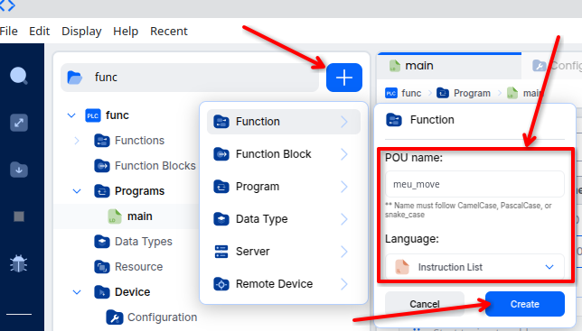

**2. Declare as variáveis e o corpo.** `entra` (Input, `WORD`) e `sai`
(Output, `WORD`); o corpo só transfere um valor para o outro:

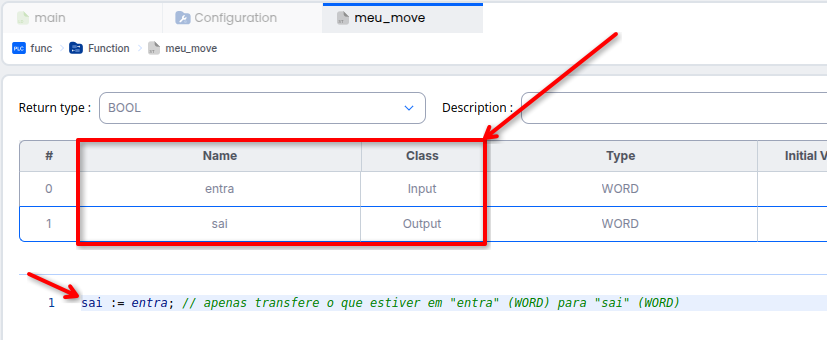

> Mesmo com a linguagem marcada como Instruction List, o corpo aparece
> como `sai := entra;` — no fundo é a mesma ideia do `MOVE` da seção 2,
> só que escrita à mão pelo programador em vez de vir pronta da
> biblioteca padrão.

**3. Use `meu_move` dentro do `main` (em Ladder).** Ele aparece em
**User-defined POUs**, na biblioteca lateral, junto dos blocos padrão —
arraste para o rung como qualquer outro bloco, com `EN`/`ENO` e os pinos
`entra`/`sai`:

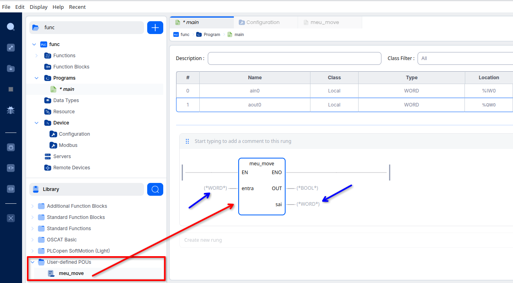

**4. Ligue os fios.** `ain0` → `entra` e `sai` → `aout0`:

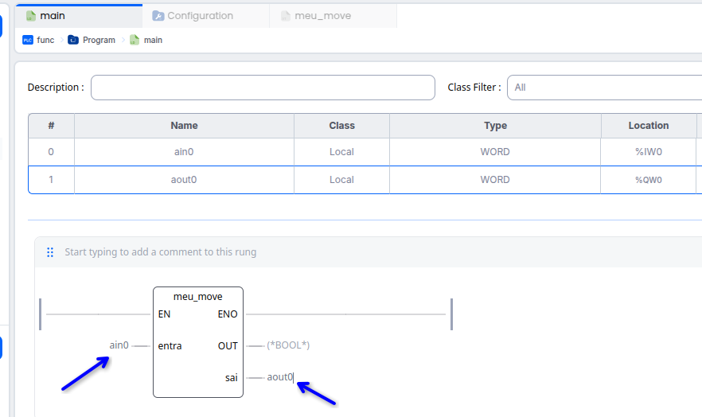

**5. Rode em modo debug.** O valor de `ain0` atravessa `meu_move` até
`aout0` sem alteração (`1648` → `1648`) — exatamente o esperado de uma
função sem memória:

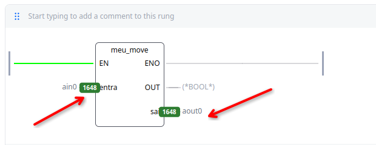

> **Ponto-chave:** `meu_move` foi escrito em **Instruction List**, mas é
> chamado de dentro de um rung em **Ladder**. A linguagem de implementação
> não "vaza" para quem usa o POU.

### Parte B — `meu_contador`, um Function Block escrito em Ladder que chama `meu_move` por dentro

**6. Crie o POU.** Escolha **Function Block**, nome `meu_contador`,
linguagem **Ladder**. Variáveis: `contar` (Input, `BOOL`), `valor`
(Output, `INT`) e `memoria` (Local, `INT`, valor inicial `0`) — é a
`memoria` que dá ao bloco seu estado interno, guardado de um ciclo de
varredura para o outro.

**7. Monte o corpo em dois rungs.** O primeiro soma `1` a `memoria`
(bloco `ADD`: `IN1 := 1`, `IN2 := memoria`, `OUT := memoria`) toda vez
que `contar` estiver ativo; o segundo reaproveita `meu_move` — a mesma
Function da Parte A — para copiar `memoria` em `valor`:

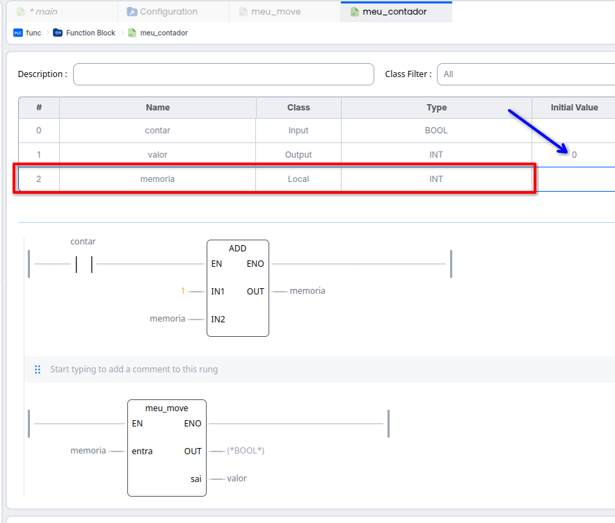

> **Segundo ponto-chave:** `meu_contador` é um Function Block em
> **Ladder**, mas usa por dentro uma Function escrita em **IL**
> (`meu_move`). Linguagens diferentes, convivendo sem nenhum problema —
> e prova de que um POU pode reaproveitar outro POU já pronto, mesmo que
> tenham sido escritos em linguagens diferentes.

**8. De volta ao `main`, crie duas instâncias.** `MEU_CONTADOR0` e
`MEU_CONTADOR1`, cada uma como uma linha própria na tabela de variáveis,
com **Type** `meu_contador`:

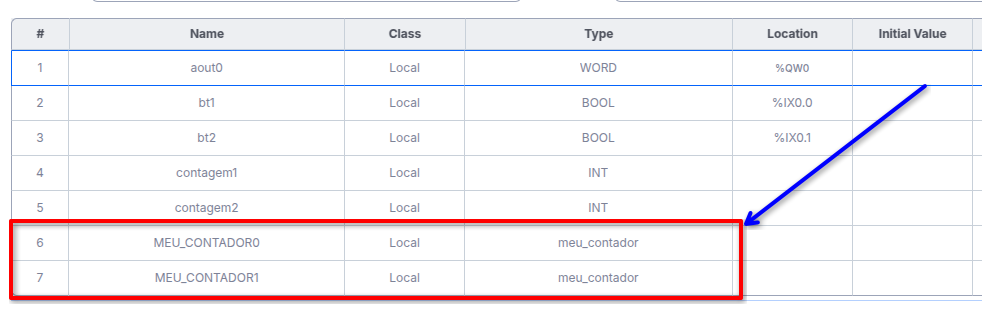

**9. Monte dois rungs independentes.** `bt1` (contato de borda `P`) →
`MEU_CONTADOR0.contar`, saída em `contagem1`; e `bt2` (contato de borda
`P`) → `MEU_CONTADOR1.contar`, saída em `contagem2`. A biblioteca lateral
mostra `meu_move` e `meu_contador` juntos, em **User-defined POUs**:

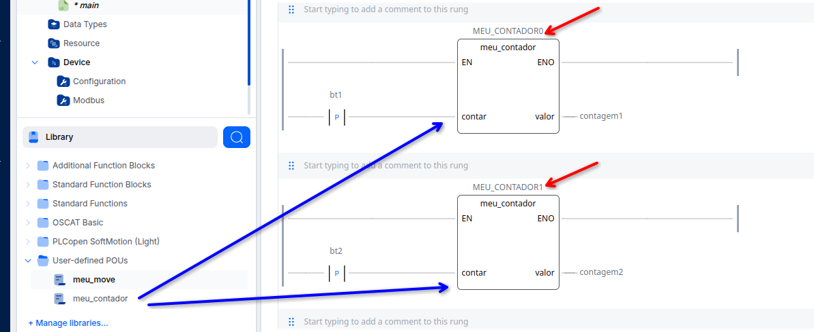

**10. Rode em modo debug.** Pressionando `bt1` cinco vezes e `bt2` onze
vezes, `contagem1` chega a `5` e `contagem2` a `11`, **de forma
independente**:

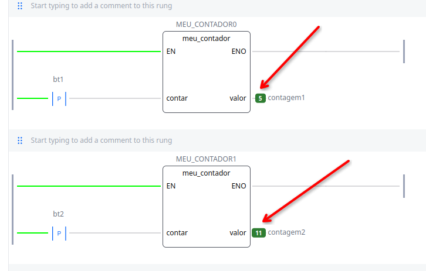

> **Terceiro ponto-chave:** essa é a prova prática da seção 4. Duas
> instâncias do **mesmo** Function Block, com a **mesma** lógica interna,
> guardam **memórias separadas** — porque cada instância
> (`MEU_CONTADOR0`, `MEU_CONTADOR1`) é uma variável própria. Se
> `meu_contador` fosse uma Function em vez de um Function Block, não
> haveria instância nenhuma para guardar esse histórico, e as duas
> chamadas dividiriam o mesmo resultado.

---

## 7. Aplicações — quando criar sua própria Function ou Function Block

- **Function própria** — quando você repete o **mesmo cálculo sem
  estado** em vários lugares do programa. Exemplos:
  - uma função `ADC_PARA_CELSIUS` que reescala uma leitura de 0–4095 para
    uma temperatura em °C;
  - uma função `DENTRO_DA_FAIXA` que devolve `TRUE`/`FALSE` comparando um
    valor contra um mínimo e um máximo.
- **Bloco de Função próprio** — quando a lógica precisa **lembrar de algo**
  entre ciclos de varredura. Exemplos:
  - um bloco `DEBOUNCE` que só libera a saída depois que a entrada ficar
    estável por um tempo mínimo (usaria um `TON` por dentro);
  - um bloco `ALARME_HISTERESE` que liga acima de um limite e só desliga
    bem abaixo dele, evitando "tremer" perto do limiar;
  - um bloco `CONTADOR_PRODUCAO` que acumula peças contadas e zera só
    quando receber um comando de reset explícito.
- POUs criados pelo usuário aparecem na mesma biblioteca de busca dos
  blocos padrão (a mesma lupa usada na aula 06 para achar `TON`), o que
  incentiva reaproveitar lógica entre programas.
- Como a linguagem de cada Function/Function Block é escolhida na hora de
  criá-la, dá para usar a linguagem mais adequada a cada lógica — por
  exemplo, uma conta matemática mais elaborada em **ST** (mais compacto
  para expressões), mesmo que o programa principal esteja em **Ladder**.
  Foi exatamente o que o passo a passo da seção 6 mostrou com `meu_move`
  (IL) e `meu_contador` (Ladder).

---

## 8. Quadro-resumo

| Pergunta | Resposta rápida |
|---|---|
| O que diferencia Function de Function Block? | Function Block guarda estado (memória) entre ciclos; Function não |
| Function Block precisa de quê a mais? | Uma variável de instância (ex.: `SR0`) |
| Quantas saídas de dado uma Function pode ter? | Só uma (`OUT`), fora o `ENO` |
| `TON`/`TOF`/`SR`/`R_TRIG` são Function ou Function Block? | Function Block (todos guardam estado) |
| `MOVE`/`ADD`/`GT` são Function ou Function Block? | Function (sem estado) |
| Toda atribuição simples em ST (`x := y`) esconde o quê? | Uma chamada de função `MOVE` |
| A linguagem de uma Function/Function Block precisa bater com a do programa que a chama? | Não — `meu_move` (IL) e `meu_contador` (Ladder) provam isso, dentro de um `main` também em Ladder |
