# Aula: Funções e Blocos de Função em C/C++ no OpenPLC

## Pré-requisitos

- **[Tutorial OpenPLC Editor](../05-tutorial-openplc-esp32/tutorial-openplc-esp32.md)**
  (aula 05) — criar projeto, transferir para o ESP32.
- **[Funções e Blocos de Função](../09-funcoes/funcoes.md)** (aula 09) —
  essencial. Esta aula assume que a diferença entre Function e Function
  Block, e a ideia de instância/memória, já estão claras.
- Noções básicas de C/C++ (a aula não ensina a linguagem, só como ela se
  encaixa dentro de um POU do OpenPLC).

---

## 1. Introdução — por que sair do IEC 61131-3?

As cinco linguagens da norma (ST, Ladder, FBD, IL, SFC) foram desenhadas
para **lógica de controle determinística** — e são ótimas nisso. Mas elas
não têm (e não pretendem ter) acesso a coisas como pilha de rede Wi-Fi,
armazenamento não-volátil em flash, ou bibliotecas de terceiros para um
sensor específico.

O detalhe é que, por baixo do runtime do OpenPLC rodando num ESP32, existe
um ambiente **Arduino/ESP-IDF completo** — com Wi-Fi, Bluetooth, sistema
de arquivos e milhares de bibliotecas já prontas. O OpenPLC Editor abre
uma porta direta para esse ambiente: você pode escrever um POU inteiro em
**C/C++ puro**, no mesmo espírito da aula 09 — a linguagem de
implementação é uma escolha **por POU**, e aqui a escolha é "nenhuma das
cinco da norma, e sim C/C++ direto".

É a válvula de escape para quando ST/Ladder/FBD não alcançam. A aula
começa por um **primeiro exemplo bem simples** — um pisca-pisca em C, sem
Wi-Fi e sem biblioteca extra, que roda até no **OpenPLC Simulator**, sem
placa nenhuma (seção 3). Depois, o exemplo do servidor Wi-Fi evolui em
**três níveis**: um servidor isolado (seção 4), depois conectado a pinos
do Ladder (seção 7), e por fim uma página que lê e comanda o CLP
remotamente (seção 8).

---

## 2. Como funciona por baixo dos panos

Ao escrever um POU em C/C++ no OpenPLC Editor, o corpo (entre a lista de
variáveis e o fim do POU) é código C/C++ de verdade, com duas funções de
papel reservado — o mesmo modelo de um sketch Arduino:

- **`setup()`** roda **uma única vez**: na primeira varredura em que
  aquela instância do bloco é executada.
- **`loop()`** roda **a cada varredura**, a partir daí.

Por trás dos panos, o compilador do OpenPLC (STruC++) gera uma classe
C++ para o seu POU. É esse código gerado — não visível no Editor, mas
produzido na pasta `build/` do projeto — que mostra exatamente o que
acontece a cada varredura. O trecho abaixo foi gerado a partir do
`pisca_c`, o primeiro exemplo da seção 3 (um bloco com uma entrada
`habilita` e uma saída `saida`), mas o mecanismo é idêntico para qualquer
POU em C/C++:

```cpp
// build/.../src/pou_PISCA_C.cpp - gerado automaticamente
void PISCA_C::operator()() {
    PISCA_C_VARS vars;
      vars.HABILITA = &HABILITA;   // ponteiros para os pinos DESTA instancia
      vars.SAIDA = &SAIDA;
    if (HASBEENINITIALIZED == false) {
        pisca_c_setup(&vars);      // o seu setup()
        HASBEENINITIALIZED = true;
    }
    pisca_c_loop(&vars);           // o seu loop()
}
```

Repare: isso é **exatamente** o comportamento de instância da aula 09.
`HASBEENINITIALIZED` é memória própria daquela instância — se você
declarar duas instâncias do mesmo POU em C (`PISCA_C0`, `PISCA_C1`, como
fizemos com `MEU_CONTADOR0`/`MEU_CONTADOR1`), cada uma teria seu
`HASBEENINITIALIZED` e chamaria seu próprio `setup()` de forma
independente na primeira vez que rodasse. **É um Function Block por
definição.**

Os pinos `VAR_INPUT`/`VAR_OUTPUT` viram campos de um struct
(`PISCA_C_VARS`), acessível através de um ponteiro `vars`. Mas o
compilador não te obriga a escrever `vars->...` toda vez — para cada pino
declarado, ele gera automaticamente um `#define` que permite usar **o
nome do pino direto**, sem prefixo nenhum (trecho real de
`c_blocks_code.cpp`):

```cpp
// PISCA_C — Variables Table names bound to the interface struct
#define habilita (*(vars->HABILITA))
#define saida (*(vars->SAIDA))
```

Ou seja: dentro do `setup()`/`loop()`, você escreve só `habilita` ou
`saida` — nunca `vars->habilita`. Escrever `vars->habilita` faz o
pré-processador expandir a macro **depois** do `vars->`, gerando
`vars->(*(vars->HABILITA))`, que não compila.

### Cuidado: variáveis globais do C **não** são por instância

Os pinos são por instância (cada instância tem seu `HABILITA`/`SAIDA`),
mas as **variáveis globais** que você escreve no corpo C/C++ (como
`estado` e `ultima_troca` do `pisca_c`, ou o `WebServer server` do
`server_ap`) existem **uma única vez no programa inteiro** — são do
*tipo* do bloco, não da instância. Se o `main` tiver `PISCA_C0` e
`PISCA_C1`, os dois vão ler e escrever **o mesmo** `estado`, e um bagunça
o pisca do outro. Nesta aula cada bloco em C tem **uma instância só**, e
aí isso não aparece. Se precisar de duas instâncias independentes, o
estado tem que morar num lugar que seja por instância — por exemplo, num
pino `VAR_OUTPUT` a mais (ex.: `estado : BOOL`), que vira campo da
instância como `saida`.

Uma segunda pegadinha, que só aparece quando o POU tem funções auxiliares
além de `setup()`/`loop()` (como as rotas de um servidor web, seção 8):
**só `setup()`/`loop()` recebem o ponteiro `vars`**. Qualquer outra função
que você escrever — por exemplo, uma chamada de volta (*callback*) de
biblioteca, como as rotas do `WebServer` — **não enxerga os pinos**, nem
pelo `#define`, porque esse `#define` também depende de `vars` estar em
escopo. A seção 8 mostra como contornar isso.

---

## 3. Primeiro exemplo — pisca-pisca em C/C++ (`pisca_c`)

Antes de Wi-Fi e servidor web, o menor exemplo útil: um bloco em C/C++
que faz uma saída **piscar** enquanto uma entrada estiver ligada. É o
equivalente a um pisca feito com dois `TON` em Ladder (aula 06), só que
escrito em C. Ele não usa nenhuma biblioteca além do `Arduino.h` (para
`millis()`), então dá para testar **no OpenPLC Simulator, sem placa
nenhuma**.

Projeto pronto: `prj/c_pisca`.

### Passo 1 — criar o projeto

**New Project → PLC Project**, nome `c_pisca`, uma pasta vazia, linguagem
base **Ladder Diagram**, tarefa cíclica `T#20ms` (o padrão) — igual à
aula 05. A placa já vem como **OpenPLC Simulator**, e é ela que vamos
usar para testar.

### Passo 2 — criar o Function Block em C/C++

Clique no **`+`** ao lado do nome do projeto → **Function Block**. Dê o
nome `pisca_c` e, em **Language**, escolha **C/C++** (a última da lista,
abaixo das linguagens da norma e de Python):

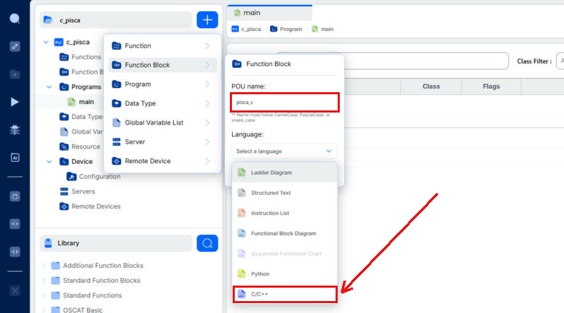

O Editor abre o POU já com um modelo pronto. Vale ler o comentário do
topo: ele resume o modelo inteiro — `setup()` roda uma vez quando o bloco
inicializa, `loop()` roda a cada varredura, e as variáveis da tabela são
acessadas **pelo nome**, direto no código:

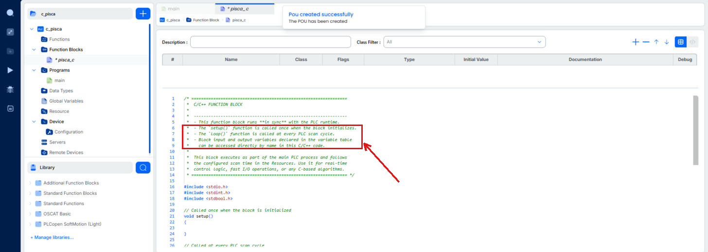

### Passo 3 — declarar os pinos e escrever o código

Na tabela de variáveis do `pisca_c`, crie (botão **`+`** da tabela):

| Name | Class | Type | Para quê |
|---|---|---|---|
| `habilita` | Input | BOOL | `TRUE` = pisca; `FALSE` = saída desligada |
| `saida` | Output | BOOL | a saída que pisca |

Depois apague o código do modelo e cole o corpo abaixo:

```cpp
#include <Arduino.h>

const unsigned long MEIO_PERIODO_MS = 500;  // tempo ligado = tempo desligado

unsigned long ultima_troca = 0;   // instante (ms) da ultima troca da saida
bool estado = false;              // estado atual do pisca

// Roda UMA vez, na primeira varredura
void setup()
{
    ultima_troca = millis();
}

// Roda a CADA varredura (aqui, a cada 20 ms)
void loop()
{
    if (!habilita)
    {
        estado = false;                        // desabilitado: saida apagada
    }
    else if (millis() - ultima_troca >= MEIO_PERIODO_MS)
    {
        estado = !estado;                      // passou meio periodo: inverte
        ultima_troca = millis();
    }

    saida = estado;                            // escreve no pino de saida
}
```

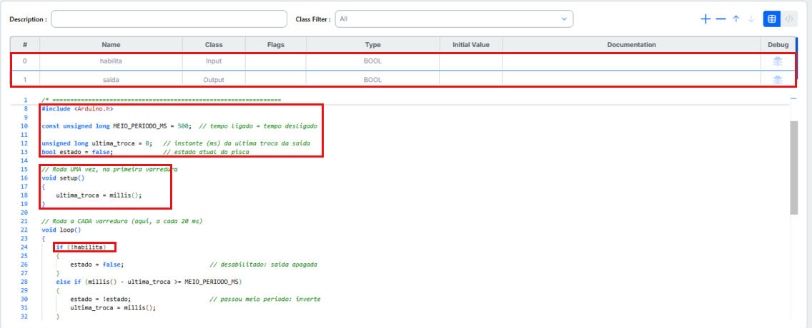

No print, as caixas marcam as três partes do bloco:

- **Pinos** (tabela): `habilita` e `saida` — é por eles que o bloco
  conversa com o Ladder.
- **Memória** (variáveis globais `estado` e `ultima_troca`): o que precisa
  sobreviver de uma varredura para a outra. É isso que faz dele um
  Function Block (aula 09) — veja o cuidado com globais na seção 2.
- **`setup()`/`loop()`**: `setup()` só anota o instante inicial;
  `loop()` decide, a cada 20 ms, se já está na hora de inverter a saída.
  Os pinos são usados **pelo nome** (`habilita`, `saida`), sem `vars->`.

**Por que `millis()` e não `delay(500)`?** O jeito "de Arduino" de piscar
seria `saida = true; delay(500); saida = false; delay(500);`. Dentro do
CLP isso é um erro grave: o `delay` **para a varredura inteira** — todos os
rungs, de todos os programas, ficam 1 s congelados a cada chamada (seção
5). Com `millis()`, o `loop()` só **consulta o relógio** e volta na hora;
ele roda e termina em microssegundos, a varredura segue normal, e a troca
acontece numa das varreduras seguintes. É o mesmo princípio de um `TON`:
medir o tempo que passou, nunca esperar parado.

### Passo 4 — usar o bloco no `main`

No `main`, crie as variáveis `botao` (BOOL, Location `%IX0.0`) e `led`
(BOOL, Location `%QX0.0`). Em **Create new rung**, arraste o `pisca_c` da
biblioteca (**User-defined POUs**) para o rung, ponha um contato
`botao` antes e uma bobina `led` depois. O Editor cria sozinho a
instância `PISCA_C0` na tabela:

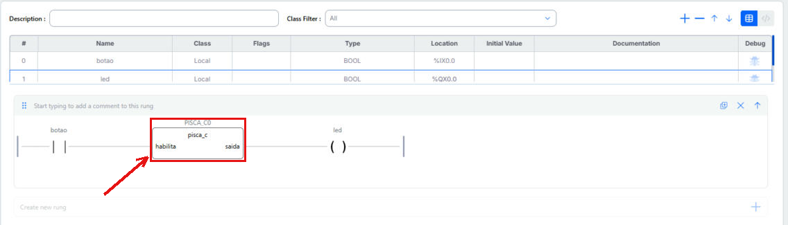

Como o `pisca_c` tem pinos, o bloco aparece com eles (`habilita` à
esquerda, `saida` à direita), e o fio do rung passa por eles direto. No
programa em texto, fica:

```pascal
PROGRAM main
  VAR
    botao : BOOL AT %IX0.0;
    led : BOOL AT %QX0.0;
    PISCA_C0 : pisca_c;
  END_VAR
```

Salve (**Ctrl+S**).

### Passo 5 — testar no simulador

Com a placa **OpenPLC Simulator**, clique no **▶** da barra lateral. O
Editor compila (console: *Compiling Structured Text to C++ with
STruC++...*, *Installing Arduino core...*), sobe o simulador e conecta o
debugger sozinho (*Debugger connected*). No `main`, clique duas vezes no
contato `botao` → **Force True**. O rung fica verde até o bloco, e a
bobina `led` passa a alternar entre verde (ligada) e azul (desligada):

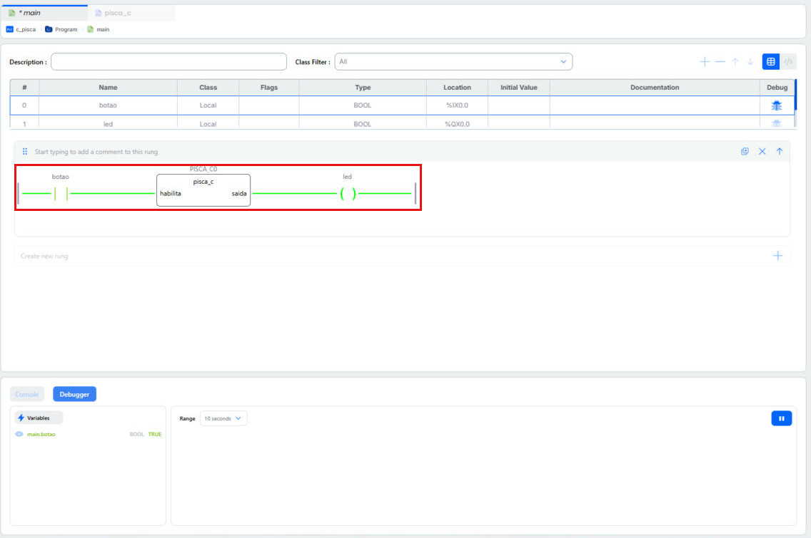

Para ver o pisca "de verdade", use o gráfico do debugger: na coluna
**Debug** da tabela de variáveis, clique no ícone de `botao` e no de
`PISCA_C0`; no painel **Debugger**, expanda `main.PISCA_C0` e clique no
olho ao lado de `saida`. Aparece uma **onda quadrada de 1 s** — 500 ms
ligada, 500 ms desligada:

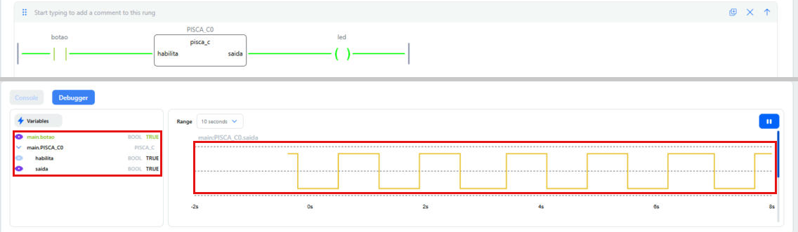

Repare que os pinos do bloco em C (`habilita`, `saida`) aparecem no
debugger como os de qualquer bloco padrão. As variáveis globais do C
(`estado`, `ultima_troca`) **não aparecem** — só os pinos.

Agora force o `botao` em **FALSE**: a `saida` para de piscar e fica
desligada — é o `if (!habilita)` do `loop()` agindo:

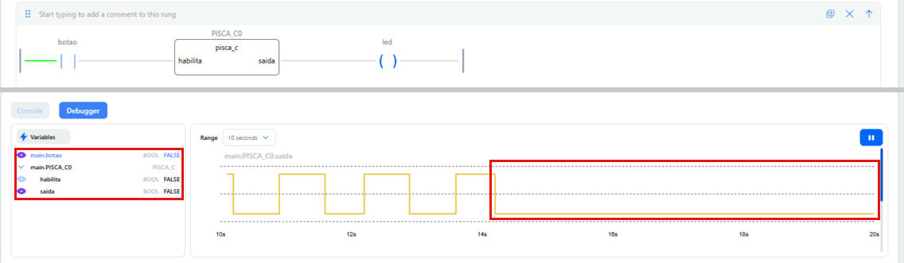

Para parar o simulador, clique no **■** (o mesmo botão do ▶).

> **Na placa:** para rodar no ESP32 em vez do simulador, troque a placa em
> **Device → Configuration** para *ESP32-DOIT DEVKIT V1* e mapeie
> `%IX0.0`/`%QX0.0` no **Pin Mapping** (ex.: GPIO 22 = entrada, GPIO 2 =
> LED da placa, como na seção 7). O código do bloco não muda nada.

> **Atenção — `Serial`/`printf` derruba o debugger.** Na primeira versão
> deste exemplo, o `setup()` tinha `Serial.begin(115200)` e um `printf`.
> Compilou normal, o debugger conectou — e caiu segundos depois
> (*simulator unresponsive → LOST*). Tirando essas duas linhas, tudo
> funcionou. O motivo está no código gerado: o debugger do Editor conversa
> com o CLP por Modbus **na própria `Serial`, a 115200** (`MBSERIAL_IFACE
> Serial` em `defines.h`). Um `printf` dentro do bloco joga bytes no meio
> dessa conversa. Detalhes na seção 5.

---

## 4. Nível 1 — servidor HTTP simples em Access Point (`server_ap`)

Em vez de **entrar** numa rede Wi-Fi existente, o ESP32 **cria a própria
rede** — modo **Access Point (AP)**. Isso não depende de nenhuma
infraestrutura de terceiros, o que é ideal para testar em sala de aula
(cada ESP32 vira sua própria ilha de rede).

No projeto (`c_func`), clique no `+`, escolha **Function Block**, dê um
nome (`server_ap`) e, na lista de linguagens, escolha **C/C++** — repare
que ela aparece ao lado das cinco linguagens da norma (Ladder, ST, IL,
FBD, SFC) e também de Python:

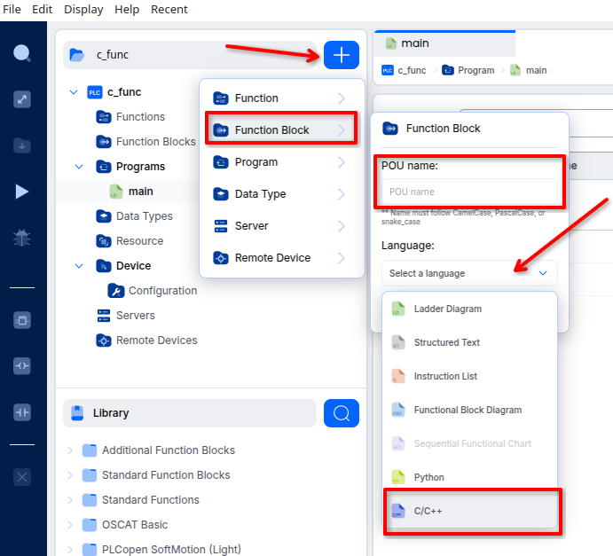

O corpo é escrito direto no editor de código do POU:

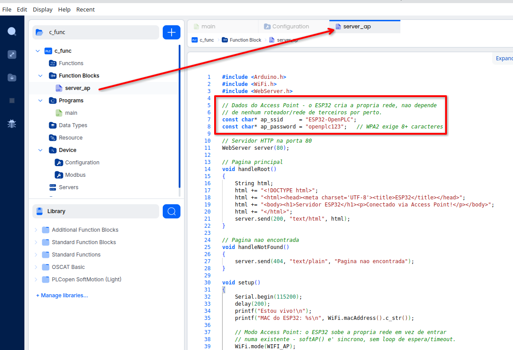

Em texto, para copiar/colar (o `FUNCTION_BLOCK server_ap` / `VAR` /
`END_VAR` do início é sintaxe IEC, não C++ — o corpo de verdade começa no
primeiro `#include`):

```cpp
#include <Arduino.h>
#include <WiFi.h>
#include <WebServer.h>

// Dados do Access Point - o ESP32 cria a propria rede, nao depende
// de nenhum roteador/rede de terceiros por perto.
const char* ap_ssid     = "ESP32-OpenPLC";
const char* ap_password = "openplc123";   // WPA2 exige 8+ caracteres

// Servidor HTTP na porta 80
WebServer server(80);

// Pagina principal
void handleRoot()
{
    String html;
    html += "<!DOCTYPE html>";
    html += "<html><head><meta charset='UTF-8'><title>ESP32</title></head>";
    html += "<body><h1>Servidor ESP32</h1><p>Conectado via Access Point!</p></body>";
    html += "</html>";
    server.send(200, "text/html", html);
}

// Pagina nao encontrada
void handleNotFound()
{
    server.send(404, "text/plain", "Pagina nao encontrada");
}

void setup()
{
    Serial.begin(115200);
    delay(200);
    printf("Estou vivo!\n");
    printf("MAC do ESP32: %s\n", WiFi.macAddress().c_str());

    // Modo Access Point: o ESP32 sobe a propria rede em vez de entrar
    // numa existente - softAP() e' sincrono, sem loop de espera/timeout.
    WiFi.mode(WIFI_AP);
    bool ok = WiFi.softAP(ap_ssid, ap_password);

    if (ok)
    {
        printf("Access Point '%s' no ar. Conecte um celular/PC nessa rede\n", ap_ssid);
        printf("e acesse http://%s no navegador.\n", WiFi.softAPIP().toString().c_str());
    }
    else
    {
        printf("FALHA ao criar o Access Point '%s'.\n", ap_ssid);
    }

    server.on("/", handleRoot);
    server.onNotFound(handleNotFound);
    server.begin();
}

void loop()
{
    server.handleClient();
}
```

### O que está acontecendo

- **`setup()`** sobe a rede Wi-Fi própria do ESP32 (`WiFi.softAP`) e um
  servidor HTTP simples, com uma rota `/` que devolve uma página HTML.
  Isso roda **uma vez só**, e só depois disso o `loop()` passa a rodar.
  Diferente do modo estação, `softAP()` é **síncrono** — devolve
  `true`/`false` na hora, sem precisar de um laço de espera.
- **`loop()`** chama `server.handleClient()` — a função da biblioteca
  `WebServer` que checa se algum navegador fez uma requisição e responde.
  Isso precisa rodar **a cada varredura**, senão o servidor não atenderia
  ninguém enquanto o CLP estivesse ocupado com outra coisa.
- O IP do Access Point é sempre o mesmo, por padrão: **`192.168.4.1`**.
  Para testar: procure a rede `ESP32-OpenPLC` no Wi-Fi do celular/PC,
  conecte com a senha `openplc123`, e acesse `http://192.168.4.1`.
- Nenhuma dessas bibliotecas (`WiFi.h`, `WebServer.h`) existe em
  ST/Ladder/FBD — é exatamente esse tipo de parede que um POU em C/C++
  atravessa.

### Por que isso é Function Block, e não Function

Os mesmos três motivos da aula 09, só que a memória aqui está "escondida"
dentro do C++ em vez de aparecer como `VAR_OUTPUT`:

- **Guarda estado entre varreduras**: o objeto `WebServer server` e o
  fato de já ter (ou não) rodado `setup()` precisam sobreviver de uma
  varredura para a outra — exatamente o que uma Function não faz.
- **Precisa de instância**: `SERVER_AP0` é uma variável, do mesmo jeito
  que `TON0` ou `MEU_CONTADOR0`.
- **Não é "mesma entrada, mesma saída"**: chamar esse bloco não devolve
  nada previsível de fora — o comportamento depende inteiramente do
  histórico (o AP já subiu? já tem alguém acessando a página?).

### Uso no `main`

No programa principal, é só declarar a instância e chamá-la — sem nenhum
fio de dado, já que este POU não declarou `VAR_INPUT`/`VAR_OUTPUT`:

```pascal
PROGRAM main
  VAR
    SERVER_AP0 : server_ap;
  END_VAR
```

Ele aparece em **User-defined POUs**, na biblioteca lateral, junto dos
blocos padrão — arraste para o rung como qualquer outro Function Block.
Sem `VAR_INPUT`/`VAR_OUTPUT` declarados (a versão deste nível), só
`EN`/`ENO` aparecem:

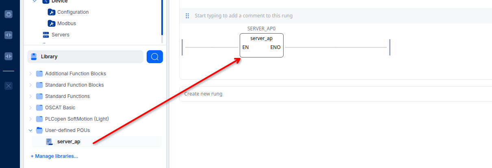

No rung, `EN` vai direto no trilho esquerdo e `ENO` no direito — o bloco
roda em toda varredura, sem condição, igual ao `meu_move` da aula 09:

```
trilho-esquerdo ──▶ EN [ server_ap ] ENO ──▶ trilho-direito
                         SERVER_AP0
```

Para testar: transfira para o ESP32, abra um terminal serial separado
(seção 5) para acompanhar os `printf`, e confirme pelo efeito observável
de fora — conectar no Wi-Fi `ESP32-OpenPLC` e acessar `http://192.168.4.1`.

---

## 5. Travamentos silenciosos e como depurar com `printf`/`Serial`

### O risco: travar a varredura inteira, sem nenhum aviso

Nada no compilador impede escrever, dentro de `setup()` ou `loop()`, um
`delay(5000)` ou um laço que nunca termina. Isso trava a varredura
**inteira** do CLP — todos os outros rungs, de todos os outros
programas, ficam esperando — e é **silencioso**: não aparece erro
nenhum, não aparece exceção, o modo debug do Editor simplesmente para de
atualizar, sem dizer por quê. É bem diferente de um erro numa expressão
ST, que o compilador rejeitaria antes mesmo de rodar.

A primeira versão do exemplo desta aula caiu exatamente nessa armadilha:

```cpp
while (WiFi.status() != WL_CONNECTED)
{
    delay(500);
}
```

Se a rede não existisse, ou a senha estivesse errada, esse laço nunca
terminava — e a primeira varredura do CLP ficava presa para sempre,
literalmente para sempre, sem nenhuma mensagem de erro em lugar nenhum.
Foi assim que a aula acabou migrando para o modo Access Point da seção
4: além de não depender de rede de terceiros, elimina esse laço de
espera (`softAP()` é síncrono).

O mesmo tipo de armadilha apareceu de novo mais adiante nesta aula, de um
jeito mais sutil: numa versão intermediária do exemplo, o Access Point só
subia quando um pino de entrada estivesse `TRUE` — só que, sem o AP no
ar, não havia como alcançar a página pra ligar/observar esse pino em
primeiro lugar. Não era um travamento de scan, mas o mesmo princípio: uma
dependência circular que só aparece quando se testa de verdade. A seção 8
mostra a versão corrigida.

### A ferramenta: `printf`/`Serial.print`

Como visto na seção anterior, o exemplo já usa `printf` para deixar
rastro do que está acontecendo:

```cpp
Serial.begin(115200);
printf("Estou vivo!\n");
printf("MAC do ESP32: %s\n", WiFi.macAddress().c_str());
...
printf("Access Point '%s' no ar. ... http://%s\n", ap_ssid, WiFi.softAPIP().toString().c_str());
```

No ESP32 (Arduino core), `printf` sai pela mesma porta serial que
`Serial.print` — é só uma forma mais prática de montar a mensagem com
`%s`/`%d` em vez de concatenar `String`. **O `Serial.begin(115200)` tem
que rodar antes**, ou nada sai.

### `printf` e o debugger do Editor não convivem

A `Serial` que o seu bloco usa para `printf` **é a mesma** que o OpenPLC
usa para o debugger/Modbus. Dá para ver isso no código gerado
(`build/<placa>/src/defines.h`):

```cpp
#define MBSERIAL_IFACE Serial
#define MBSERIAL_BAUD 115200
```

Ou seja: enquanto o Editor está em modo debug, ele está conversando com o
CLP por Modbus RTU nessa porta, a 115200. Um `printf` dentro do bloco
joga texto no meio desses quadros Modbus, e a conexão cai. Foi o que
aconteceu ao testar o `pisca_c` da seção 3 com um `printf` no `setup()`:
o debugger conectou e, segundos depois, *simulator unresponsive →
enter-recovery → LOST*. Sem o `printf`, ficou estável. Na prática:

- **Ou** você depura pelo Editor (debug ao vivo, gráfico, forçar
  variáveis) — e o bloco **não** usa `Serial`/`printf`;
- **ou** você depura pelo terminal serial (abaixo) — e o Editor fica
  **desconectado**.

Para passar informação do C para o debug do Editor sem `printf`, declare
um pino a mais (`VAR_OUTPUT`) e escreva nele: ele aparece no debugger
como qualquer outro pino (seção 3, passo 5).

### Onde esses `printf` aparecem? Em lugar nenhum do Editor

Este é o ponto mais importante: **nada disso aparece na tela do OpenPLC
Editor** — nem no modo debug, nem em nenhum log da ferramenta. São bytes
crus saindo pela porta serial (a mesma porta USB usada para gravar o
ESP32), e só aparecem se algo do **outro lado** estiver ouvindo essa
porta. É preciso abrir um **terminal serial separado**, como extensão
"Serial Monitor" do VS Code:

1. Grave o programa no ESP32 e **feche/libere a porta serial** no lado
   do OpenPLC Editor — só um programa por vez pode manter a porta
   aberta; se a ferramenta de gravação ainda estiver com ela presa, o
   monitor não consegue abrir.
2. No VS Code, abra a extensão/painel **Serial Monitor** (paleta de
   comandos → *Serial Monitor: Start Monitoring*, ou o painel dedicado
   se a extensão já estiver instalada).
3. Selecione a **mesma porta** usada para gravar o ESP32 (ex.:
   `/dev/ttyUSB0`) e o **mesmo baud rate** passado para
   `Serial.begin(...)` no código — aqui, `115200`.
4. Depois de conectado, resete o ESP32 (botão físico, ou desconecte e
   reconecte o USB) para ver o `setup()` rodar do zero — as linhas
   `printf` vão aparecer ao vivo nesse painel, fora do Editor.

Sem isso, um POU em C/C++ sem `VAR_INPUT`/`VAR_OUTPUT` é uma caixa preta
total: nada dele aparece na tabela de variáveis nem no live debug do
OpenPLC — o `printf`/terminal serial é, muitas vezes, a **única** janela
para o que está acontecendo lá dentro.

---

## 6. Cuidados e limites de usar C/C++ dentro do OpenPLC

Sair da norma tem preço. Antes de escrever um POU em C/C++, vale pesar:

- **Perde portabilidade.** O código só compila para alvos que tenham as
  bibliotecas que ele usa. O `pisca_c` (só `Arduino.h`/`millis()`) roda
  no simulador e no ESP32; o `server_ap` (`WiFi.h`/`WebServer.h`) só no
  ESP32. Trocar de hardware pode quebrar o POU inteiro.
- **Perde a disciplina de varredura determinística.** Ver seção 5 —
  qualquer chamada bloqueante dentro de `loop()` trava o CLP inteiro,
  silenciosamente, o oposto do que um `TON` faz com segurança dentro do
  modelo IEC (nunca bloqueia o scan).
- **Perde visibilidade de debug live.** Sem `VAR_INPUT`/`VAR_OUTPUT`,
  nada do POU aparece no modo debug do Editor — só no terminal serial
  (seção 5), ou observando o efeito de fora (ex.: acessar a página HTTP).
  A seção 7 mostra como recuperar parte dessa visibilidade, declarando
  pinos de verdade.
- **Ainda assim é um Function Block "de verdade".** Tudo que a aula 09
  disse sobre instância e memória continua valendo — só que, em vez dos
  blocos prontos da norma, quem gerencia a memória é você, em C++ puro.

---

## 7. Nível 2 — AP com entrada e saída conectadas ao Ladder

O nível 1 não trocou nenhum dado com o resto do programa — só `EN`/`ENO`,
sem fios. Isso funciona, mas desperdiça a maior vantagem de estar dentro
do OpenPLC: poder ligar esse bloco a contatos, bobinas e outros POUs do
programa, do mesmo jeito que qualquer bloco padrão.

A receita é a mesma da aula 09: declarar `VAR_INPUT`/`VAR_OUTPUT` no
POU. A diferença é só **como acessar esses pinos dentro do código C++**
— pelo nome direto, como a macro da seção 2 explica.

Este nível é deliberadamente simples — só prova que os pinos chegam vivos
dentro do bloco, sem página nenhuma envolvida ainda (isso fica pro nível
3, seção 8):

Os pinos são declarados em sintaxe IEC, não C++:

```pascal
FUNCTION_BLOCK server_ap
  VAR_INPUT
    entrada : BOOL := false;
  END_VAR
  VAR_OUTPUT
    led_saida : BOOL := false;
  END_VAR
```

O corpo, a partir daqui, é C++ puro:

```cpp
#include <Arduino.h>
#include <WiFi.h>
#include <WebServer.h>

const char* ap_ssid     = "ESP32-OpenPLC";
const char* ap_password = "openplc123";

WebServer server(80);

void handleRoot() { server.send(200, "text/html", "<h1>Servidor ESP32</h1>"); }
void handleNotFound() { server.send(404, "text/plain", "Pagina nao encontrada"); }

void setup()
{
    Serial.begin(115200);

    WiFi.mode(WIFI_AP);
    bool ok = WiFi.softAP(ap_ssid, ap_password);
    printf("server_ap: AP %s (IP=%s)\n", ok ? "iniciado" : "falhou",
           WiFi.softAPIP().toString().c_str());

    server.on("/", handleRoot);
    server.onNotFound(handleNotFound);
    server.begin();
}

void loop()
{
    server.handleClient();

    // repete direto o pino de entrada na saida - so' pra provar que os
    // pinos chegam vivos aqui dentro, sem nenhuma pagina interativa ainda
    led_saida = entrada;
}
```

No Editor, o POU ganha as duas linhas de pino na tabela de variáveis
(`entrada`/`led_saida`), e o `loop()` é onde a ponte pino↔pino acontece:

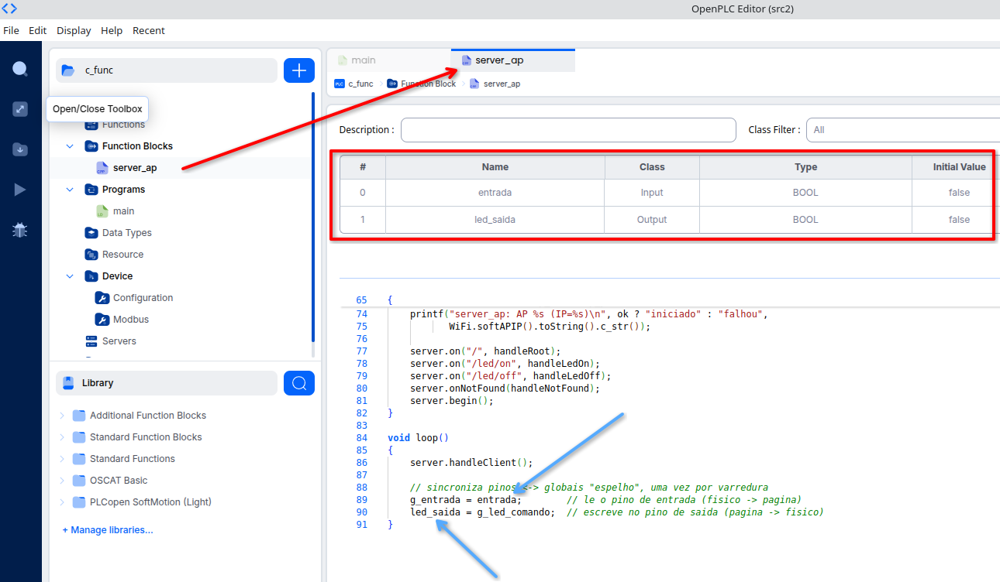

- `entrada` **lê** o pino de entrada — o nome do pino sozinho já expande
  para o acesso correto (`*(vars->ENTRADA)`), então funciona como
  qualquer variável `BOOL` normal em C++.
- `led_saida = ...` **escreve** no pino de saída — na próxima varredura,
  esse valor já está disponível pra qualquer rung do `main` que o
  utilizar.
- **Cuidado:** não prefixe o nome do pino com `vars->` no seu código — o
  `#define` gerado pelo compilador já faz esse trabalho. Escrever
  `vars->entrada` quebra a expansão da macro e não compila (é exatamente
  o erro que apareceu ao testar este exemplo pela primeira vez).
- O AP sobe sozinho em `setup()`, sem depender de nenhum pino. Uma versão
  anterior deste exemplo tentava ligar/desligar o AP por um pino de
  entrada — e caiu na armadilha citada na seção 5: sem o AP no ar, não
  tinha como alcançar a página pra controlar esse mesmo pino. Pinos de
  entrada aqui servem só pra **trocar dados com o Ladder**, nunca pra
  decidir se o servidor existe ou não.

### Uso no `main`

```pascal
PROGRAM main
  VAR
    liga        : BOOL AT %IX0.0;   (* entrada fisica: botao/chave *)
    led         : BOOL AT %QX0.0;   (* saida fisica: LED *)
    SERVER_AP0  : server_ap;
  END_VAR
```

```
liga ──▶ entrada [ server_ap ] led_saida ──▶ led
                     SERVER_AP0
```

No Editor, isso vira uma instância `SERVER_AP0` na tabela de variáveis do
`main`, com `liga` ligado em `entrada` e `led_saida` ligado em `led`:

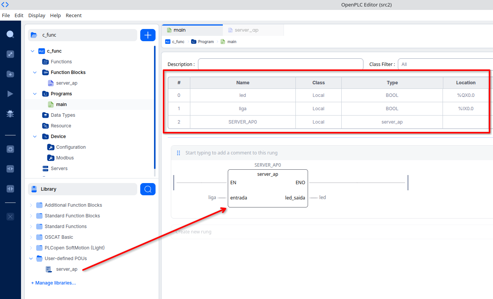

A partir daqui, `SERVER_AP0` aparece na tabela de variáveis com
`entrada` e `led_saida` visíveis — inclusive no modo debug do Editor,
recuperando parte da visibilidade que a seção 6 disse que se perde com
C/C++ puro. **Mas:** para usar o debug do Editor, tire o
`Serial.begin`/`printf` do `setup()` — eles disputam a mesma porta serial
com o debugger (seção 5). Use o `printf` só enquanto estiver depurando
pelo terminal serial, com o Editor desconectado.

`liga` e `led` são pinos físicos de verdade — no **Pin Mapping** da placa
(aba **Configuration**), `liga` está no GPIO 22 (entrada digital) e `led`
no GPIO 2 (saída digital):

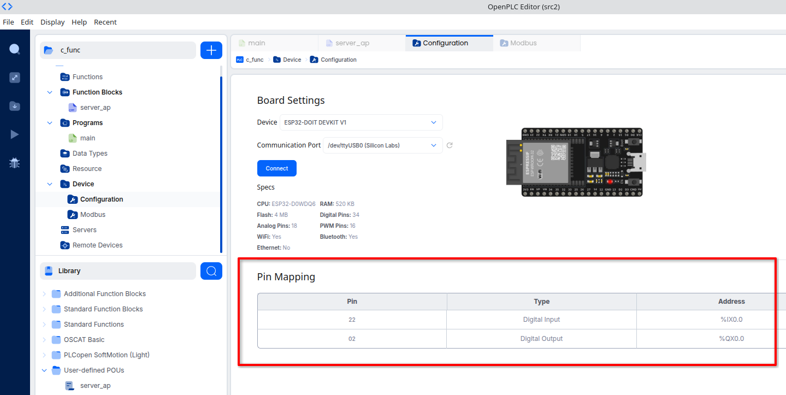

---

## 8. Nível 3 — detecção de entrada e acionamento remoto de saída pela página

O nível 2 provou que os pinos chegam vivos no C++. Este nível junta as
duas pontas que fazem esse exemplo valer a pena: **mostrar** o estado de
uma entrada física na página, e **acionar remotamente** uma saída a
partir de um clique na página — o painel de controle de verdade.

### A pegadinha do `vars` fora de `setup()`/`loop()`

As funções de rota do `WebServer` (`handleRoot`, `handleLedOn`...) são
chamadas pela própria biblioteca com a assinatura fixa `void()` — **sem**
o ponteiro `vars`. Isso significa que o `#define` dos pinos (que expande
para `*(vars->NOME)`) **não funciona dentro delas**: não existe `vars`
nesse escopo, e o compilador rejeitaria a macro.

A solução é usar `loop()` (que *tem* `vars` em escopo) como uma **ponte**:
a cada varredura, ele copia o pino de entrada para uma variável global
comum, e copia uma variável global comum para o pino de saída. As rotas
da página só leem/escrevem essas globais, nunca os pinos diretamente:

Os pinos são declarados em sintaxe IEC (não é C++ — por isso os
comentários usam `(* ... *)`, e não `//`):

```pascal
FUNCTION_BLOCK server_ap
  VAR_INPUT
    entrada : BOOL := false;   (* so' para MOSTRAR na pagina - nao controla o AP *)
  END_VAR
  VAR_OUTPUT
    led_saida : BOOL := false;   (* comandado pela chave da pagina *)
  END_VAR
```

O corpo, a partir daqui, é C++ puro:

```cpp
#include <Arduino.h>
#include <WiFi.h>
#include <WebServer.h>

const char* ap_ssid     = "ESP32-OpenPLC";
const char* ap_password = "openplc123";

WebServer server(80);

// Copias em variaveis globais "normais" - handleRoot()/handleLedOn()/
// handleLedOff() sao chamadas pelo WebServer com a assinatura void(),
// SEM o ponteiro "vars", entao NAO enxergam os pinos (que so existem
// via o #define que aponta pra vars->...). Só loop() (que vira
// server_ap_loop(vars)) tem "vars" no escopo. Por isso loop() copia o
// pino de entrada pra uma global a cada varredura, e a pagina web só
// le/escreve nessas globais - nunca nos pinos diretamente.
bool g_entrada     = false;   // espelho do pino de entrada, pra pagina mostrar
bool g_led_comando = false;   // estado pedido pela pagina, pro loop() escrever no pino

String pagina_html()
{
    String html;
    html += "<!DOCTYPE html><html><head><meta charset='UTF-8'>";
    html += "<meta http-equiv='refresh' content='2'>";  // recarrega sozinha a cada 2s
    html += "<title>ESP32 - OpenPLC</title></head><body>";
    html += "<h1>Painel ESP32</h1>";

    html += "<p>Entrada fisica: <b style=\"color:";
    html += g_entrada ? "green" : "red";
    html += "\">";
    html += g_entrada ? "LIGADA" : "DESLIGADA";
    html += "</b></p>";

    html += "<p>LED: <b>";
    html += g_led_comando ? "LIGADO" : "DESLIGADO";
    html += "</b></p>";

    html += "<p>";
    html += "<a href=\"/led/on\"><button>Ligar LED</button></a> ";
    html += "<a href=\"/led/off\"><button>Desligar LED</button></a>";
    html += "</p>";

    html += "</body></html>";
    return html;
}

void handleRoot()     { server.send(200, "text/html", pagina_html()); }
void handleNotFound() { server.send(404, "text/plain", "Pagina nao encontrada"); }

void handleLedOn()
{
    g_led_comando = true;
    server.sendHeader("Location", "/");
    server.send(303);   // redireciona de volta pra pagina principal
}

void handleLedOff()
{
    g_led_comando = false;
    server.sendHeader("Location", "/");
    server.send(303);
}

void setup()
{
    Serial.begin(115200);

    // O AP sobe uma unica vez aqui, sem depender de nenhum pino -
    // se dependesse de "entrada", nao teria como alcancar a pagina
    // pra ver/mudar esse estado antes do AP existir (paradoxo do ovo
    // e da galinha, seção 5). softAP() e' sincrono, sem loop de espera.
    WiFi.mode(WIFI_AP);
    bool ok = WiFi.softAP(ap_ssid, ap_password);
    printf("server_ap: AP %s (IP=%s)\n", ok ? "iniciado" : "falhou",
           WiFi.softAPIP().toString().c_str());

    server.on("/", handleRoot);
    server.on("/led/on", handleLedOn);
    server.on("/led/off", handleLedOff);
    server.onNotFound(handleNotFound);
    server.begin();
}

void loop()
{
    server.handleClient();

    // sincroniza pinos <-> globais "espelho", uma vez por varredura
    g_entrada = entrada;        // le o pino de entrada (fisico -> pagina)
    led_saida = g_led_comando;  // escreve no pino de saida (pagina -> fisico)
}
```

### Detalhes de HTML: como a página conversa com o C++

Todo o mecanismo de interação é feito de **requisições HTTP simples**,
sem JavaScript. Vale entender as três peças, porque o exercício da
seção 9 pede pra você estender exatamente isso:

- **Rota = `server.on(caminho, funcao)`.** Cada URL que a página pode
  chamar precisa de uma rota registrada em `setup()`. Aqui há três:
  `/` (mostra a página), `/led/on` e `/led/off` (mudam o estado e
  redirecionam de volta).
- **Botão que só liga/desliga = link simples.** `<a href="/led/on">`
  dentro de um `<button>` faz o navegador simplesmente **visitar** essa
  URL — um `GET` sem corpo, sem nenhum dado extra. É suficiente quando a
  ação não carrega **valor** nenhum, só um comando fixo.
- **Redirecionar depois de agir = `303 + Location`.** Depois de mudar
  `g_led_comando`, a rota responde `server.send(303)` com
  `server.sendHeader("Location", "/")` — isso manda o navegador buscar a
  página principal de novo, já atualizada, em vez de mostrar uma página
  em branco ou deixar o botão "reenviável" ao atualizar.
- **`<meta http-equiv="refresh" content="2">`** faz a própria página
  recarregar sozinha a cada 2 segundos — é assim que o estado da
  `entrada` aparece "ao vivo" sem precisar de JavaScript nenhum.

O que falta para **mandar um valor** (não só ligar/desligar) é uma quarta
peça, que o exercício da seção 9 vai pedir (agora em
[exercicio-potenciometro-pwm-enunciado.md](exercicio-potenciometro-pwm-enunciado.md)):
um **formulário** com um controle deslizante, e uma rota que lê esse
valor:

```html
<form action="/pwm" method="GET">
  <input type="range" name="valor" min="0" max="255" value="128">
  <input type="submit" value="Aplicar">
</form>
```

```cpp
void handlePwm()
{
    if (server.hasArg("valor"))
    {
        int v = server.arg("valor").toInt();   // valor chega como texto - precisa converter
        // ... aplicar "v" em algum lugar (variavel global espelho, PWM, etc.) ...
    }
    server.sendHeader("Location", "/");
    server.send(303);
}
```

`method="GET"` faz o navegador montar a URL como `/pwm?valor=128` —
`server.arg("valor")` lê esse pedaço da URL como texto, e `.toInt()`
converte pra número. É o mesmo mecanismo dos botões (`server.on` +
redirecionamento), só que agora carregando um número em vez de nada.

### Uso no `main`

Sem mudança em relação ao nível 2 — mesma instância, mesmos pinos
`entrada`/`led_saida`. O que mudou foi só o **conteúdo** do POU:

```pascal
PROGRAM main
  VAR
    liga        : BOOL AT %IX0.0;   (* entrada fisica: botao/chave que aparece na pagina *)
    led         : BOOL AT %QX0.0;   (* saida fisica: LED controlado pela pagina *)
    SERVER_AP0  : server_ap;
  END_VAR
```

```
liga ──▶ entrada [ server_ap ] led_saida ──▶ led
                     SERVER_AP0
```

Para testar: conecte no Wi-Fi `ESP32-OpenPLC`, acesse
`http://192.168.4.1`, aperte o botão físico ligado em `liga` e veja o
texto da página mudar (até 2s de atraso, por causa do refresh), e use os
botões **Ligar LED**/**Desligar LED** da página pra acender o LED físico
de verdade.

---

## 9. Exercício proposto

A aula continua num exercício separado, aplicando os três níveis acima
com **valores** (não só liga/desliga): mostrar a leitura de um
potenciômetro na página, e um slider na página ajustando um PWM que
controla o brilho de um LED.

> **[exercicio-potenciometro-pwm-enunciado.md](exercicio-potenciometro-pwm-enunciado.md)**

---

## 10. Ideias para outros POUs em C/C++ (aplicações)

Sem código completo aqui — são pontos de partida para exercícios futuros,
no mesmo espírito da seção de aplicações da aula 09:

- **Sensor com biblioteca própria** — um DHT22 ou DS18B20 (protocolo
  one-wire, sensível a timing) tem biblioteca Arduino pronta, mas nenhum
  bloco ST/Ladder padrão fala esse protocolo.
- **Armazenamento não-volátil** — usar `Preferences`/EEPROM do ESP32 para
  um valor (ex.: um contador de produção) sobreviver a uma queda de
  energia — coisa que nenhuma variável comum do OpenPLC faz sozinha,
  porque vive em RAM.
- **Protocolos fora do escopo da norma** — cliente MQTT, requisição HTTP
  de saída, Bluetooth — qualquer coisa que dependa de pilha de rede.
- **Bibliotecas de terceiros** — qualquer biblioteca Arduino/ESP-IDF já
  pronta para um chip ou módulo específico, sem reescrever do zero em ST.

---

## 11. Quadro-resumo

| Pergunta | Resposta rápida |
|---|---|
| Um POU em C/C++ no OpenPLC é Function ou Function Block? | Function Block — guarda estado (variáveis globais/estáticas do próprio C++) entre varreduras |
| O que roda só uma vez? | `setup()` — na primeira varredura daquela instância |
| O que roda toda varredura? | `loop()` |
| Como esperar um tempo dentro de `loop()`? | Com `millis()` (comparar o tempo que passou e sair), nunca `delay()` — igual ao `pisca_c` da seção 3 |
| Variáveis globais do C são por instância? | **Não** — existem uma vez só para todas as instâncias; só os pinos são por instância |
| Onde ficam os pinos `VAR_INPUT`/`VAR_OUTPUT` dentro do código? | Como campos de um struct (`vars`); acesse pelo **nome do pino direto** (`entrada`), nunca `vars->entrada` — o `#define` gerado já faz a ponte |
| Por que uma rota do `WebServer` (`handleRoot`...) não pode ler um pino direto? | Ela não recebe o ponteiro `vars` — só `setup()`/`loop()` recebem. `loop()` precisa copiar o valor pra uma global antes |
| Maior risco de escrever C/C++ dentro de um POU? | Bloquear a varredura inteira do CLP com um `delay()`/laço infinito, de forma silenciosa (sem erro nenhum no Editor) |
| Onde aparecem os `printf`/`Serial.print`? | Em nenhum lugar do Editor — só num terminal serial separado (ex.: Serial Monitor do VS Code), na mesma porta e baud rate |
| Dá pra usar `printf` e o debugger do Editor juntos? | Não — os dois usam a mesma `Serial` (115200); o `printf` derruba a conexão de debug |
| Como testar um bloco em C sem placa? | Placa **OpenPLC Simulator** + ▶, desde que o código só use `Arduino.h` (nada de `WiFi.h`) |
| Por que o AP não pode depender de um pino de entrada pra subir? | Sem o AP no ar não há como alcançar a página pra controlar esse pino — paradoxo do ovo e da galinha |
| Como a página manda um botão liga/desliga pro C++? | Um link (`<a href="/rota">`) que dispara um `GET` simples numa rota registrada com `server.on(...)` |
| Como a página manda um **valor** (não só liga/desliga)? | Um `<form method="GET">` com `<input type="range">`; o valor chega via `server.arg("nome")` como texto |
| O que se perde ao sair da norma IEC 61131-3? | Portabilidade entre alvos e disciplina de scan determinística — visibilidade de debug se recupera parcialmente com `VAR_INPUT`/`VAR_OUTPUT` (seção 7) |
