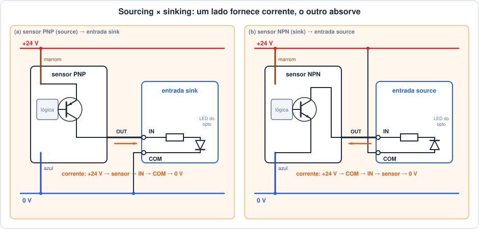
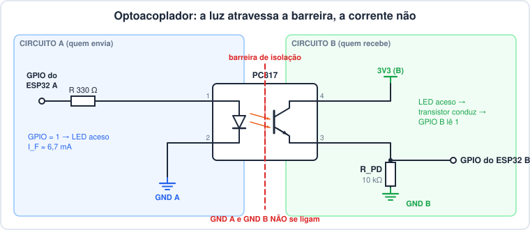
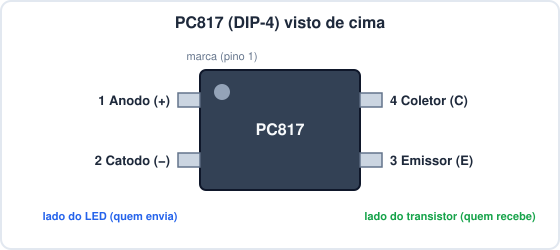
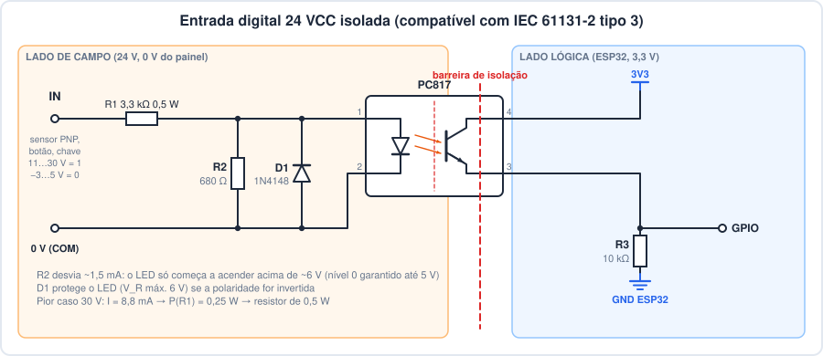
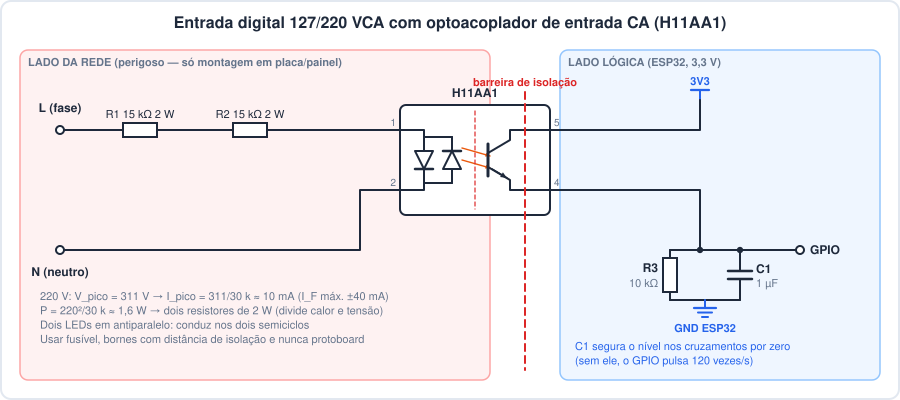
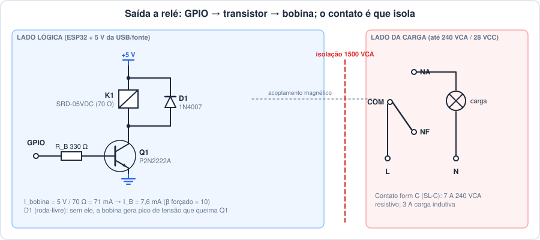
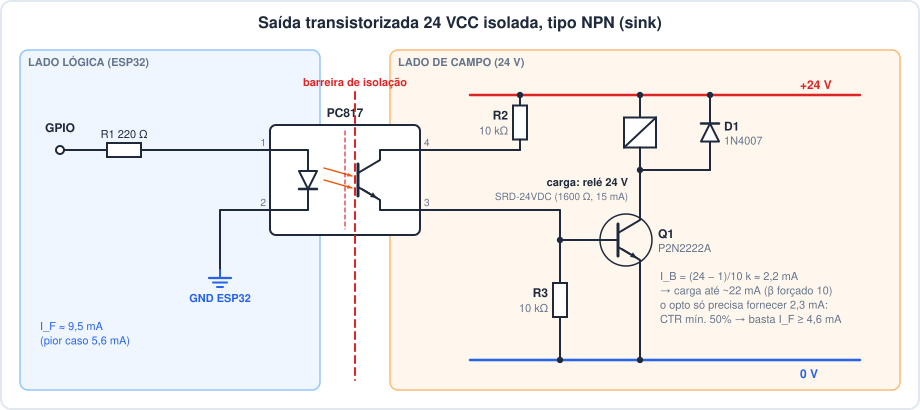
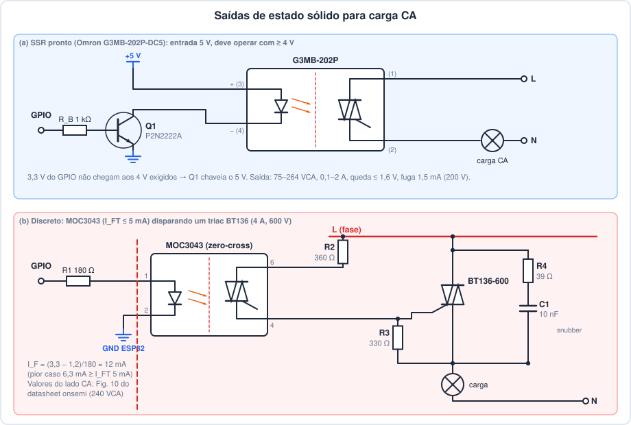
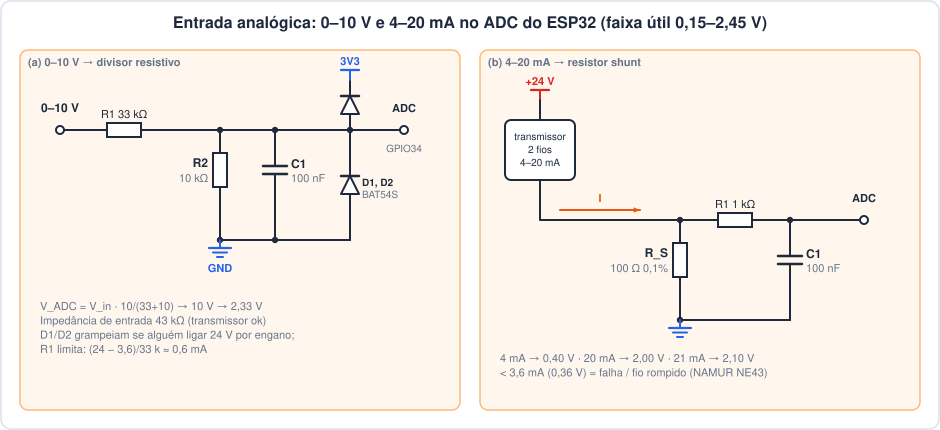
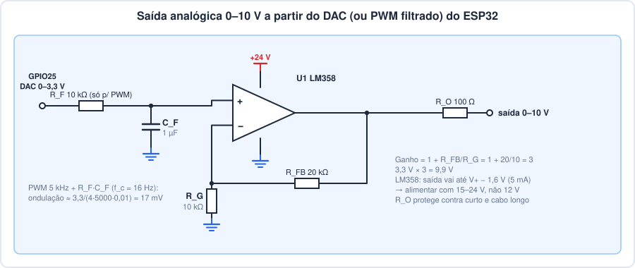

# Aula: Interface de E/S industrial com o ESP32 (24 V, 127/220 V e sinais analógicos)

> Aula de **hardware**. A pergunta é uma só: como ligar um sensor de
> 24 V, uma botoeira em 220 V ou um transmissor 4–20 mA num pino que
> aguenta **3,6 V no máximo**, sem queimar nada e sem que um defeito no
> campo chegue até o microcontrolador? Todos os cálculos usam valores
> tirados dos **datasheets** dos componentes; a lista está nas
> [Referências](#referências).

## Pré-requisitos

- **[Partida de motor com ESP32](../04-partida-motor-esp32/partida-motor-esp32.md)**
  (aula 04): pull-down, módulo relé, regra "a GPIO nunca toca a carga".
- **[Variáveis no OpenPLC](../07-variaveis-openplc/variaveis-openplc.md)**
  (aula 07): entrada/saída analógica `%IW`/`%QW` e conversão de escala.
- Lei de Ohm, potência (P = V·I = I²·R) e noção de diodo e transistor.

---

## 1. Dois mundos de tensão

| | Mundo do ESP32 | Mundo industrial ("campo") |
|---|---|---|
| Alimentação | 3,3 V | 24 VCC (comando), 127/220 VCA (rede), 380 VCA (força) |
| Nível lógico 1 | ≥ 2,475 V | 11…30 V (entrada 24 V) |
| Corrente de um sinal | µA a poucos mA | 2…15 mA (entrada), até centenas de mA (saída) |
| Cabos | centímetros na placa | dezenas de metros junto de motores e inversores |
| Analógico | 0…~2,5 V no ADC | 0–10 V ou 4–20 mA |

Os limites do lado esquerdo saem do **ESP32 Series Datasheet v5.3**
(Espressif), tabelas 5-1 e 5-3:

| Parâmetro (datasheet ESP32) | Valor | O que significa na prática |
|---|---|---|
| VDD (máx. absoluto) | 3,6 V | acima disso o chip pode ser danificado |
| V_IH mín. / V_IL máx. | 0,75 × VDD = **2,475 V** / 0,25 × VDD = **0,825 V** | entre os dois a leitura é indefinida |
| Tensão máx. num pino de entrada | VDD + 0,3 V = **3,6 V** | 5 V, 12 V ou 24 V direto no pino queimam a entrada |
| V_OH mín. (saída em 1) | 0,8 × VDD = **2,64 V** | use 2,64 V no cálculo de **pior caso**, não 3,3 V |
| I_OH (fornecer) / I_OL (absorver) | 40 mA / 28 mA (típ., força máxima) | cai para ~29 mA por pino se vários pinos fornecem corrente ao mesmo tempo |
| Corrente total de todos os pinos | 1200 mA (máx. absoluto) | |
| Pull-up/pull-down interno | 45 kΩ | o OpenPLC não liga esses resistores (aula 04) |

Por que **isolar**, e não só "abaixar a tensão":

1. **Tensão** — 24 V no pino do ESP32 é quase 7× o máximo absoluto.
2. **Ruído e surtos** — cabos longos, ao lado de motores e contatores,
   captam picos de centenas de volts. Se o pino estiver ligado
   eletricamente ao campo, esses picos chegam até o chip.
3. **Laços de terra** — o "0 V" do painel e o GND do ESP32 (que pode estar
   ligado num computador pela USB) não estão no mesmo potencial. Ligar
   os dois faz circular corrente pelos fios de sinal.
4. **Segurança** — se um fio de 220 V encostar no circuito de campo, a
   barreira de isolação impede que essa tensão chegue até a USB e até
   quem está mexendo no computador.

A peça que resolve os quatro problemas ao mesmo tempo é o
**optoacoplador** (seção 5). Para saídas, o **relé**, que também isola
(seção 8).

---

## 2. Lendo um datasheet para fazer conta

Todo cálculo desta aula segue o mesmo roteiro:

1. **Máximos absolutos** (*Absolute Maximum Ratings*): limites que **nunca**
   podem ser ultrapassados, nem por um instante. **Não** são condição de
   trabalho; o projeto fica bem abaixo deles.
2. **Características elétricas** (*Electrical/Electro-optical
   Characteristics*): valores **mín./típ./máx.** com uma **condição de
   teste** (ex.: "CTR mín. 50 % **com I_F = 5 mA e V_CE = 5 V**"). Um
   valor sem a condição de teste não serve para nada.
3. **Curvas** (*Characteristic Data*): mostram como o componente se
   comporta fora do ponto de teste (outra corrente, outra temperatura).
   O próprio datasheet avisa que as curvas são **referência, não
   garantia**.
4. **Pior caso**: some as tolerâncias contra você. Por exemplo, a saída do
   ESP32 com o V_OH mínimo (2,64 V), o LED do opto com o V_F máximo, o CTR
   mínimo e a temperatura mais alta. O circuito tem que funcionar assim
   também, não só "na bancada, com tudo típico".

---

## 3. Padrões de sinal industrial

### 3.1 Entradas digitais 24 VCC — IEC 61131-2

A norma de CLPs (IEC 61131-2) define três **tipos** de entrada digital
24 V. Um cartão de entrada "tipo 3" tem que aceitar os limites abaixo:

| | Tipo 1 | Tipo 2 | Tipo 3 |
|---|---|---|---|
| Nível 0 (tensão) | −3 … +5 V | −3 … +5 V | −3 … +5 V |
| Nível 1 (tensão) | 15 … 30 V | 11 … 30 V | 11 … 30 V |
| Nível 1 (corrente) | 2 … 15 mA | 6 … 30 mA | 2 … 15 mA |
| Uso típico | chaves, sensores 3 fios | sensores **2 fios** (precisam de corrente de repouso) | o mais comum hoje: 3 fios, baixo consumo |

> Fontes: tabela da Analog Devices e nota de aplicação da Beckhoff
> (ver [Referências](#referências)). As duas concordam que o nível 0 vai
> até +5 V; para projeto certificado, consulte o texto da norma.

A **faixa de transição** (5…11 V) existe de propósito: ali a entrada pode
ler 0 ou 1, e o sensor tem que ficar sempre fora dela. A corrente mínima de
2 mA também tem motivo: um contato com corrente muito baixa não "limpa" a
oxidação da superfície, e um cabo longo capta ruído com facilidade.

### 3.2 Sinais analógicos

| Sinal | Faixa | Vantagem | Desvantagem |
|---|---|---|---|
| 0–10 V | 0 V = 0 %, 10 V = 100 % | simples; mede com divisor | queda no cabo vira erro; "0 V" pode ser fio rompido |
| 4–20 mA | 4 mA = 0 %, 20 mA = 100 % | corrente não cai no cabo; **zero vivo**: < 3,6 mA = falha (NAMUR NE43) | precisa de resistor *shunt* e de fonte para o laço |

### 3.3 Rede elétrica (Brasil)

127 V ou 220 V eficazes, **60 Hz**. A tensão de pico é V_rms × √2:
**180 V** em 127 V e **311 V** em 220 V. Com a tolerância de +10 %, o pico
de 220 V chega a **342 V**. É com esse valor que se dimensionam a tensão e
a isolação dos componentes.

---

## 4. Sink × source, PNP × NPN

Num circuito de 24 V, quem **fornece** corrente para o outro é *source*
(fonte), e quem **absorve** a corrente e a leva para o 0 V é *sink*
(dreno). Um sinal sempre liga um *source* a um *sink*:



| Sensor (saída) | Comportamento | Liga em entrada | Corrente |
|---|---|---|---|
| **PNP** | chaveia o **+24 V** para o fio de saída (*source*) | **sink** (a entrada vai internamente para o 0 V) | sai do sensor, entra no CLP |
| **NPN** | chaveia o **0 V** para o fio de saída (*sink*) | **source** (a entrada vai internamente para o +24 V) | sai do CLP, entra no sensor |

- **Cores do sensor de 3 fios** (padrão IEC 60947-5-2): marrom = +24 V,
  azul = 0 V, preto = saída.
- Na Europa e no Brasil predomina o **PNP**: o sinal ativo é "tem
  24 V". Equipamento asiático costuma usar NPN.
- **Cuidado com o nome**: alguns fabricantes chamam a entrada sink de
  "entrada PNP", porque ela recebe sensor PNP, e outros de "entrada
  positiva". Não confie no rótulo: olhe o desenho de ligação no manual.
- **Tensão residual**: um sensor ligado não entrega exatamente 24 V. A
  saída cai cerca de 1–2 V; confira no catálogo do sensor. Um sensor PNP
  ligado entrega ~22 V, que está longe dos 11 V mínimos.
- **Entrada universal**: muitos CLPs usam um opto com **dois LEDs em
  antiparalelo** (PC814, H11AA1, seção 7) e um borne comum (S/S). Com o
  comum no 0 V, a entrada aceita sensor PNP; com o comum no +24 V, aceita
  NPN.

---

## 5. Optoacoplador

Um LED infravermelho e um fototransistor no mesmo encapsulamento,
separados por um isolante transparente. Quando passa corrente no LED, a
luz faz o transistor conduzir. Entre os dois lados passa **luz**, não
corrente: cada lado tem o seu próprio GND.





### 5.1 O que o datasheet do PC817 diz

Valores do datasheet **Sharp PC817X Series** (folha D2-A03101EN), a
25 °C:

| Parâmetro | Valor | Condição | Para que serve |
|---|---|---|---|
| I_F máx. (LED) | 50 mA | máx. absoluto | limite da corrente no LED |
| V_R máx. (LED) | 6 V | máx. absoluto | o LED **não** aguenta tensão reversa alta |
| V_F (LED) | 1,2 V típ. / 1,4 V máx. | I_F = 20 mA | queda no LED, usada no cálculo do resistor |
| V_CEO máx. | 80 V (35 V em peças com código de data até jul/2002) | máx. absoluto | maior tensão no lado do transistor |
| I_C máx. | 50 mA | máx. absoluto | |
| **CTR** | **50 … 600 %** | I_F = 5 mA, V_CE = 5 V | I_C = CTR × I_F |
| V_CE(sat) | 0,1 V típ. / 0,2 V máx. | I_F = 20 mA, I_C = 1 mA | tensão no transistor quando conduz |
| t_r / t_f | 4 / 3 µs típ. (18 µs máx.) | R_L = 100 Ω | velocidade (cai muito com R_L maior, Fig. 13) |
| V_iso | 5,0 kV rms | 1 min, 60 Hz | **isolação** entre os lados |

**CTR** (*Current Transfer Ratio*) é o "ganho" do opto: com CTR = 50 % e
I_F = 5 mA, o transistor consegue conduzir **até** 2,5 mA. Ele conduz
menos se o resistor de carga limitar a corrente; nesse caso o transistor
**satura**, que é o que se quer numa entrada digital. O datasheet divide o
CTR em faixas, marcadas no corpo da peça: rank A = 80…160 %, B = 130…260 %,
C = 200…400 %, D = 300…600 %. Uma peça sem marca pode ser qualquer valor
entre 50 % e 600 %, então o projeto usa **50 %**.

O que as curvas mostram, e por que se deixa margem:

- **Fig. 7 (I_F × V_F)**: a 25 °C, V_F ≈ 1,0 V com 1 mA e ≈ 1,1 V com 5 mA.
- **Fig. 9 (CTR × temperatura)**: a 100 °C o CTR cai para cerca de 50–60 %
  do valor a 25 °C. O LED também perde brilho com os anos de uso. Por isso
  o projeto deixa **2 a 3 vezes** de folga no CTR.
- **Fig. 13 (tempo × R_L)**: com R_L = 10 kΩ, subida e descida levam algumas
  dezenas de µs. Para um CLP com varredura de 20 ms isso não faz
  diferença. Para contar pulsos rápidos, use R_L menor e mais I_F.

### 5.2 Exemplo de cálculo 1 — GPIO de um ESP32 para GPIO de outro ESP32

É o circuito do [laboratório](#13-laboratório). **Lado do LED** (ESP32 A,
GPIO em 1):

```
I_F = (V_OH − V_F) / R

típico:     (3,3 − 1,1) / 330 Ω = 6,7 mA
pior caso:  (2,64 − 1,4) / 330 Ω = 3,8 mA
            (V_OH mín. do ESP32, V_F máx. do PC817)
```

- 6,7 mA está bem abaixo dos 50 mA do LED e dos ~29–40 mA do GPIO. ✔
- Potência no LED: 6,7 mA × 1,1 V ≈ 7 mW, contra 70 mW máx. ✔

**Lado do transistor** (ESP32 B, coletor no 3V3, emissor no GPIO com
pull-down R_PD = 10 kΩ):

```
corrente necessária:   I_C = (3,3 − V_CE(sat)) / R_PD
                           = (3,3 − 0,2) / 10 kΩ = 0,31 mA
corrente disponível:   I_C ≤ CTR × I_F = 0,50 × 3,8 mA = 1,9 mA    (pior caso)
folga:                 1,9 / 0,31 ≈ 6 vezes  → o transistor satura com folga
```

- GPIO em 1: 3,3 − 0,2 ≈ **3,1 V** ≥ V_IH 2,475 V. ✔
- GPIO em 0 (LED apagado): corrente de fuga I_CEO ≤ 100 nA × 10 kΩ =
  **1 mV** ≤ V_IL 0,825 V. ✔
- A ligação com o emissor no GPIO e o pull-down para o GND **não inverte a
  lógica** (LED aceso = 1), igual ao pull-down da aula 04. A ligação
  clássica, com pull-up no coletor e emissor no GND, também funciona, mas
  inverte o sinal (LED aceso = 0).

---

## 6. Entrada digital 24 VCC isolada



Objetivo: atender o **tipo 3** da IEC 61131-2 (nível 0 até 5 V, nível 1 a
partir de 11 V, de 2 a 15 mA) usando só um PC817, três resistores e um
diodo.

**Por que existe o R2.** Sem ele, o LED começa a conduzir com ~1 V, e uma
entrada "solta", com um pouco de tensão induzida no cabo, já acenderia o
LED. Com 680 Ω em paralelo, o LED só passa a conduzir quando a tensão em
R2 chega a ~1,0 V (Fig. 7), ou seja, quando já passam 1,0/680 = 1,47 mA
por R2:

```
V_in(liga) ≈ V_F + I_R2 × R1 = 1,0 + 1,47 mA × 3,3 kΩ ≈ 5,9 V
```

Abaixo de ~5,9 V o LED fica apagado, o que garante o nível 0 até 5 V.

Conferência nos pontos da norma (V_F ≈ 1,0–1,15 V, conforme a Fig. 7):

| V_in | I total = (V_in − V_F)/R1 | I em R2 = V_F/680 | I_F (LED) | Resultado |
|---|---|---|---|---|
| 5 V | 5/(3,3k+0,68k) = 1,26 mA | todo | ≈ 0 (V_R2 = 0,85 V < 1,0 V) | **0** ✔ |
| 11 V | (11 − 1,05)/3,3k = **3,0 mA** | 1,54 mA | 1,5 mA → I_C ≥ 0,75 mA > 0,31 mA | **1** ✔ (2…15 mA ✔) |
| 24 V | (24 − 1,1)/3,3k = 6,9 mA | 1,6 mA | 5,3 mA | **1** ✔ |
| 30 V | (30 − 1,15)/3,3k = **8,7 mA** | 1,7 mA | 7,0 mA (máx. 50 mA ✔) | **1** ✔ (≤ 15 mA ✔) |

- **Potência em R1** no pior caso (30 V): P = I² × R = (8,7 mA)² × 3,3 kΩ =
  **0,25 W**. Um resistor de 1/4 W estaria no limite; use **0,5 W**.
- **D1 (1N4148) em antiparalelo** com o LED: se alguém inverter os fios,
  D1 conduz e a tensão reversa no LED fica em ~0,7 V, abaixo dos 6 V
  máximos. A corrente reversa, (24 − 0,7)/3,3 kΩ = 7 mA, é inofensiva.
- O lado lógico é o mesmo da seção 5.2. Como o I_F mínimo (1,5 mA a 11 V)
  é menor que no laboratório, a folga de CTR cai para ~2,4×. Ainda dá,
  mas é por isso que não se aumenta o R1 "para economizar".
- **Sensor NPN**: esta entrada é *sink* (aceita PNP). Para NPN, inverta o
  sentido: COM no +24 V e o sensor puxando o borne IN para o 0 V. Ou use
  um opto de entrada CA (PC814/H11AA1) para aceitar os dois.

---

## 7. Entrada digital 127/220 VCA



> ⚠ **Rede elétrica mata.** Este circuito é para entender como um cartão
> de entrada CA funciona por dentro. **Não se monta em protoboard**: vai
> numa placa com fusível, bornes adequados e distância de isolação
> (creepage), por quem tem a habilitação exigida pela NR-10.

O **H11AA1** (Vishay, doc. 83608) tem dois LEDs em antiparalelo, então
conduz nos dois semiciclos. Do datasheet: I_F máx. **±40 mA**, V_F 1,2 V
típ. / 1,5 V máx. (±10 mA), **CTR mín. 20 %** (±10 mA, V_CE = 10 V),
BV_CEO 80 V, isolação 5000 V rms.

**Resistor série para 220 V** (pior caso +10 % = 242 V eficazes, 342 V de
pico), com R = 2 × 15 kΩ = 30 kΩ:

```
I_pico  = 342 V / 30 kΩ = 11,4 mA     (≤ 40 mA ✔)
I_rms   = 242 V / 30 kΩ = 8,1 mA
P       = V² / R = 242² / 30 kΩ = 1,95 W
          → dois resistores de 2 W (~1 W em cada)
V/resistor = 342/2 = 171 V de pico
          (um resistor comum de 1/4 W aguenta ~250 V: dividir é necessário)
```

Dividir em **dois resistores** espalha o calor e a tensão, e um defeito num
deles (curto) não põe a rede inteira no LED. Com 127 V o mesmo circuito
funciona (I_pico 6 mA, P ≈ 0,5 W).

**O problema dos cruzamentos por zero.** A corrente é senoidal, e perto de
0 V o LED apaga 120 vezes por segundo (2 × 60 Hz). Quando o LED está
aceso, quanto ele precisa conduzir?

```
I_C necessário = 0,31 mA (pull-down 10 kΩ)
  →  I_F ≥ 0,31 / 0,20 = 1,6 mA
  →  |v| ≥ 1,6 mA × 30 kΩ ≈ 49 V
tempo com |v| < 49 V em 220 V:  2 × asin(49/311) / (2π·60) ≈ 0,84 ms
                                (duas vezes por ciclo)
```

Duas soluções:

- **Hardware**: C1 = 1 µF em paralelo com o pull-down. Constante de tempo
  τ = 10 kΩ × 1 µF = 10 ms. Nos 0,84 ms de "buraco", a tensão cai de 3,1 V
  para 3,1 × e^(−0,084) ≈ 2,85 V, ainda acima de 2,475 V. ✔ Ao desligar a
  rede, o GPIO leva τ × ln(3,1/0,825) ≈ 13 ms para chegar ao nível 0,
  menos de uma varredura de 20 ms.
- **Software**: sem C1, o GPIO pulsa. Um `TOF` de 30 ms no Ladder
  (aula 06) segura o sinal entre os pulsos. Faz o mesmo papel do capacitor.

---

## 8. Saídas digitais

### 8.1 Relé



O relé isola por construção: a bobina fica de um lado e o contato do outro,
e o datasheet do **Songle SRD** garante **1500 VCA** entre os dois por
1 minuto. Mas a bobina pede mais corrente do que um GPIO fornece:

| SRD (datasheet Songle, alta sensibilidade 0,36 W) | 05 VDC | 24 VDC |
|---|---|---|
| Resistência da bobina | 70 Ω ±10 % | 1600 Ω |
| Corrente nominal | 71,4 mA | 15 mA |
| Tensão para operar (pull-in) | ≤ 75 % = 3,75 V | ≤ 18 V |
| Tensão para soltar (drop-out) | ≥ 10 % = 0,5 V | ≥ 2,4 V |

71 mA é mais que os ~29–40 mA de um GPIO, então quem aciona a bobina é um
transistor **P2N2222A** (onsemi). O datasheet garante V_CE(sat) ≤ 0,3 V
com **I_C/I_B = 10** (150 mA / 15 mA), por isso o cálculo usa **β forçado = 10**:

```
I_B = I_C / 10 = 71 mA / 10 = 7,1 mA
R_B = (V_OH − V_BE) / I_B = (3,3 − 0,8) / 7,1 mA = 352 Ω
    →  330 Ω (I_B = 7,6 mA)
pior caso:  (2,64 − 0,8) / 330 = 5,6 mA → β forçado 12,7
            ainda muito abaixo do h_FE mín. (75 a 10 mA; 100 a 150 mA)
tensão na bobina: 5 − 0,3 = 4,7 V ≥ 3,75 V de pull-in ✔
potência no Q1: 0,3 V × 71 mA ≈ 21 mW ✔
```

- **Diodo de roda-livre (D1)**: ao desligar, a indutância da bobina tenta
  manter a corrente e gera um pico de tensão que passa dos 40 V de
  V_(BR)CEO do 2N2222A. O 1N4007, em paralelo com a bobina e com o catodo
  no +5 V, dá um caminho para essa corrente.
- **Atenção à capacidade do contato.** O corpo do relé traz "10 A 250 VAC",
  mas o datasheet diz que o contato **reversor (form C, "SL-C") aguenta
  7 A em 240 VCA**, e 10 A só em 125 VCA. Com **carga indutiva**
  (cos φ = 0,4: motor, bobina de contator), o limite cai para **3 A**.
- **Vida útil**: 10⁵ operações elétricas na carga nominal. Comutando a
  cada 10 s, isso dá **12 dias**. Relé não serve para PWM nem para
  liga/desliga rápido; para isso use SSR ou transistor.
- **Módulos relé "optoacoplados"** só isolam de verdade se você tirar o
  jumper JD-VCC e alimentar a bobina com uma fonte separada. Com o
  jumper, o GND da bobina é o mesmo do ESP32.

### 8.2 Saída transistorizada 24 VCC (NPN/sink)

É o que um CLP chama de "saída a transistor": aciona relés 24 V,
sinaleiros e entradas de outros equipamentos.



```
I_B de Q1 = (24 − V_CE(opto) − V_BE) / R2 − V_BE/R3
          = (24 − 0,2 − 0,8)/10 kΩ − 0,08 mA ≈ 2,2 mA
carga máxima com β forçado 10:  I_C ≈ 22 mA      → relé SRD-24VDC (15 mA) ✔
o opto precisa conduzir 2,3 mA:  I_F ≥ 2,3 mA / 0,50 = 4,6 mA
I_F com R1 = 220 Ω:  (3,3 − 1,2)/220 = 9,5 mA típico
           pior caso (2,64 − 1,4)/220 = 5,6 mA ≥ 4,6 mA ✔
P(R2) = (2,3 mA)² × 10 kΩ = 53 mW ✔
```

- R3 (10 kΩ base-emissor) garante que Q1 desligue por completo quando o
  opto apaga, porque drena a pequena corrente de fuga do opto.
- Para cargas maiores (centenas de mA), troque Q1 por um MOSFET de nível
  lógico, por um arranjo Darlington (ULN2803) ou por um CI de saída
  industrial com proteção contra curto. O raciocínio é o mesmo, com os
  números do datasheet da peça escolhida.
- A versão **PNP/source** (chaveia o +24 V para a carga, mais comum na
  Europa e no Brasil) usa um transistor PNP ou um MOSFET canal P no lado
  positivo, acionado pelo opto da mesma forma.

### 8.3 Relé de estado sólido (SSR) pronto



O **G3MB-202P** (Omron) é o SSR dos módulos de 1, 2 e 4 canais vendidos
para Arduino/ESP32. O datasheet tem várias armadilhas:

| Item (datasheet Omron G3MB) | Valor | Consequência |
|---|---|---|
| Entrada 5 VDC: faixa de operação | 4 … 6 V, 440 Ω ±20 % | |
| **Tensão para operar** | **≤ 4 V** | **3,3 V do GPIO não garante o acionamento** → transistor chaveando o 5 V (I ≈ 5 V/440 Ω ≈ 11 mA; com R_B = 1 kΩ, I_B = 2,5 mA) |
| Saída | 100–240 VCA (75–264 V), **0,1 a 2 A** | **só CA**: é um triac, e com CC ele não desliga |
| Corrente mínima de carga | 0,1 A | uma lâmpada LED de 5 W em 220 V (~23 mA) pode não funcionar bem |
| Corrente de fuga desligado | **1,5 mA** a 200 VCA | um LED "desligado" pode ficar brilhando fraco |
| Queda em condução | ≤ 1,6 V rms | a 2 A: 1,6 × 2 = **3,2 W** de calor |
| Corrente × temperatura | 2 A até 25 °C, caindo linearmente até **0,5 A a 80 °C** | dentro de um painel quente, a capacidade cai muito |
| Disparo | no cruzamento por zero (*zero cross*) | liga com pouco ruído, mas só no próximo zero (até ½ ciclo + 1 ms) |

### 8.4 Triac discreto com MOC3043

Parte (b) da mesma figura. O **MOC3043M** (onsemi) é um opto com saída a
triac e detector de zero. Do datasheet:

- **I_FT máx. = 5 mA** (MOC3043). O MOC3041 pede 15 mA, e com ele já seria
  preciso um transistor. A nota 3 recomenda operar entre o I_FT e o máximo
  absoluto (60 mA).
- V_F 1,25 V típ. / 1,5 V máx. (I_F = 30 mA); V_DRM 400 V; isolação 4170 V rms.

```
R1 = (3,3 − 1,2) / 180 Ω ≈ 12 mA típico
pior caso: (2,64 − 1,5) / 180 Ω = 6,3 mA ≥ 5 mA ✔
           (o GPIO fornece 12 mA sem problema)
```

O lado da rede copia a **Fig. 10 do datasheet** (circuito para 240 VCA):
360 Ω em série com o gate, 330 Ω entre o gate e o MT1, e snubber de
39 Ω + 10 nF em paralelo com o triac. Para carga muito indutiva, o
datasheet manda trocar os 39 Ω por 360 Ω. O triac de potência
(ex.: **BT136-600**, 4 A, 600 V) é escolhido pela corrente da carga e
precisa de dissipador. Para a corrente de gate e a resistência térmica,
use o datasheet do fabricante da peça que você comprar (WeEn, ST etc.).

### 8.5 Comparação

| | Relé | Transistor (24 VCC) | SSR / triac |
|---|---|---|---|
| Carga | CA **e** CC | só CC | só CA |
| Isolação | própria (bobina × contato) | precisa de opto | própria (opto interno) |
| Vida útil | ~10⁵ manobras elétricas | sem desgaste | sem desgaste |
| Velocidade | 10 ms para operar, 5 ms para soltar | µs (PWM possível) | meio ciclo da rede (zero cross) |
| Desligado | aberto de verdade | fuga de µA | **fuga de mA** |
| Ligado | ~0 V (100 mΩ) | V_CE(sat) | ~1,6 V → **esquenta** |

---

## 9. Entrada analógica

O ADC do ESP32 tem 12 bits, mas (datasheet, tabelas 4-3 e 4-4):

- Com atenuação 3 (11 dB), a faixa **efetiva** vai de **150 a 2450 mV**,
  com erro total de **±60 mV** depois da calibração. Fora dessa faixa,
  e principalmente acima de 2450 mV, a precisão piora.
- Sem calibração, a leitura varia **±6 % de um chip para outro**.
- A linearidade da tabela 4-3 é medida **com um capacitor de 100 nF no
  pino**. Sem ele, conte com resultados piores que os da tabela.
- Use os pinos do **ADC1** (GPIO32–39). O ADC2 é usado pelo Wi-Fi e não
  fica disponível com o Wi-Fi ligado (aviso do ESP-IDF). A aula 07 usa o
  GPIO34, que é ADC1.



### 9.1 0–10 V

```
V_ADC = V_in × R2 / (R1 + R2) = 10 V × 10 k / 43 k = 2,33 V    (< 2,45 V ✔)
impedância de entrada = 43 kΩ
          (transmissores 0–10 V aceitam carga ≥ alguns kΩ ✔)
filtro: f_c = 1 / (2π × (R1‖R2) × C1) = 1 / (2π × 7,7 kΩ × 100 nF) ≈ 210 Hz
```

- Abaixo de ~0,65 V na entrada (150 mV no ADC), a medida perde precisão.
  O começo da escala fica "mole".
- **Proteção**: se alguém ligar 24 V nesse borne, o divisor sozinho
  entregaria 5,6 V ao pino. Os diodos BAT54S grampeiam o pino entre GND e
  3V3, e R1 limita a corrente em (24 − 3,6)/33 kΩ ≈ 0,6 mA.

### 9.2 4–20 mA

```
R_S ≤ 2,45 V / 20 mA = 122 Ω   →  escolher 100 Ω (deixa margem para sobrefaixa)
4 mA → 0,40 V    20 mA → 2,00 V    21 mA (sobrefaixa) → 2,10 V
          (tudo dentro de 0,15–2,45 V ✔)
P(R_S) = (20 mA)² × 100 Ω = 40 mW
          use 0,1 % (o erro do resistor vira erro de medida)
tensão que sobra para o transmissor: 24 − 2,0 V = 22 V
          (transmissores pedem ~10–12 V mínimo ✔)
```

- **Zero vivo**: leitura abaixo de 0,36 V (3,6 mA) quer dizer fio rompido
  ou transmissor com defeito (NAMUR NE43). Vale ter um alarme no programa.
- **Calibração em dois pontos** (aula 07): injete 4 mA e 20 mA, anote a
  leitura bruta do `%IW` nos dois casos e faça a reta no programa. Isso
  corrige ao mesmo tempo a tolerância do shunt e a não linearidade do ADC.
- **Isolação analógica**: este circuito liga o 0 V do laço ao GND do
  ESP32. Para isolar um sinal analógico é preciso um amplificador isolado
  ou um ADC externo com isolador digital e conversor CC-CC isolado. É bem
  mais caro que um opto, e por isso muitos projetos isolam só as E/S
  digitais.

---

## 10. Saída analógica

O ESP32 tem **dois DACs de 8 bits** (GPIO25 e GPIO26, datasheet §4.9.2).
O 0–3,3 V do DAC ainda precisa virar 0–10 V e aguentar um cabo de campo:



```
ganho do não inversor = 1 + R_FB / R_G = 1 + 20 k / 10 k = 3
3,3 V × 3 = 9,9 V
(para chegar a 10,0 V: R_FB = 20 k + trimpot, ou 22 k e limite no programa)
```

- **Por que alimentar o LM358 com 15–24 V**: o datasheet TI (SLOS068)
  mostra que a saída só sobe até **V+ − 1,61 V** (máx., 5 mA). Com 12 V, o
  máximo garantido seria ~10,4 V, apertado. Com 24 V sobra folga.
- Do lado de baixo, a saída fica **100–150 mV acima de V−** (50 µA): o
  "0 V" real é ~0,1 V, cerca de 1 % da escala. Para chegar a 0 V exatos é
  preciso fonte simétrica ou um amp-op *rail-to-rail*.
- A entrada do LM358 aceita tensões perto do GND (*common-mode input
  includes ground*). Por isso ele funciona com fonte única aqui.
- **R_O = 100 Ω** em série protege a saída contra curto no borne e evita
  oscilação com a capacitância de cabos longos.
- **Com PWM no lugar do DAC** (qualquer GPIO, mais resolução): filtro RC
  com R_F = 10 kΩ e C_F = 1 µF tem f_c = 1/(2π·10k·1µ) = 16 Hz. A 5 kHz, a
  ondulação fica em ΔV ≈ V/(4·f·R·C) = 3,3/(4 × 5000 × 0,01) ≈ 17 mV, que
  vira ~50 mV depois do ganho 3 (0,5 %). O preço é a resposta lenta: leva
  ~5τ = 50 ms para assentar.
- **4–20 mA de saída**: um conversor tensão→corrente (amp-op, transistor
  e resistor de referência, I = V/R) ou um CI transmissor dedicado, como o
  XTR115/XTR116 da TI.

---

## 11. Alimentação e aterramento

- **A isolação só vale se cada lado tiver a própria fonte.** Se o "0 V" da
  fonte de 24 V do campo estiver ligado ao GND do ESP32, o opto continua
  funcionando, mas não isola mais nada.
- Num painel: fonte 24 V para o campo; o ESP32 alimentado por **outra**
  fonte, ou por um **conversor CC-CC isolado** (24 V → 5 V) tirado da
  mesma fonte de 24 V.
- **USB também é terra.** Dois ESP32 ligados na USB do mesmo computador já
  têm o GND em comum através do PC. O laboratório mede isso.

---

## 12. Checklist de projeto de uma E/S

- [ ] Tensões **máximas** do campo levantadas (com +10 % e surtos), não só
      a nominal.
- [ ] Cada resistor com **potência** calculada no pior caso e com 50 % de
      folga.
- [ ] Corrente do LED do opto calculada com **V_OH mín.** e **V_F máx.**; CTR
      mínimo, com folga de 2–3×.
- [ ] Diodo de proteção contra **polaridade invertida** nas entradas CC.
- [ ] Diodo de **roda-livre** em toda bobina (relé, contator, solenoide).
- [ ] Contato do relé conferido no **datasheet** (form A/C, resistivo ×
      indutivo), não no que está impresso no corpo.
- [ ] SSR: corrente mínima, fuga, calor e derating com a temperatura
      conferidos.
- [ ] ADC usado só na **faixa efetiva** (0,15–2,45 V), com proteção contra
      sobretensão no pino.
- [ ] **Fontes separadas** dos dois lados da barreira.
- [ ] Rede elétrica: fusível, distância de isolação, nada em protoboard.

---

## 13. Laboratório

A prática desta aula é trocar sinais entre **dois ESP32 sem GND comum**,
só com dois PC817 (o cálculo da seção 5.2):

> **[laboratorio-optoacoplador-enunciado.md](laboratorio-optoacoplador-enunciado.md)**

---

## 14. Quadro-resumo

| Pergunta | Resposta rápida |
|---|---|
| Tensão máxima num pino do ESP32? | 3,6 V (VDD + 0,3 V) |
| Nível 1/0 garantido na entrada do ESP32? | ≥ 2,475 V / ≤ 0,825 V |
| V_OH para cálculo de pior caso? | 2,64 V, não 3,3 V |
| Sensor PNP liga em entrada…? | **sink** (a entrada vai para o 0 V); NPN → entrada **source** |
| O que é CTR? | I_C / I_F do opto; PC817 = 50…600 % com I_F = 5 mA. Projete com o mínimo e folga de 2–3× |
| Nível 0/1 de uma entrada 24 V (IEC 61131-2 tipo 3)? | 0: −3…5 V; 1: 11…30 V com 2…15 mA |
| Para que serve o resistor em paralelo com o LED da entrada 24 V? | criar um limiar (~6 V) para o nível 0 ser garantido até 5 V |
| Por que uma entrada CA precisa de filtro? | o LED apaga nos cruzamentos por zero (120 vezes/s) → C na saída ou `TOF` no Ladder |
| Por que um diodo na bobina do relé? | a indutância gera pico de tensão ao desligar e queima o transistor |
| Contato do SRD "10 A 250 V"? | o form C aguenta 7 A em 240 VCA e só 3 A com carga indutiva |
| SSR G3MB-202P direto no GPIO? | não: deve operar com ≥ 4 V; só chaveia CA; fuga de 1,5 mA |
| Faixa útil do ADC do ESP32 (11 dB)? | 0,15–2,45 V, erro ±60 mV calibrado |
| Shunt para 4–20 mA? | 100 Ω → 0,40–2,00 V; < 0,36 V = fio rompido |
| 0–10 V no ADC? | divisor 33 k/10 k → 2,33 V a 10 V |
| 0–10 V a partir do DAC? | LM358 não inversor, ganho 3, alimentado com 15–24 V |
| Quando o opto não isola nada? | quando os dois lados compartilham a mesma fonte/GND |

---

## Referências

Valores usados nos cálculos (consultados em outubro de 2026):

- Espressif — **ESP32 Series Datasheet v5.3**, tab. 4-3/4-4 (ADC), §4.9.2
  (DAC), tab. 5-1 (máx. absolutos), tab. 5-3 (características DC).
  <https://documentation.espressif.com/esp32_datasheet_en.pdf>
- Espressif — ESP-IDF, *Analog to Digital Converter* (faixas por atenuação,
  restrição do ADC2 com Wi-Fi).
  <https://docs.espressif.com/projects/esp-idf/en/v4.4/esp32/api-reference/peripherals/adc.html>
- Sharp — **PC817X Series**, folha D2-A03101EN (2003): máx. absolutos,
  características, faixas de CTR, Fig. 6/7/9/12/13.
  <https://mm.digikey.com/Volume0/opasdata/d220001/medias/docus/8886/PC817X.pdf>
- Vishay — **H11AA1**, doc. 83608, rev. 2.0 (2026).
  <https://www.vishay.com/docs/83608/h11aa1.pdf>
- onsemi — **MOC3031M … MOC3043M**, rev. 4 (2022): I_FT, V_F, Fig. 10.
  <https://www.farnell.com/datasheets/3920023.pdf>
- onsemi — **P2N2222A**: h_FE, V_CE(sat), V_(BR)CEO.
  <https://www.onsemi.com/download/data-sheet/pdf/p2n2222a-d.pdf>
- Songle — **SRD** relay: tabela de bobinas, capacidade dos contatos,
  rigidez dielétrica, vida útil.
  <https://www.circuitbasics.com/wp-content/uploads/2015/11/SRD-05VDC-SL-C-Datasheet.pdf>
- Omron — **G3MB** (SSR): entrada, saída, fuga, queda, derating, pinagem.
  <https://media.digikey.com/pdf/Data%20Sheets/Omron%20PDFs/G3MB.pdf>
- Texas Instruments — **LM358/LM2904 (SLOS068AB)**: excursão de saída.
  <https://www.ti.com/lit/ds/symlink/lm358.pdf>
- Analog Devices — *Industrial Digital Inputs: They're Not Quite as Simple
  as Counting from 0 to 1* (tipos IEC 61131-2).
  <https://www.analog.com/jp/resources/technical-articles/industrial-digital-inputs-theyre-not-quite-as-simple-as-counting-from-0-to-1.html>
- Beckhoff — nota de aplicação DK9222-0909-0008 (EN 61131-2, tipos 1/2/3).
  <https://download.beckhoff.com/download/document/application_notes/DK9222-0909-0008.pdf>
