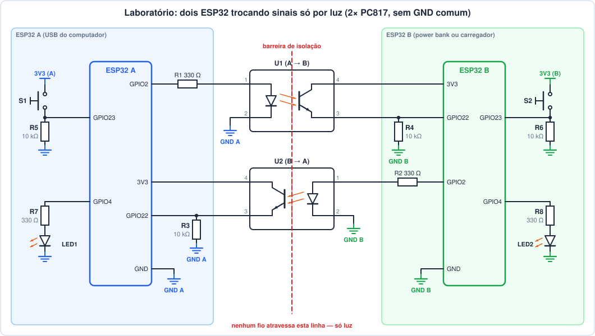

# Laboratório: dois ESP32 conversando por luz (sem GND comum)

> **Pré-requisito:** aula [Interface de E/S industrial](interface-io-industrial.md),
> em especial a seção 5 (optoacoplador e o exemplo de cálculo 5.2).
> OpenPLC Editor e gravação no ESP32 como na aula 05.

## Objetivo

Fazer dois ESP32 trocarem sinais nos **dois sentidos**, usando **só dois
optoacopladores PC817** e **nenhum fio ligando os GNDs**:

- o botão de cada ESP32 acende o LED do **outro** ESP32;
- depois, um ESP32 conta os pulsos que o outro envia.

É o mesmo problema de ligar um CLP a um equipamento de outro painel, com
outra fonte e outro "0 V", só que em 3,3 V e sem risco.

---

## Materiais (por dupla)

| Qtd. | Item | Observação |
|---|---|---|
| 2 | ESP32 DevKit (DOIT 38 pinos ou similar) | A e B |
| 2 | **PC817** (DIP-4) | U1 (A → B) e U2 (B → A) |
| 4 | resistor **330 Ω** | 2 para os LEDs dos optos, 2 para os LEDs indicadores |
| 4 | resistor **10 kΩ** | 2 pull-downs dos optos, 2 pull-downs dos botões |
| 2 | botão pulsador NA | S1 (em A) e S2 (em B) |
| 2 | LED comum (vermelho/verde) | LED1 (em A) e LED2 (em B) |
| 1–3 | protoboard | ver "Montagem" |
| — | jumpers macho-macho e macho-fêmea | |
| 2 | cabo USB | |
| 1 | **power bank ou carregador USB de tomada** | para alimentar o ESP32 B **sem** passar pelo computador |
| 1 | multímetro | |

---

## A regra do laboratório

> **Nenhum fio liga o lado A ao lado B.** O único caminho entre eles é a
> luz dentro dos dois PC817.

E atenção a um detalhe que derruba muita gente: **dois ESP32 ligados na
USB do mesmo computador já têm o GND em comum**, através do próprio PC. Por
isso o ESP32 B é alimentado por um power bank ou carregador de tomada. (Na
Parte 5 você vai medir isso.)

---

## 1. Esquema




Os dois ESP32 usam **os mesmos pinos**, com o mesmo programa na Parte 3:

| Sinal | GPIO | Endereço OpenPLC | Liga em |
|---|---|---|---|
| `botao` | GPIO23 | `%IX0.0` | botão para 3V3 + pull-down 10 kΩ |
| `rx` | GPIO22 | `%IX0.1` | emissor (pino 3) do opto que **recebe** + pull-down 10 kΩ |
| `tx` | GPIO2 | `%QX0.0` | 330 Ω → anodo (pino 1) do opto que **envia** (o LED azul da placa também acende) |
| `led_rx` | GPIO4 | `%QX0.1` | 330 Ω → LED indicador → GND |

---

## 2. Montagem

### Tabela de ligações

**ESP32 A** (todos os GND abaixo são o **GND do A**):

| De | Para |
|---|---|
| GPIO2 | R1 (330 Ω) → **U1 pino 1** (anodo) |
| **U1 pino 2** (catodo) | GND A |
| 3V3 | **U2 pino 4** (coletor) |
| **U2 pino 3** (emissor) | GPIO22 **e** R3 (10 kΩ) → GND A |
| 3V3 | S1 → GPIO23; GPIO23 → R5 (10 kΩ) → GND A |
| GPIO4 | R7 (330 Ω) → LED1 (anodo, perna longa) → catodo → GND A |

**ESP32 B** (todos os GND abaixo são o **GND do B**):

| De | Para |
|---|---|
| 3V3 | **U1 pino 4** (coletor) |
| **U1 pino 3** (emissor) | GPIO22 **e** R4 (10 kΩ) → GND B |
| GPIO2 | R2 (330 Ω) → **U2 pino 1** (anodo) |
| **U2 pino 2** (catodo) | GND B |
| 3V3 | S2 → GPIO23; GPIO23 → R6 (10 kΩ) → GND B |
| GPIO4 | R8 (330 Ω) → LED2 → GND B |

### Dica: use o canal central da protoboard como barreira

Coloque os dois PC817 numa protoboard pequena, **atravessando o canal
central**, como um CI. Assim os pinos 1 e 2 ficam numa metade e os pinos 4
e 3 na outra:

- **U1**: pinos 1–2 (LED) na metade de **cima**, pinos 4–3 na metade de
  **baixo**.
- **U2**: **gire 180°**. Os pinos 1–2 (LED) ficam na metade de **baixo** e
  os pinos 4–3 na de **cima**.
- Resultado: **tudo o que é do ESP32 A fica na metade de cima, e tudo o
  que é do B na metade de baixo**. As trilhas de alimentação de cima são
  do A e as de baixo são do B: **nunca** faça uma ponte entre elas.

Os ESP32 (que são largos) ficam cada um na sua protoboard e se ligam aos
optos com jumpers.

---

## 3. Antes de energizar

1. Confira a **marca do pino 1** de cada PC817. Um opto invertido não
   queima, mas não funciona.
2. Com tudo **desligado**, meça a **resistência entre GND A e GND B**: tem
   que dar **OL** (circuito aberto). Se der qualquer valor, existe uma
   ligação errada ou uma trilha de alimentação em ponte.
3. Meça também entre **3V3 A** e **3V3 B**: OL.
4. Ligue o **ESP32 A na USB do computador** e o **ESP32 B no power bank**.

---

## 4. Procedimento

### Parte 1 — o cálculo antes da montagem

Antes de ligar, preencha com os valores da aula (seção 5.2):

| Grandeza | Típico | Pior caso |
|---|---|---|
| I_F no LED do opto com 330 Ω | | |
| I_C necessária para o GPIO ler 1 com pull-down de 10 kΩ | | — |
| CTR mínimo necessário (= I_C / I_F) | — | |
| CTR mínimo garantido pelo datasheet do PC817 | 50 % | 50 % |

### Parte 2 — um sentido só, com multímetro (A → B)

Programe **só o ESP32 A**, com um rung: `botao` → `tx`. Depois meça, com
o multímetro em tensão CC:

| Medida | S1 solto | S1 apertado |
|---|---|---|
| Tensão em R1 (330 Ω) → calcule I_F = V/330 | | |
| Tensão GPIO22 do **B** em relação ao **GND B** | | |
| Tensão GPIO22 do B em relação ao **GND A** (!) | | |

A última linha é de propósito: o que o multímetro mostra quando você mede
entre os dois lados isolados?

### Parte 3 — os dois sentidos

Crie no OpenPLC um projeto com as quatro variáveis da tabela da seção 1 e
o Pin Mapping correspondente. O programa (Ladder, dois rungs) é:

```
botao ──| |──────────( ) tx
rx    ──| |──────────( ) led_rx
```

Grave **o mesmo programa nos dois ESP32**. Teste:

- [ ] S1 (em A) acende o LED2 (em B).
- [ ] S2 (em B) acende o LED1 (em A).
- [ ] O LED azul de cada placa (GPIO2) acende junto com o botão daquela
      placa: é o sinal saindo.
- [ ] Use o modo debug do Editor no ESP32 A para ver `rx` mudar quando você
      aperta S2.

### Parte 4 — eco e "selo" entre dois CLPs

1. Mude só o programa do **B** para devolver o que recebe:
   `tx := rx` (no Ladder: contato `rx` → bobina `tx`).
   Aperte S1: o que acontece com LED1, no **A**? Por que isso funciona
   como uma **confirmação de recebimento**?
2. Agora **antes de testar**, escreva sua previsão: o que acontece se
   **os dois** ESP32 rodarem `tx := botao OR rx`? Teste e explique o que
   viu. Com qual circuito das aulas 02/04 isso se parece?
3. Proponha uma mudança (em um dos dois programas) que permita "desfazer"
   o que aconteceu no item 2 sem desligar a alimentação.

### Parte 5 — a prova do GND

> Aqui, excepcionalmente, medimos resistência com as placas ligadas:
> entre dois GNDs não há tensão capaz de danificar o multímetro. Em
> qualquer outro circuito, meça resistência sempre **desenergizado**.

1. Com o B no power bank, meça a resistência entre GND A e GND B (os dois
   ligados): ________ Ω.
2. **Desligue** o power bank e ligue o B **numa outra USB do mesmo
   computador**. Meça de novo: ________ Ω.
3. Explique a diferença. O circuito continuou funcionando nos dois casos?
   Então, para que serviu o power bank?

### Desafio — contar pulsos

- **A** envia pulsos enquanto S1 estiver apertado: 200 ms ligado e 200 ms
  desligado (use dois `TON`, ou o `pisca` que você já fez).
- **B** conta as **bordas de subida** de `rx` (`R_TRIG` + `CTU`, aulas 06
  e 09) e acende o LED2 quando a contagem chega a **5**. S2 zera a
  contagem.
- Vá diminuindo o tempo dos pulsos de A (200 → 100 → 50 → 20 → 10 ms). A
  partir de quanto o B começa a **perder** pulsos? O limite é do opto ou da
  varredura do CLP? Justifique com os números do datasheet (Fig. 13) e com
  a configuração da tarefa (`T#20ms`).

---

## Perguntas para o relatório

1. Por que o lado do LED do opto usa 330 Ω e não 10 kΩ? E o que
   aconteceria **sem** resistor nenhum?
2. Na Parte 2, por que a tensão medida entre o GPIO22 do B e o **GND A** não
   faz sentido (ou fica "pulando")?
3. O PC817 isola até 5 kV rms. Nesta montagem em protoboard, qual parte
   limitaria a isolação de verdade? (Pense na distância entre as trilhas.)
4. Se os dois ESP32 estivessem no mesmo GND, os optos seriam
   "desnecessários"? Cite duas situações industriais em que a isolação
   continua valendo a pena mesmo com tensões baixas.
5. O GPIO2 é um pino de *strapping* do ESP32 (define o modo de boot).
   Por que a ligação deste laboratório (LED do opto puxando o GPIO2 para
   o GND) não atrapalha a gravação? Que GPIO você **não** usaria no lugar
   dele?

---

## Checklist de entrega

- [ ] Foto da montagem mostrando os dois optos e as duas alimentações
      separadas.
- [ ] Tabela da Parte 1 (cálculo) e tabela da Parte 2 (medidas), com a
      comparação entre o calculado e o medido.
- [ ] Explicação da Parte 4 (eco e selo) e da Parte 5 (GND pela USB).
- [ ] Programa do desafio (A e B) e a frequência máxima encontrada, com a
      justificativa.
- [ ] Respostas das perguntas.
