# Controle P, PI e PID: entender antes de implementar

> **Versão 3.** A aula segue sempre o mesmo aquecedor. Primeiro deduzimos o modelo dele a partir da física e resolvemos a equação passo a passo. Depois estudamos o proporcional e o seu erro permanente, revisamos a integral como área e memória, construímos o PI (contínuo e discreto, com o cálculo de cada retângulo) e discutimos amostragem e windup. Por último, a derivada, a sua implementação filtrada e a sensibilidade ao ruído. Todas as tabelas mostram o **setpoint (SP)** ao lado da temperatura medida (PV), para comparar.

## 0. O processo usado em toda a aula

Considere um pequeno bloco metálico aquecido por uma resistência elétrica. O ar em volta está a 20 °C e queremos manter o bloco a 40 °C. A potência da resistência é comandada de 0 a 100%. Usaremos sempre este mesmo processo para comparar os controladores.

| Símbolo | Significado | Unidade |
|---|---|---|
| r ou SP | temperatura desejada (setpoint): 40 °C | °C |
| y ou PV | temperatura medida (variável de processo) | °C |
| e = r − y | erro: quanto falta para chegar ao desejado | °C |
| u | potência efetivamente aplicada | % |

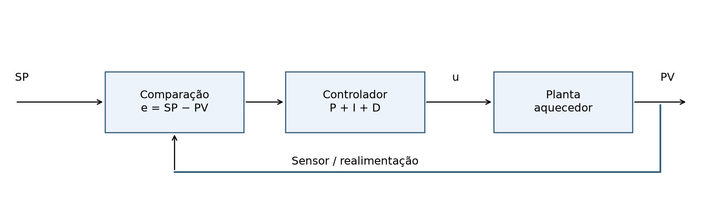

O controlador compara o SP com a PV medida, calcula o erro e decide a potência u. A planta (o aquecedor) responde a essa potência, a temperatura muda, o sensor mede de novo e o ciclo se repete. Para entender o que cada controlador faz, precisamos primeiro saber **como a planta responde à potência**.

### 0.1 De onde vem o modelo: balanço de energia

A temperatura do bloco muda porque entra e sai energia. Em cada instante:

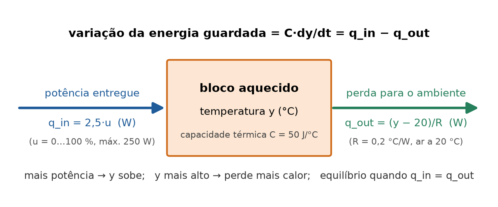

- **Energia que entra:** a resistência entrega no máximo 250 W. Com o comando em u %, entrega q_in = 250·u/100 = 2,5·u watts.
- **Energia que sai:** o bloco perde calor para o ar. Pela **lei de resfriamento de Newton**, a perda é proporcional à diferença de temperatura: q_out = (y − 20)/R. O número R = 0,2 °C/W é a **resistência térmica**: para cada watt perdido, o bloco precisa estar 0,2 °C acima do ar. Quanto mais quente o bloco, mais calor ele perde.
- **Energia guardada:** a diferença entre o que entra e o que sai fica no bloco e aumenta a temperatura. A **capacidade térmica** C = 50 J/°C diz quantos joules são necessários para subir 1 °C (é aproximadamente um bloco de alumínio de 55 g).

Juntando as três ideias, a taxa de variação da energia guardada é a potência que entra menos a que sai:

$$C\frac{dy}{dt}=q_{in}-q_{out}$$

Agora substituímos cada termo pelos números, um passo de cada vez.

**Passo 1 — substituir C, q_in e q_out:**

$$50\frac{dy}{dt}=2{,}5u-\frac{y-20}{0{,}2}$$

**Passo 2 — fazer a divisão por 0,2** (dividir por 0,2 é multiplicar por 5):

$$50\frac{dy}{dt}=2{,}5u-5(y-20)=2{,}5u-5y+100$$

**Passo 3 — dividir a equação inteira por 5**, para deixar y com coeficiente 1:

$$10\frac{dy}{dt}=0{,}5u-y+20$$

**Passo 4 — passar o y para o lado esquerdo:**

$$10\frac{dy}{dt}+y=20+0{,}5u$$

Esta é a equação do aquecedor usada na aula toda. Os dois números que aparecem nela têm significado físico:

| Número | De onde vem | Significado |
|---|---|---|
| 10 s (constante de tempo τ) | τ = R·C = 0,2 °C/W × 50 J/°C = 10 s | quão **devagar** a temperatura responde |
| 0,5 °C/% (ganho K) | K = R × 2,5 W/% = 0,2 × 2,5 = 0,5 | quantos graus acima do ambiente cada 1% de potência sustenta |
| 20 °C | temperatura do ar | para onde o bloco volta se desligar |

**Por que primeira ordem?** O modelo tem um único "reservatório" de energia (o bloco, com uma temperatura só) e uma perda proporcional à diferença de temperatura. Por isso aparece só a primeira derivada. Um forno real tem mais coisas: o sensor demora a acompanhar o bloco, o calor leva tempo para atravessar o material (atraso de transporte), a perda muda com a temperatura e com ventilação. Essas dinâmicas extras precisariam ser identificadas em ensaio. Também escolhemos números redondos para que as contas sejam fáceis: um bloco real costuma ter τ de minutos, não de 10 s. As equações são as mesmas; só a escala de tempo muda.

### 0.2 Equilíbrio: quanto de potência é preciso para cada temperatura

No equilíbrio a temperatura não muda mais, então dy/dt = 0. A equação fica:

$$0+y_{eq}=20+0{,}5u\qquad\Rightarrow\qquad y_{eq}=20+0{,}5u$$

Para manter **40 °C**, isolamos u: 40 = 20 + 0,5u → 0,5u = 20 → **u = 40%**. Essa potência precisa ficar ligada **o tempo todo**, porque o bloco a 40 °C perde (40 − 20)/0,2 = 100 W, exatamente os 2,5 × 40 = 100 W que a resistência entrega. Com 100% de potência, o máximo alcançável é 20 + 0,5 × 100 = **70 °C**. Esses dois números (40% para o SP; 70 °C no máximo) vão explicar a limitação do P e o windup.

### 0.3 Resolvendo a equação passo a passo (potência constante)

Ligamos a resistência em u = 40% constante, com o bloco inicialmente a 20 °C, **sem controlador**. Como a temperatura evolui?

**Passo 1 — medir a distância até o equilíbrio.** Defina x = y − y_eq (quanto falta para o equilíbrio). Com u constante, y_eq é constante, então dx/dt = dy/dt e y = x + y_eq. Substituindo na equação do aquecedor:

$$10\frac{dx}{dt}+x+y_{eq}=20+0{,}5u\qquad\Rightarrow\qquad 10\frac{dx}{dt}+x=0$$

(os termos y_eq e 20 + 0,5u se cancelam, porque são iguais).

**Passo 2 — interpretar.** A equação diz dx/dt = −x/10: a distância até o equilíbrio diminui a uma taxa proporcional a ela mesma. Longe do equilíbrio, aproxima rápido; perto, aproxima devagar. A função que tem essa propriedade é a exponencial:

$$x(t)=x(0)\,e^{-t/10}$$

(Confira: derivando, dx/dt = −x(0)e^(−t/10)/10 = −x/10.)

**Passo 3 — voltar para y.** Como y = y_eq + x, a solução geral, que vamos reutilizar várias vezes, é:

$$y(t)=y_{eq}+\left(y(0)-y_{eq}\right)e^{-t/\tau}$$

**Receita:** para qualquer equação da forma τ·dy/dt + y = (valor final), a resposta parte de y(0) e se aproxima exponencialmente do valor final, com constante de tempo τ.

**Passo 4 — números.** Com u = 40%: y_eq = 40 °C, y(0) = 20 °C, τ = 10 s:

$$y(t)=40+(20-40)e^{-t/10}=40-20e^{-t/10}$$

Por exemplo, em t = 10 s: e^(−1) = 0,3679, então y = 40 − 20 × 0,3679 = 32,64 °C.

<!--BEGIN MALHA_ABERTA-->

| t (s) | u (%) | SP (°C) | PV (°C) | Falta para o SP (°C) | Caminho percorrido 20 → 40 |
| --- | --- | --- | --- | --- | --- |
| 0 | 40 | 40,000 | 20,000 | 20,000 | 0,0 % |
| 5 | 40 | 40,000 | 27,869 | 12,131 | 39,3 % |
| 10 | 40 | 40,000 | 32,642 | 7,358 | 63,2 % |
| 20 | 40 | 40,000 | 37,293 | 2,707 | 86,5 % |
| 30 | 40 | 40,000 | 39,004 | 0,996 | 95,0 % |
| 50 | 40 | 40,000 | 39,865 | 0,135 | 99,3 % |

<!--END MALHA_ABERTA-->

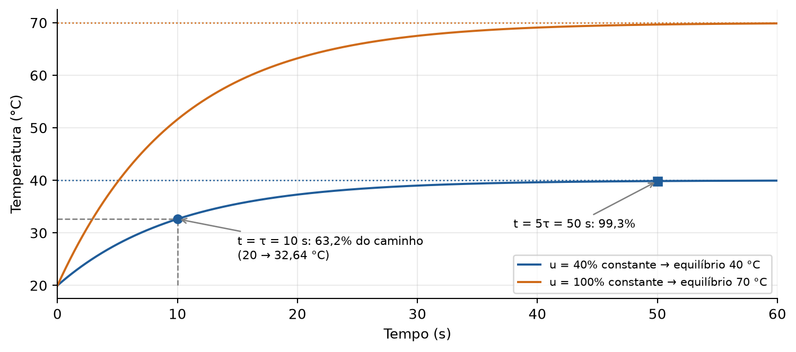

**Como ler a constante de tempo:** depois de τ = 10 s, a temperatura percorreu 63,2% do caminho (de 20 para 32,64 °C); depois de 3τ, 95%; depois de 5τ = 50 s, 99,3%, e na prática "chegou".

**Então para que um controlador, se 40% fixo já leva a 40 °C?** Por dois motivos. Primeiro, os 40% só valem se o ar estiver a 20 °C e a perda for exatamente R = 0,2 °C/W. Se a sala esfriar, alguém abrir uma porta ou o bloco receber uma peça fria, os mesmos 40% levam a outra temperatura, e ninguém corrige. O controlador **mede** a PV e ajusta a potência. Segundo, em malha aberta são ~50 s para chegar; um controlador pode aplicar mais potência no começo e reduzir perto do SP.

O modelo é didático: não inclui atraso de transporte, ruído ou não linearidades. A saída é limitada a 0–100%, salvo quando explicitamente analisamos o modelo linear sem saturação.

---

## 1. Controle proporcional: atuar na proporção do erro

### 1.1 A ideia física

O controlador P responde ao erro **que existe agora**. Se a temperatura está muito abaixo do desejado, aplica mais potência. À medida que a temperatura se aproxima do SP, o erro diminui e a potência também diminui.

Na forma contínua, sem uma potência base:

$$e(t)=r(t)-y(t)$$

$$u(t)=K_p e(t)$$

Usaremos Kp = 2 %/°C. Cada grau de erro gera dois pontos percentuais de potência.

| SP (°C) | PV (°C) | Erro = SP − PV | Potência P = 2·erro | Potência que manteria essa PV |
|---|---|---|---|---|
| 40 | 20 | 20 °C | 40% | 0% |
| 40 | 25 | 15 °C | 30% | 10% |
| 40 | 30 | 10 °C | 20% | 20% |
| 40 | 35 | 5 °C | 10% | 30% |
| 40 | 40 | 0 °C | 0% | 40% |

A última coluna vem do equilíbrio da seção 0.2 (u = (PV − 20)/0,5). Compare as duas colunas de potência: abaixo de 30 °C, o P entrega **mais** do que o necessário para manter a temperatura, e o bloco esquenta; acima de 30 °C, entrega **menos**, e o bloco esfria. As duas colunas só se igualam em 30 °C. Em 40 °C o P mandaria desligar o aquecedor, mas são necessários 40% para sustentar essa temperatura. Logo, com essa lei de controle, **40 °C não é um equilíbrio possível**.

### 1.2 Onde o processo realmente para? (passo a passo)

No equilíbrio a temperatura não varia (dy/dt = 0), então vale a relação da seção 0.2:

$$y_\infty=20+0{,}5u_\infty$$

**Passo 1 — substituir a lei do P**, u∞ = 2(40 − y∞):

$$y_\infty=20+0{,}5\cdot2(40-y_\infty)$$

**Passo 2 — multiplicar** 0,5 × 2 = 1:

$$y_\infty=20+40-y_\infty=60-y_\infty$$

**Passo 3 — juntar os y∞ de um lado:** y∞ + y∞ = 60 → 2y∞ = 60 →

$$y_\infty=30\ ^\circ\mathrm{C},\qquad e_\infty=40-30=10\ ^\circ\mathrm{C}$$

**Conferência:** em 30 °C há erro de 10 °C; esse erro gera 2 × 10 = 20% de potência; 20% sustenta 20 + 0,5 × 20 = 30 °C. A malha se equilibra **com erro**.

### 1.3 Resposta contínua passo a passo

**Passo 1 — substituir u = 2(40 − y) na equação do aquecedor:**

$$10\frac{dy}{dt}+y=20+0{,}5\cdot2(40-y)=20+40-y$$

**Passo 2 — passar o −y para a esquerda:**

$$10\frac{dy}{dt}+2y=60$$

**Passo 3 — dividir por 2**, para ficar na forma da receita da seção 0.3 (y com coeficiente 1):

$$5\frac{dy}{dt}+y=30$$

Agora a equação diz: valor final 30 °C e constante de tempo **5 s** (a metade dos 10 s da planta sozinha: a malha fechada é mais rápida, mas para no lugar errado).

**Passo 4 — aplicar a receita** com y(0) = 20, valor final 30 e τ = 5 s:

$$y(t)=30+(20-30)e^{-t/5}=30-10e^{-t/5}$$

$$e(t)=40-y(t)=10+10e^{-t/5}$$

**Exemplo em t = 5 s:** e^(−1) = 0,3679 → y = 30 − 3,679 = 26,321 °C; erro = 13,679 °C; potência = 2 × 13,679 = 27,358%.

A tabela abaixo usa essas soluções contínuas. Cada linha é uma fotografia do processo em um instante; não é uma atualização discreta do controlador.

<!--BEGIN P_CONT-->

| t (s) | SP (°C) | PV (°C) | Erro = SP − PV (°C) | P = u (%) |
| --- | --- | --- | --- | --- |
| 0 | 40,000 | 20,000 | 20,000 | 40,000 |
| 1 | 40,000 | 21,813 | 18,187 | 36,375 |
| 5 | 40,000 | 26,321 | 13,679 | 27,358 |
| 10 | 40,000 | 28,647 | 11,353 | 22,707 |
| 20 | 40,000 | 29,817 | 10,183 | 20,366 |
| 40 | 40,000 | 29,997 | 10,003 | 20,007 |
| 60 | 40,000 | 30,000 | 10,000 | 20,000 |
| limite | 40,000 | 30,000 | 10,000 | 20,000 |

<!--END P_CONT-->

**Como ler:** a coluna SP fica sempre em 40 °C, mas a PV nunca passa de 30 °C. No início, o erro de 20 °C gera 40% de potência. A temperatura sobe, o que reduz o erro e a potência. Aos 20 s, o processo já está muito perto de 30 °C e a atuação se aproxima de 20%.

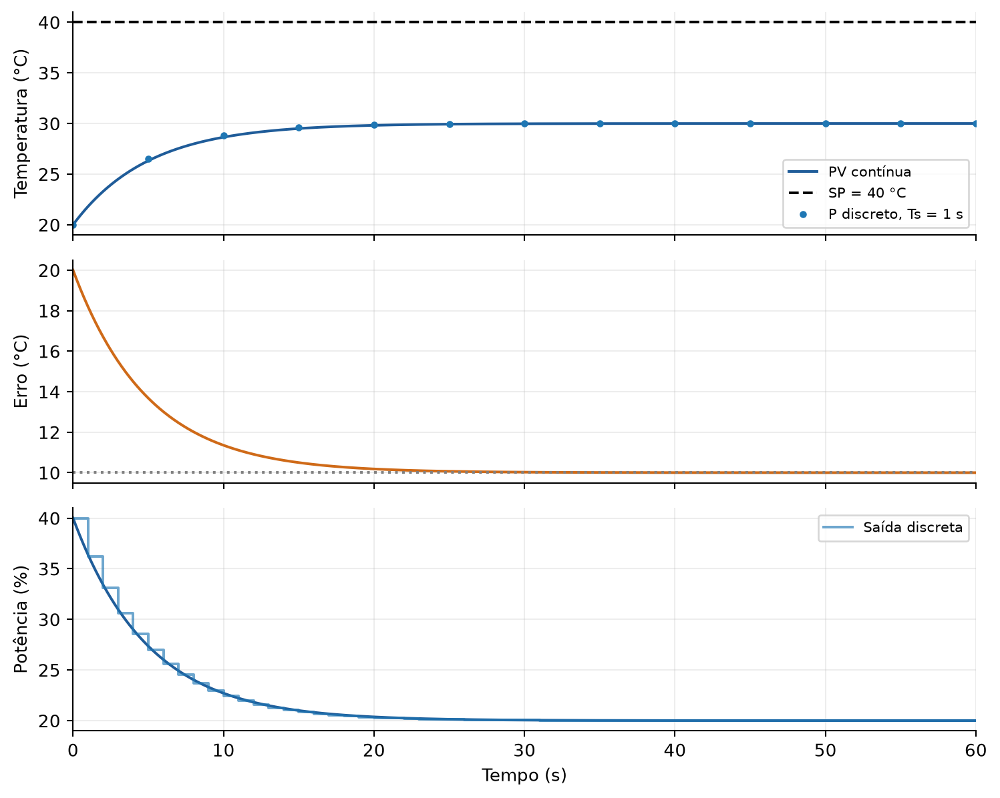

No gráfico, a linha da temperatura para abaixo do SP tracejado, o erro converge para 10 °C e a potência converge para 20%. Os pontos e degraus indicam a versão discreta que veremos a seguir.

### 1.4 Por que o erro não chega a zero neste exemplo?

Pela equação e(t) = 10 + 10e^(−t/5), o erro é maior que 10 °C para todo tempo finito e tende a 10 °C quando o tempo cresce. Ele não apenas demora a desaparecer: **há um erro permanente de equilíbrio**.

Para um ganho Kp positivo qualquer, repetimos a conta da seção 1.2 com Kp no lugar de 2:

$$y_\infty=20+0{,}5K_p(40-y_\infty)\ \Rightarrow\ y_\infty(1+0{,}5K_p)=20+20K_p\ \Rightarrow\ y_\infty=\frac{20+20K_p}{1+0{,}5K_p}$$

E o erro é o que falta para o SP:

$$e_\infty=40-y_\infty=\frac{40(1+0{,}5K_p)-20-20K_p}{1+0{,}5K_p}=\frac{20}{1+0{,}5K_p}$$

O 20 do numerador é a distância entre o SP (40 °C) e o ambiente (20 °C). Para zerar a fração, Kp teria que ser infinito.

| Kp (%/°C) | Conta | Erro permanente (°C) | SP (°C) | PV final (°C) |
|---|---|---|---|---|
| 0,5 | 20 / (1 + 0,25) | 16,00 | 40 | 24,00 |
| 2 | 20 / (1 + 1) | 10,00 | 40 | 30,00 |
| 10 | 20 / (1 + 5) | 3,33 | 40 | 36,67 |

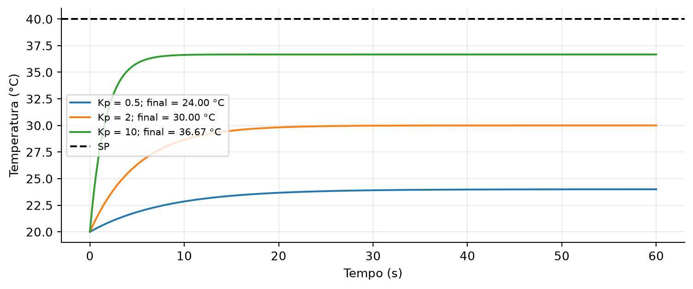

Este gráfico compara **modelos lineares sem saturação** para isolar o efeito do ganho. Com Kp = 10, o comando inicial seria 200%, impossível no atuador real; o limite de 100% alteraria o transitório. Os equilíbrios indicados continuam dentro da faixa disponível.

Aumentar Kp reduz o erro neste processo, mas não o zera com ganho finito. Ganhos elevados também tornam o sistema mais sensível a ruído e, em plantas com atraso ou dinâmicas adicionais, podem causar oscilação e instabilidade.

**O alcance dessa conclusão:** não é correto afirmar que todo controle P sempre tem erro diferente de zero. Uma planta integradora pode atingir erro nulo com P em certas condições. Também podemos usar uma base u = ub + Kp·e: se ub for exatamente 40%, este aquecedor pode equilibrar em 40 °C com e = 0. Contudo, perdas ou condições diferentes exigem outra potência base. Aqui analisamos uma planta autorregulante, sem base, que exige potência não nula para manter o SP.

### 1.5 Controle P em tempo discreto

No CLP, a medição e o cálculo ocorrem a cada Ts segundos. O índice k identifica cada amostra:

$$t_k=kT_s,\qquad e[k]=r[k]-y[k]$$

$$u[k]=K_p e[k]$$

Não aparece Ts multiplicando Kp: o proporcional é uma multiplicação instantânea e não calcula área nem inclinação. Entretanto, Ts determina quando a saída será atualizada. Entre duas chamadas, o atuador **mantém** o último comando.

**Como a planta evolui entre duas amostras.** Durante um intervalo, u[k] fica constante. Então vale a receita da seção 0.3, aplicada durante Ts segundos, partindo de y[k] e indo em direção ao equilíbrio desse intervalo, y_eq = 20 + 0,5u[k]:

$$y[k+1]=y_{eq}+\left(y[k]-y_{eq}\right)e^{-T_s/10}$$

Chamando a = e^(−Ts/10) e substituindo y_eq:

$$y[k+1]=20+0{,}5u[k]+a\left(y[k]-20-0{,}5u[k]\right)$$

Separando o que multiplica y[k] e o que multiplica u[k]:

$$y[k+1]=20+a(y[k]-20)+0{,}5(1-a)u[k]$$

Com Ts = 1 s: a = e^(−0,1) = **0,904837** e 0,5(1 − a) = **0,047581**. Esses dois números resumem o aquecedor em uma amostra: 90,48% do desvio em relação a 20 °C permanece, e cada 1% de potência mantida por 1 s acrescenta 0,0476 °C.

**Ordem de cálculo em cada amostra:** medir y[k] → calcular e[k] → calcular u[k] → manter u[k] durante Ts → obter y[k+1].

**Amostra k = 0 (t = 0 s):**

- y[0] = 20,000 °C; e[0] = 40 − 20 = 20,000 °C; u[0] = 2 × 20 = 40,000%.
- y[1] = 20 + 0,904837 × (20 − 20) + 0,047581 × 40 = 20 + 0 + 1,903 = **21,903 °C**.

**Amostra k = 1 (t = 1 s):**

- e[1] = 40 − 21,903 = 18,097 °C; u[1] = 2 × 18,097 = 36,193%.
- y[2] = 20 + 0,904837 × 1,903 + 0,047581 × 36,193 = 20 + 1,722 + 1,722 = **23,444 °C**.

A tabela mostra as primeiras amostras com cada parcela da conta (as colunas 5 e 6 são os dois termos da equação de y[k+1]):

<!--BEGIN P_PASSO-->

| k | y[k] (°C) | e[k] = 40 − y[k] | u[k] = 2·e[k] (%) | a·(y[k] − 20) | 0,04758·u[k] | y[k+1] = 20 + col.5 + col.6 |
| --- | --- | --- | --- | --- | --- | --- |
| 0 | 20,000 | 20,000 | 40,000 | 0,000 | 1,903 | 21,903 |
| 1 | 21,903 | 18,097 | 36,193 | 1,722 | 1,722 | 23,444 |
| 2 | 23,444 | 16,556 | 33,111 | 3,117 | 1,575 | 24,692 |
| 3 | 24,692 | 15,308 | 30,616 | 4,245 | 1,457 | 25,702 |
| 4 | 25,702 | 14,298 | 28,596 | 5,160 | 1,361 | 26,520 |

<!--END P_PASSO-->

Continuando a mesma conta até 60 s:

<!--BEGIN P_DISC-->

| k = t (s) | SP (°C) | PV (°C) | Erro (°C) | u mantida (%) |
| --- | --- | --- | --- | --- |
| 0 | 40,000 | 20,000 | 20,000 | 40,000 |
| 1 | 40,000 | 21,903 | 18,097 | 36,193 |
| 2 | 40,000 | 23,444 | 16,556 | 33,111 |
| 5 | 40,000 | 26,520 | 13,480 | 26,960 |
| 10 | 40,000 | 28,789 | 11,211 | 22,422 |
| 20 | 40,000 | 29,853 | 10,147 | 20,293 |
| 40 | 40,000 | 29,998 | 10,002 | 20,004 |
| 60 | 40,000 | 30,000 | 10,000 | 20,000 |

<!--END P_DISC-->

As curvas contínua e discreta são próximas, mas não idênticas: no contínuo, a potência muda a todo instante; no discreto, fica constante entre amostras (por exemplo, em t = 1 s a PV discreta é 21,903 °C e a contínua é 21,813 °C, porque o discreto manteve os 40% do início durante o segundo inteiro). O equilíbrio do P discreto estável continua sendo 30 °C, pois, em regime permanente, as mesmas relações de erro e potência precisam ser satisfeitas.

### 1.6 Limitações do P para guardar

O P reage imediatamente ao erro, mas não guarda informação do passado. Neste processo, reduzir o erro também reduz a potência necessária para continuar aquecendo. O resultado é o erro permanente. Aumentar o ganho ajuda até certo ponto, mas não substitui memória e pode prejudicar estabilidade, suavidade e limites da atuação.

---

## 2. Revisão: o que é uma integral?

### 2.1 Área, duração e sinal

Uma integral soma pequenas áreas entre uma curva e o eixo do tempo. No gráfico do erro, a altura é medida em °C e a largura em segundos. A área tem unidade °C·s.

Se e = 4 °C durante 2 s, a área é a de um retângulo:

$$A=4\cdot2=8\ ^\circ\mathrm{C}\cdot\mathrm{s}$$

Se o mesmo erro dura 5 s, a área é 20 °C·s. O tamanho do erro e o tempo durante o qual ele existe importam.

A notação contínua é:

$$A(t)=\int_0^t e(\tau)\,d\tau$$

τ é apenas o nome da variável usada dentro da soma contínua. O limite superior t indica até onde acumulamos a área.

### 2.2 A integral tem memória

Erros positivos aumentam a área acumulada. Erros negativos a diminuem. Quando o erro é zero, não acrescentamos área, mas **o total anterior permanece**.

| Intervalo | Erro | Conta | Área acrescentada | Área ao final |
|---|---|---|---|---|
| 0–1 s | +4 °C | 4 × 1 | +4 °C·s | 0 + 4 = 4 °C·s |
| 1–2 s | +4 °C | 4 × 1 | +4 °C·s | 4 + 4 = 8 °C·s |
| 2–3 s | 0 °C | 0 × 1 | 0 °C·s | 8 + 0 = 8 °C·s |
| 3–4 s | −2 °C | −2 × 1 | −2 °C·s | 8 − 2 = 6 °C·s |

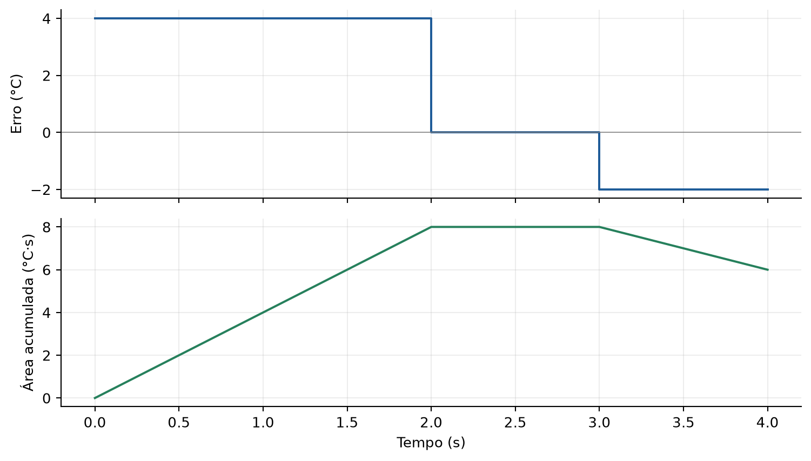

Entre 2 e 3 s, o erro é zero, mas a área acumulada continua em 8 °C·s. Entre 3 e 4 s, o erro é negativo, então a área cai. A curva da área sobe, para ou desce de acordo com o sinal do erro.

### 2.3 Área em tempo discreto: retângulos

O computador não conhece a curva inteira. Tem apenas as amostras e[0], e[1], e[2]…, tomadas a cada Ts. Para cada intervalo entre duas amostras, de t[k−1] a t[k], aproximamos a área por um **retângulo** de largura Ts. Falta decidir a **altura** do retângulo, e há duas escolhas comuns:

- **Retângulo à esquerda:** altura = erro no **início** do intervalo, e[k−1]. Área ΔA[k] = e[k−1]·Ts.
- **Retângulo à direita:** altura = erro no **fim** do intervalo, e[k]. Área ΔA[k] = e[k]·Ts.

A área total é a anterior mais o retângulo novo. Com o retângulo à direita, que é o que usaremos no PI desta aula:

$$\Delta A[k]=e[k]\,T_s$$

$$A[k]=A[k-1]+\Delta A[k]$$

A vantagem do retângulo à direita é usar o erro que acabou de ser medido, sem precisar guardar o anterior. Começamos com A[0] = 0 (não há área antes do início do experimento) e somamos o primeiro retângulo em k = 1, cobrindo o intervalo de 0 a 1·Ts.

Uma terceira opção é o **trapézio**, com a média das duas alturas:

$$\Delta A[k]=\frac{e[k-1]+e[k]}{2}T_s$$

### 2.4 Como a frequência de amostragem influencia a conta

A frequência de amostragem fs é o número de amostras por segundo:

$$f_s=\frac{1}{T_s}$$

**Primeiro caso: erro constante.** Se e = 4 °C por 2 s, usar Ts = 1 s produz 2 retângulos de área 4 × 1 = 4. Usar Ts = 0,5 s produz 4 retângulos de área 4 × 0,5 = 2. Nos dois casos, o total é 8 °C·s, que é o valor correto.

Amostragem mais rápida não deve aumentar artificialmente a integral. Ela produz mais parcelas, mas cada parcela tem uma largura menor. Somar apenas os valores de erro, sem multiplicar por Ts, faz o resultado depender indevidamente da quantidade de chamadas (no exemplo, daria 4 + 4 = 8 com Ts = 1 s, mas 4 + 4 + 4 + 4 = 16 com Ts = 0,5 s).

**Segundo caso: erro variável.** Considere e(t) = 4 + 2t, entre 0 e 2 s. A área exata é:

$$A=\int_0^2(4+2t)dt=\left[4t+t^2\right]_0^2=(8+4)-0=12\ ^\circ\mathrm{C}\cdot\mathrm{s}$$

Com Ts = 1 s, as amostras são e(0) = 4, e(1) = 6 e e(2) = 8. As contas ficam:

- à esquerda: e(0)·1 + e(1)·1 = 4 + 6 = **10** °C·s (subestima: o erro está subindo e usamos a altura menor de cada intervalo);
- à direita: e(1)·1 + e(2)·1 = 6 + 8 = **14** °C·s (superestima: usamos a altura maior);
- trapézio: (4 + 6)/2 + (6 + 8)/2 = 5 + 7 = **12** °C·s.

| Ts (s) | fs (Hz) | Retângulos à esquerda | Retângulos à direita | Área exata |
|---|---|---|---|---|
| 1,00 | 1 | 4 + 6 = 10,0 | 6 + 8 = 14,0 | 12,0 |
| 0,50 | 2 | (4 + 5 + 6 + 7)·0,5 = 11,0 | (5 + 6 + 7 + 8)·0,5 = 13,0 | 12,0 |
| 0,25 | 4 | 11,5 | 12,5 | 12,0 |

Áreas em °C·s. A regra do trapézio dá 12 neste exemplo porque o erro é uma reta; isso não torna o trapézio exato para qualquer curva.

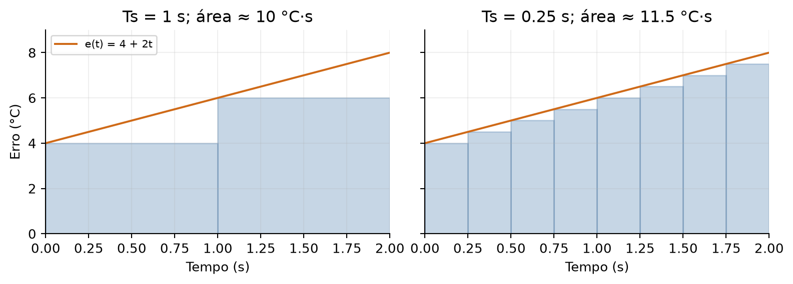

**Leitura:** os retângulos largos deixam uma faixa maior sem representar. Reduzir Ts diminui esse erro de aproximação para esta curva. Porém, amostrar rápido não recupera informação que o sensor não mede, nem elimina atrasos ou ruído.

Se o intervalo real variar, a largura correta é o tempo decorrido entre chamadas, Δtk. Usar um Ts fixo enquanto o programa executa com intervalos diferentes também distorce a integral. Em CLP, prefira uma tarefa periódica e confirme o período.

---

## 3. Controle PI: proporcional mais memória integral

### 3.1 Construção contínua

O PI soma a resposta ao erro presente e uma parcela baseada na área acumulada:

$$P(t)=K_p e(t)$$

$$I(t)=I(0)+K_i\int_0^t e(\tau)\,d\tau$$

$$u(t)=P(t)+I(t)$$

Kp tem unidade %/°C e Ki tem unidade %/(°C·s). O ganho Ki converte a área do erro em potência.

**Exemplo de área:** Ki = 0,2 e erro de 5 °C durante 3 s acrescentam área de 5 × 3 = 15 °C·s. Portanto, a integral aumenta 0,2 × 15 = 3%. Se o erro depois zerar, esses 3% permanecem.

Outra forma de enxergar a integral é pela sua taxa de mudança:

$$\frac{dI}{dt}=K_i e(t)$$

Com erro positivo, I cresce; com erro negativo, I diminui; com erro zero, I para de mudar. Assim, **erro zero significa integral constante, não integral nula**.

### 3.2 Por que o PI consegue eliminar o erro permanente? (passo a passo)

**Passo 1 — no equilíbrio, nada varia**, inclusive I. Pela equação acima, dI/dt = Ki·e = 0. Como Ki ≠ 0, a única saída é **e∞ = 0**.

**Passo 2 — com erro zero, a PV é o SP:** y∞ = 40 °C, e a parcela proporcional vale P∞ = 2 × 0 = 0.

**Passo 3 — a planta ainda precisa de 40%** para ficar em 40 °C (seção 0.2). Como u = P + I e P = 0, toda a potência vem da integral:

$$e_\infty=0,\qquad P_\infty=0,\qquad I_\infty=u_\infty=40\%$$

A integral guarda a potência necessária para compensar as perdas. O P já não precisa manter um erro para gerar essa potência. Compare com o P puro, que precisava de 10 °C de erro para gerar 20%.

Esse resultado depende de estabilidade e referência alcançável. Uma planta limitada a 70 °C não chegará a 80 °C por receber uma integral maior. Também não significa que o erro será exatamente zero em todo instante ou que um sensor digital terá precisão infinita.

### 3.3 PI contínuo: solução passo a passo

Adote Kp = 2, Ki = 0,2, I(0) = 0 e y(0) = 20 °C. Repare em uma coincidência que torna a conta simples: Kp/Ki = 2/0,2 = 10 s, igual à constante de tempo τ da planta. (Esse quociente se chama tempo integral, Ti; escolher Ti = τ é um ajuste clássico para plantas de primeira ordem.)

Vamos mostrar que, com esses ganhos, a solução é a mesma exponencial de constante de tempo 10 s da malha aberta com 40%:

$$y(t)=40-20e^{-t/10},\qquad e(t)=40-y(t)=20e^{-t/10}$$

**Passo 1 — parcela P:**

$$P(t)=2\cdot20e^{-t/10}=40e^{-t/10}$$

**Passo 2 — parcela I, integrando o erro** (a integral de e^(−τ/10) é −10e^(−τ/10)):

$$I(t)=0{,}2\int_0^t20e^{-\tau/10}d\tau=4\left[-10e^{-\tau/10}\right]_0^t=40\left(1-e^{-t/10}\right)$$

**Passo 3 — somar:**

$$u(t)=40e^{-t/10}+40-40e^{-t/10}=40\%$$

A potência fica em 40% o tempo todo: o que o P perde à medida que o erro cai, a I ganha.

**Passo 4 — conferir na equação da planta.** Derivando y: dy/dt = 2e^(−t/10). Então o lado esquerdo da equação do aquecedor vale:

$$10\cdot2e^{-t/10}+40-20e^{-t/10}=40$$

e o lado direito vale 20 + 0,5 × 40 = 40. Os dois lados são iguais para todo t, então a solução está correta.

**Exemplo em t = 10 s:** e^(−1) = 0,3679 → y = 40 − 7,358 = 32,642 °C; erro = 7,358 °C; P = 14,715%; I = 40 × (1 − 0,3679) = 25,285%; u = 40%.

<!--BEGIN PI_CONT-->

| t (s) | SP (°C) | PV (°C) | Erro (°C) | P (%) | I (%) | u (%) |
| --- | --- | --- | --- | --- | --- | --- |
| 0 | 40,000 | 20,000 | 20,000 | 40,000 | 0,000 | 40,000 |
| 1 | 40,000 | 21,903 | 18,097 | 36,193 | 3,807 | 40,000 |
| 5 | 40,000 | 27,869 | 12,131 | 24,261 | 15,739 | 40,000 |
| 10 | 40,000 | 32,642 | 7,358 | 14,715 | 25,285 | 40,000 |
| 20 | 40,000 | 37,293 | 2,707 | 5,413 | 34,587 | 40,000 |
| 40 | 40,000 | 39,634 | 0,366 | 0,733 | 39,267 | 40,000 |
| 60 | 40,000 | 39,950 | 0,050 | 0,099 | 39,901 | 40,000 |
| limite | 40,000 | 40,000 | 0,000 | 0,000 | 40,000 | 40,000 |

<!--END PI_CONT-->

**O que a tabela mostra:** a PV se aproxima do SP de 40 °C (em vez de parar em 30 °C), o erro diminui, a parcela P diminui e a integral aumenta até sustentar os 40%. Neste exemplo, P + I permanece em 40% durante todo o transitório. Isso decorre dos ganhos escolhidos (Ti = τ) e não é uma propriedade geral de PI: com outros ganhos, a resposta pode ser mais lenta, mais rápida ou ultrapassar o SP.

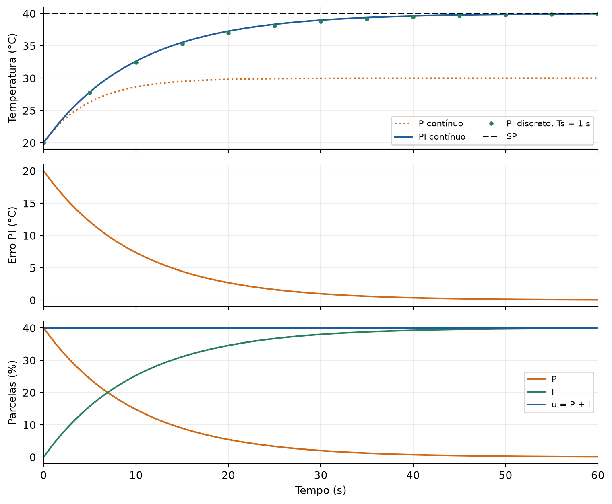

No P, a temperatura para em 30 °C. No PI, ela se aproxima de 40 °C. Observe que o erro do PI tende a zero; neste modelo ideal, a aproximação é assintótica. Isso é diferente de permanecer com um erro de 10 °C, como no P.

### 3.4 A correção começa imediatamente; o processo é que demora

É comum dizer que o erro se acumula “antes de o controlador corrigir a saída”. Precisamos distinguir a conta do controlador e a resposta física da planta.

No contínuo, I começa a mudar assim que existe erro. No discreto, o novo valor de I entra na saída no mesmo instante de atualização. O controlador **não espera juntar uma área mínima** para só depois atuar.

Quem demora a responder é o processo: a potência pode aumentar agora, mas a temperatura sobe aos poucos (constante de tempo de 10 s). Durante esse tempo, ainda há erro e a integral continua crescendo. Em uma planta com atraso de transporte, a medição pode até ficar quase parada por algum tempo após a mudança da atuação.

Esse acúmulo é normal até certo ponto. Torna-se problemático se Ki for excessivo ou, principalmente, se a integral continuar crescendo quando a atuação já está saturada. Esse segundo fenômeno é o windup.

### 3.5 PI em tempo discreto: o cálculo de cada retângulo

No CLP, a integral é a soma dos retângulos da seção 2.3 (à direita, altura e[k], largura Ts), multiplicada por Ki:

$$e[k]=r[k]-y[k]$$

$$\Delta A[k]=e[k]\,T_s$$

$$A[k]=A[k-1]+\Delta A[k]$$

$$I[k]=K_iA[k]=I[k-1]+K_i\,e[k]\,T_s$$

$$u[k]=K_p e[k]+I[k]$$

As duas formas de I[k] são a mesma conta: somar a área e depois multiplicar por Ki, ou já somar Ki·e[k]·Ts a cada chamada (é assim que se programa, guardando só I). Começamos com A[0] = 0, I[0] = 0 e u[0] = Kp·e[0]. A partir de k = 1, cada amostra acrescenta o retângulo do intervalo que acabou de terminar.

Usamos o mesmo aquecedor, Ts = 1 s, Kp = 2 e Ki = 0,2. A planta evolui entre amostras com a mesma equação da seção 1.5: y[k+1] = 20 + 0,904837·(y[k] − 20) + 0,047581·u[k].

**Amostra k = 0 (t = 0 s):** ainda não passou tempo nenhum, então não há retângulo.

- y[0] = 20,000 °C; e[0] = 20,000 °C; A[0] = 0; I[0] = 0.
- P[0] = 2 × 20 = 40,000%; u[0] = 40 + 0 = 40,000%.
- y[1] = 20 + 0,904837 × 0 + 0,047581 × 40 = **21,903 °C**.

**Amostra k = 1 (t = 1 s):** primeiro retângulo, cobrindo de 0 a 1 s.

- e[1] = 40 − 21,903 = 18,097 °C.
- ΔA[1] = e[1] × Ts = 18,097 × 1 = 18,097 °C·s (altura 18,097 °C, largura 1 s).
- A[1] = A[0] + ΔA[1] = 0 + 18,097 = 18,097 °C·s.
- I[1] = Ki × A[1] = 0,2 × 18,097 = 3,619%.
- P[1] = 2 × 18,097 = 36,193%; u[1] = 36,193 + 3,619 = **39,813%**.
- y[2] = 20 + 0,904837 × 1,903 + 0,047581 × 39,813 = 20 + 1,722 + 1,894 = **23,616 °C**.

**Amostra k = 2 (t = 2 s):** segundo retângulo, de 1 a 2 s.

- e[2] = 40 − 23,616 = 16,384 °C.
- ΔA[2] = 16,384 × 1 = 16,384 °C·s.
- A[2] = 18,097 + 16,384 = 34,480 °C·s.
- I[2] = 0,2 × 34,480 = 6,896%.
- P[2] = 2 × 16,384 = 32,767%; u[2] = 32,767 + 6,896 = **39,663%**.

**Amostra k = 3 (t = 3 s):** e[3] = 14,841 °C; ΔA[3] = 14,841 °C·s; A[3] = 34,480 + 14,841 = 49,321 °C·s; I[3] = 9,864%; P[3] = 29,681%; u[3] = **39,545%**.

A tabela reúne as primeiras amostras, com cada coluna da conta:

<!--BEGIN PI_PASSO-->

| k | y[k] (°C) | e[k] (°C) | ΔA[k] = e[k]·Ts (°C·s) | A[k] = A[k−1] + ΔA[k] | I[k] = 0,2·A[k] (%) | P[k] = 2·e[k] (%) | u[k] = P + I (%) |
| --- | --- | --- | --- | --- | --- | --- | --- |
| 0 | 20,000 | 20,000 | — (k = 0) | 0,000 | 0,000 | 40,000 | 40,000 |
| 1 | 21,903 | 18,097 | 18,097 | 18,097 | 3,619 | 36,193 | 39,813 |
| 2 | 23,616 | 16,384 | 16,384 | 34,480 | 6,896 | 32,767 | 39,663 |
| 3 | 25,160 | 14,840 | 14,840 | 49,321 | 9,864 | 29,681 | 39,545 |
| 4 | 26,550 | 13,450 | 13,450 | 62,771 | 12,554 | 26,900 | 39,454 |
| 5 | 27,804 | 12,196 | 12,196 | 74,966 | 14,993 | 24,392 | 39,385 |

<!--END PI_PASSO-->

![PI discreto: retângulos de altura e[k] e largura Ts, e a área acumulada que forma a integral](images/pi-retangulos.png)

No gráfico de cima, cada barra verde é um retângulo: largura de 1 s e altura igual ao erro medido no **fim** do intervalo (ponto verde). No de baixo, a escada é a soma das barras: a área A[k] no eixo da esquerda e a integral I[k] = 0,2·A[k] no eixo da direita. Quando o erro diminui, cada degrau é menor, mas a escada **nunca desce** enquanto o erro for positivo.

**Por que o discreto não dá exatamente os 3,807% do contínuo em t = 1 s?** No contínuo, o erro foi caindo de 20 para ~18 °C durante o primeiro segundo, e a área exata é ≈ 19,03 °C·s (0,2 × 19,03 = 3,807%). O retângulo à direita usa a altura do fim, 18,097 °C, durante o segundo inteiro, e por isso conta um pouco menos: 18,097 °C·s. Como o erro está diminuindo, o retângulo à direita subestima a área. Com Ts menor, a diferença diminui (seção 2.4).

Continuando a mesma conta até 60 s, mostrando também a área acumulada A:

<!--BEGIN PI_DISC-->

| k = t (s) | SP (°C) | PV (°C) | Erro (°C) | ΔA (°C·s) | A (°C·s) | P (%) | I (%) | u (%) |
| --- | --- | --- | --- | --- | --- | --- | --- | --- |
| 0 | 40,000 | 20,000 | 20,000 | 0,000 | 0,000 | 40,000 | 0,000 | 40,000 |
| 1 | 40,000 | 21,903 | 18,097 | 18,097 | 18,097 | 36,193 | 3,619 | 39,813 |
| 2 | 40,000 | 23,616 | 16,384 | 16,384 | 34,480 | 32,767 | 6,896 | 39,663 |
| 5 | 40,000 | 27,804 | 12,196 | 12,196 | 74,966 | 24,392 | 14,993 | 39,385 |
| 10 | 40,000 | 32,467 | 7,533 | 7,533 | 121,015 | 15,066 | 24,203 | 39,269 |
| 20 | 40,000 | 37,027 | 2,973 | 2,973 | 167,652 | 5,946 | 33,530 | 39,477 |
| 40 | 40,000 | 39,488 | 0,512 | 0,512 | 194,176 | 1,023 | 38,835 | 39,858 |
| 60 | 40,000 | 39,905 | 0,095 | 0,095 | 198,898 | 0,190 | 39,780 | 39,969 |

<!--END PI_DISC-->

Áreas em °C·s e parcelas em %. Valores arredondados apenas para apresentação; a simulação usa precisão completa. Confira em qualquer linha: I = 0,2 × A e u = P + I; e na coluna SP, que a PV se aproxima de 40 °C.

### 3.6 Amostrar mais rápido muda o ganho integral?

Ki continua sendo o ganho contínuo. O coeficiente usado por chamada é Ki·Ts. Com Ki = 0,2, ele vale 0,2 × 1 = 0,2 para Ts = 1 s e 0,2 × 0,1 = 0,02 para Ts = 0,1 s. No segundo caso, temos dez vezes mais chamadas por segundo, cada uma acumulando um décimo da área para um mesmo erro constante: no fim de 1 s, 10 × 0,02 = 0,2 por °C de erro, igual ao caso com Ts = 1 s.

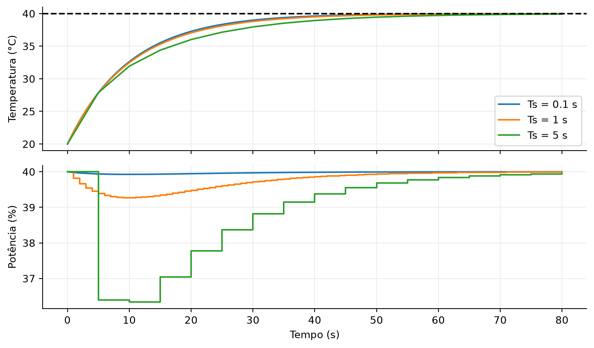

O gráfico mantém Kp e Ki e recalcula Ki·Ts. Ts maior torna a atuação menos frequente e altera a aproximação integral. Dependendo dos ganhos e da planta, isso pode aumentar oscilações e comprometer a estabilidade. Reduzir Ts não substitui uma sintonia adequada.

### 3.7 Windup: a integral cresce além do que o atuador entrega

Agora a referência é 80 °C. O aquecedor, mesmo em 100%, alcança no máximo 20 + 0,5 × 100 = 70 °C (seção 0.2). O erro permanece positivo e o integrador tenta pedir cada vez mais potência.

É essencial separar duas grandezas:

$$v[k]=P[k]+I[k]$$

$$u[k]=\min(100,\max(0,v[k]))$$

v é o comando calculado; u é a potência que pode ser aplicada. Se v = 180%, o atuador entrega somente 100%. Acrescentar mais integral não aumenta a potência real.

No experimento seguinte, usamos Kp = 2, Ki = 0,4, Ts = 1 s, sem anti-windup. **SP = 80 °C até 39 s; a partir de t = 40 s, o SP cai para 40 °C.** A coluna SP da tabela mostra essa troca.

<!--BEGIN WIND-->

| t (s) | SP (°C) | PV (°C) | Erro (°C) | P (%) | I (%) | v calculado (%) | u aplicado (%) |
| --- | --- | --- | --- | --- | --- | --- | --- |
| 0 | 80,000 | 20,000 | 60,000 | 120,000 | 0,000 | 120,000 | 100,000 |
| 10 | 80,000 | 51,606 | 28,394 | 56,788 | 160,208 | 216,996 | 100,000 |
| 20 | 80,000 | 63,233 | 16,767 | 33,534 | 244,430 | 277,964 | 100,000 |
| 39 | 80,000 | 68,988 | 11,012 | 22,024 | 342,317 | 364,341 | 100,000 |
| 40 | 40,000 | 69,084 | -29,084 | -58,168 | 330,684 | 272,515 | 100,000 |
| 45 | 40,000 | 69,445 | -29,445 | -58,889 | 272,054 | 213,165 | 100,000 |
| 60 | 40,000 | 64,375 | -24,375 | -48,749 | 98,888 | 50,139 | 50,139 |
| 80 | 40,000 | 39,645 | 0,355 | 0,710 | 33,537 | 34,246 | 34,246 |

<!--END WIND-->

**Como ler, linha a linha:**

- **t = 0 a 39 s (SP = 80 °C):** v passa de 100% já no início (120% em t = 0, porque P = 2 × 60). A potência aplicada fica travada em 100%, e a PV sobe só até perto dos 70 °C possíveis. Como o erro nunca zera (80 − 69 = 11 °C em t = 39 s), a integral cresce sem parar: 160% em t = 10 s, 342% em t = 39 s. **Esse crescimento não muda nada na planta**, porque a saída já está em 100%.
- **t = 40 s (SP = 40 °C):** o erro vira negativo de repente (40 − 69,08 = −29,08 °C), e P = −58,17%. Mas I ainda vale 330,68%, e v = −58,17 + 330,68 = 272,52%: o aquecedor **continua em 100%**, embora a temperatura esteja 29 °C acima do novo SP.
- **t = 45 s:** a PV até subiu (69,4 °C). A integral está "desenrolando" (cada amostra soma 0,4 × e[k] × 1 ≈ −11,8%), mas ainda está em 272%.
- **t = 55 s** (não está na tabela; veja o arquivo `windup-sem.csv`): só então v cai abaixo de 100% (93,8%) e a potência começa a diminuir. Foram 15 s aquecendo a todo vapor com a temperatura quase 30 °C acima do SP; a PV chegou a 69,8 °C.
- **t = 60 s:** a integral já caiu para ~99% e a potência aplicada está em 50%; a PV começa a descer (64,4 °C).
- **t = 80 s:** a PV finalmente chega perto de 40 °C.

Para a saída cair, os erros negativos precisam reduzir a integral: esse é o “desenrolar” do acúmulo.

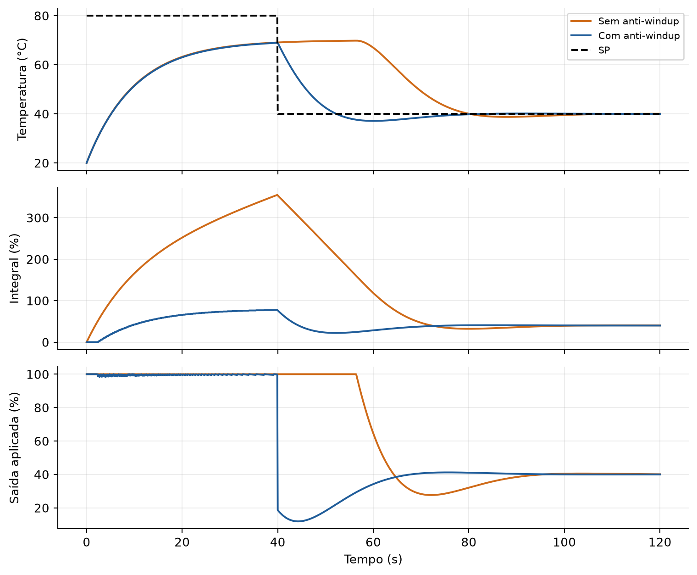

O gráfico usa Ts = 0,1 s para mostrar curvas mais detalhadas, com os mesmos ganhos. A tabela anterior usa Ts = 1 s; por isso os valores não são exatamente iguais. Compare a integral no painel do meio: a proteção evita o crescimento que não se transforma em atuação.

**Proteção por integração condicional:** calcule uma integral candidata e o comando correspondente. Se o comando exceder 100% e o erro for positivo, rejeite o incremento. Se ficar abaixo de 0% e o erro for negativo, rejeite. Aceite atualizações que não agravem a saturação. Depois recalcule a soma e limite a saída.

O anti-windup não torna uma referência impossível alcançável e não elimina o tempo de resposta da planta. Ele reduz o acúmulo indevido durante as limitações de atuação. Em sistemas com atuadores limitados externamente, o controlador também precisa conhecer a atuação realmente disponível.

### 3.8 Limitações do PI

O PI elimina o erro constante neste processo estável e alcançável, mas acrescenta memória à malha. Ki grande pode provocar ultrapassagem do SP e oscilações. A saturação exige anti-windup. O período de cálculo precisa corresponder ao Ts usado, e a integral deve permanecer armazenada entre execuções.

Para comparar bibliotecas, verifique se o parâmetro é Ki ou o tempo integral Ti. Na forma em que Kp multiplica o conjunto, a conversão é:

$$K_i=\frac{K_p}{T_i}$$

No exemplo da aula: Ki = 2/10 = 0,2 %/(°C·s), com Ti = 10 s.

---

## 4. Termo derivativo: responder à velocidade de mudança

### 4.1 Revisão da derivada

A derivada indica a inclinação de uma curva: quanto ela muda por unidade de tempo. Uma variação de −2 °C em 1 s tem inclinação média de −2/1 = −2 °C/s. Se a mesma variação ocorrer em 0,1 s, a inclinação média será −2/0,1 = −20 °C/s.

No termo D ideal, sobre o erro:

$$D(t)=K_d\frac{de(t)}{dt}$$

Kd tem unidade %·s/°C. Se o erro está diminuindo, D é negativo e reduz a atuação de aquecimento. Se o erro está crescendo, D é positivo e aumenta a atuação.

| Intervalo | Erro inicial | Erro final | Inclinação média = (final − inicial)/1 s | D para Kd = 1 |
|---|---|---|---|---|
| 0–1 s | 10 °C | 8 °C | (8 − 10)/1 = −2 °C/s | −2% |
| 1–2 s | 8 °C | 7 °C | (7 − 8)/1 = −1 °C/s | −1% |
| 2–3 s | 7 °C | 7 °C | (7 − 7)/1 = 0 °C/s | 0% |
| 3–4 s | 7 °C | 8 °C | (8 − 7)/1 = +1 °C/s | +1% |

A tabela descreve inclinações médias em cada intervalo. A derivada contínua coincide com elas se o erro for linear em cada trecho, fora dos instantes de mudança de inclinação.

O D reage à tendência atual. Não mede o futuro e não substitui a integral: quando o sinal para de variar, D tende a zero, mesmo que continue existindo erro constante (linha 2–3 s: erro de 7 °C, D = 0).

### 4.2 Contínuo: de PD a PID

Somando P e D:

$$u(t)=K_p e(t)+K_d\frac{de(t)}{dt}$$

No equilíbrio, a derivada é zero. Portanto, o PD não elimina o erro permanente do aquecedor sem base: a conta da seção 1.2 é a mesma, porque o termo D vale zero no equilíbrio. Com Kp = 2, seu equilíbrio continua sendo 30 °C.

Somando também a integral, obtemos o PID ideal:

$$u(t)=K_p e(t)+I(0)+K_i\int_0^t e(\tau)d\tau+K_d\frac{de(t)}{dt}$$

O D pode modificar a resposta transitória e contribuir para amortecimento em certas plantas. Isso não significa que sempre melhore o resultado.

### 4.3 Discreto: diferença dividida pelo tempo

Aproximamos a inclinação por duas amostras:

$$D[k]=K_d\frac{e[k]-e[k-1]}{T_s}$$

Se e anterior = 5 °C, e atual = 4 °C, Ts = 0,5 s e Kd = 1: D = 1 × (4 − 5)/0,5 = −1/0,5 = −2%.

Aqui, Ts aparece **dividindo** a diferença, pois queremos uma taxa. Na integral, ele aparece **multiplicando** o erro, pois queremos uma área.

Para uma rampa real de inclinação constante, diminuir Ts reduz proporcionalmente a diferença entre amostras, mantendo a derivada aproximada. Entretanto, uma diferença causada por ruído pode não diminuir da mesma maneira. Dividi-la por um intervalo pequeno pode produzir valores elevados.

### 4.4 Por que derivar a medição e filtrar?

Um salto no SP também é um salto no erro. A derivada ideal do erro contém um impulso nesse instante; no discreto, aparece um pico que depende de Ts. Por exemplo, se o SP passa de 40 para 50 °C entre duas amostras com Ts = 1 s e Kd = 2, a conta dá D = 2 × 10/1 = 20% em uma única amostra. É o salto derivativo, ou derivative kick.

Uma implementação comum deriva a medição com sinal negativo:

$$D(t)=-K_d\frac{dy(t)}{dt}$$

Para SP constante, de/dt = d(r − y)/dt = −dy/dt, e as duas formas são iguais. Se o SP muda, essa implementação não reage diretamente ao salto da referência; continua reagindo às mudanças de PV.

Acrescentamos um filtro de primeira ordem à derivada (o mesmo tipo de equação do aquecedor, agora com constante de tempo Tf):

$$T_f\frac{dD}{dt}+D=-K_d\frac{dy}{dt}$$

**Passo 1 — trocar as derivadas por diferenças para trás:**

$$T_f\frac{D[k]-D[k-1]}{T_s}+D[k]=-K_d\frac{y[k]-y[k-1]}{T_s}$$

**Passo 2 — multiplicar tudo por Ts:**

$$T_f\left(D[k]-D[k-1]\right)+T_sD[k]=-K_d\left(y[k]-y[k-1]\right)$$

**Passo 3 — juntar os termos com D[k]:**

$$\left(T_f+T_s\right)D[k]=T_fD[k-1]-K_d\left(y[k]-y[k-1]\right)$$

**Passo 4 — dividir por (Tf + Ts):**

$$D[k]=\frac{T_f}{T_f+T_s}D[k-1]-\frac{K_d}{T_f+T_s}(y[k]-y[k-1])$$

O primeiro termo é a memória do filtro (uma fração do D anterior); o segundo é a derivada nova, suavizada. O filtro reduz a resposta às variações rápidas. Também altera a fase e a resposta transitória; não deve ser aumentado sem avaliar o efeito no controle.

### 4.5 PID: o mesmo processo, com gráfico e tabela

Use Kp = 2, Ki = 0,2, Kd = 2 e Tf = 0,5 s. A derivada é filtrada e aplicada à medição. Inicialize I = D = 0 e medição anterior = 20 °C. A versão discreta usa Ts = 1 s e o mesmo cálculo de área do PI.

**Os coeficientes do filtro com esses números:**

$$\frac{T_f}{T_f+T_s}=\frac{0{,}5}{1{,}5}=\frac{1}{3},\qquad\frac{K_d}{T_f+T_s}=\frac{2}{1{,}5}=\frac{4}{3}$$

$$D[k]=\frac{1}{3}D[k-1]-\frac{4}{3}\left(y[k]-y[k-1]\right)$$

**Amostra k = 0:** y[0] = 20 °C, D[0] = 0, I[0] = 0, P[0] = 40%, u[0] = 40%. Como no P e no PI, y[1] = 21,903 °C.

**Amostra k = 1:**

- e[1] = 18,097 °C; P[1] = 36,193%; I[1] = 0,2 × 18,097 = 3,619% (o mesmo retângulo do PI).
- D[1] = (1/3) × 0 − (4/3) × (21,903 − 20) = −(4/3) × 1,903 = −2,538%.
- u[1] = 36,193 + 3,619 − 2,538 = **37,275%** (menos que os 39,813% do PI: o D "freia" porque a temperatura está subindo).
- y[2] = 20 + 0,904837 × 1,903 + 0,047581 × 37,275 = 20 + 1,722 + 1,774 = **23,496 °C**.

**Amostra k = 2:**

- e[2] = 40 − 23,496 = 16,504 °C; P[2] = 33,009%; I[2] = 3,619 + 0,2 × 16,504 = 6,920%.
- D[2] = (1/3) × (−2,538) − (4/3) × (23,496 − 21,903) = −0,846 − 2,123 = −2,969%.
- u[2] = 33,009 + 6,920 − 2,969 = **36,960%**.

A tabela mostra o cálculo do D nas primeiras amostras (as colunas 4 e 5 são os dois termos da equação do filtro):

<!--BEGIN PID_PASSO-->

| k | y[k] (°C) | Δy = y[k] − y[k−1] | (1/3)·D[k−1] | −(4/3)·Δy | D[k] = col.4 + col.5 (%) |
| --- | --- | --- | --- | --- | --- |
| 1 | 21,903 | 1,903 | 0,000 | -2,538 | -2,538 |
| 2 | 23,496 | 1,592 | -0,846 | -2,123 | -2,969 |
| 3 | 24,922 | 1,426 | -0,990 | -1,901 | -2,891 |
| 4 | 26,223 | 1,302 | -0,964 | -1,736 | -2,699 |

<!--END PID_PASSO-->

E a evolução até 60 s, com o SP para comparar:

<!--BEGIN PID_DISC-->

| t (s) | SP (°C) | PV (°C) | Erro (°C) | P (%) | I (%) | D (%) | u (%) |
| --- | --- | --- | --- | --- | --- | --- | --- |
| 0 | 40,000 | 20,000 | 20,000 | 40,000 | 0,000 | 0,000 | 40,000 |
| 1 | 40,000 | 21,903 | 18,097 | 36,193 | 3,619 | -2,538 | 37,275 |
| 2 | 40,000 | 23,496 | 16,504 | 33,009 | 6,920 | -2,969 | 36,960 |
| 5 | 40,000 | 27,418 | 12,582 | 25,165 | 15,208 | -2,492 | 37,880 |
| 10 | 40,000 | 32,068 | 7,932 | 15,865 | 24,840 | -1,626 | 39,079 |
| 20 | 40,000 | 36,975 | 3,025 | 6,050 | 34,584 | -0,661 | 39,973 |
| 40 | 40,000 | 39,636 | 0,364 | 0,729 | 39,461 | -0,092 | 40,097 |
| 60 | 40,000 | 39,972 | 0,028 | 0,056 | 39,981 | -0,010 | 40,027 |

<!--END PID_DISC-->

A derivada fica negativa quando a temperatura aumenta, reduzindo a atuação em relação à soma P + I. Quando a temperatura se estabiliza, D tende a zero. A potência permanente de 40% continua sendo sustentada pela integral.

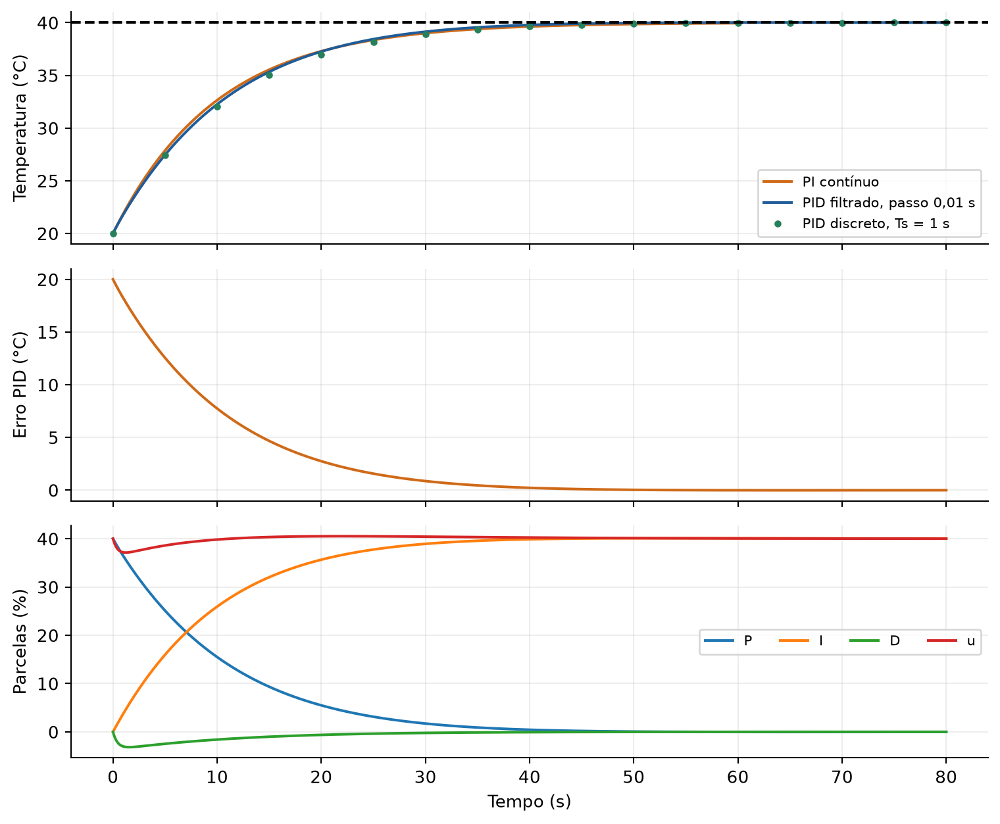

A curva de PID com passo de 0,01 s aproxima a implementação contínua filtrada; os pontos usam Ts = 1 s. Neste exemplo, adicionar D com os mesmos Kp e Ki não acelera a chegada ao SP. Não foi feita uma ressintonia para otimizar o PID: o objetivo é identificar o papel da parcela.

### 4.6 Amplificação de ruído: pequenas diferenças, grandes comandos

Suponha temperatura verdadeira de 30 °C, mas uma medição com oscilações de apenas 0,1 °C. Com Ts = 0,01 s e Kd = 1, uma sequência possível produz:

| t (s) | PV medida (°C) | Variação de PV (°C) | Conta: −Kd·ΔPV/Ts | D sem filtro (%) |
|---|---|---|---|---|
| 0,00 | 30,00 | inicialização | — | 0 |
| 0,01 | 30,10 | +0,10 | −1 × 0,10/0,01 | −10 |
| 0,02 | 29,90 | −0,20 | −1 × (−0,20)/0,01 | +20 |
| 0,03 | 30,10 | +0,20 | −1 × 0,20/0,01 | −20 |
| 0,04 | 29,90 | −0,20 | −1 × (−0,20)/0,01 | +20 |

A temperatura real não mudou, mas a saída derivativa alterna fortemente. Isso pode causar movimentação desnecessária de válvulas, desgaste, vibração e atuação irregular. Ruído não deve ser interpretado como uma mudança real do processo.

Para um ruído senoidal de amplitude A e frequência f, a amplitude da derivada ideal cresce com a frequência:

$$n(t)=A\sin(2\pi ft)$$

$$\left|D_{ruido}\right|_{amplitude}=K_d A\,2\pi f$$

Com A = 0,1 °C e Kd = 1, ruído de 4 Hz gera 1 × 0,1 × 2π × 4 ≈ 2,51% de amplitude em D. A 40 Hz, se essa frequência for medida sem aliasing, seriam 25,13%. O ganho P = 2 geraria somente 2 × 0,1 = 0,2% de amplitude para o mesmo ruído, independentemente dessa frequência no modelo ideal.

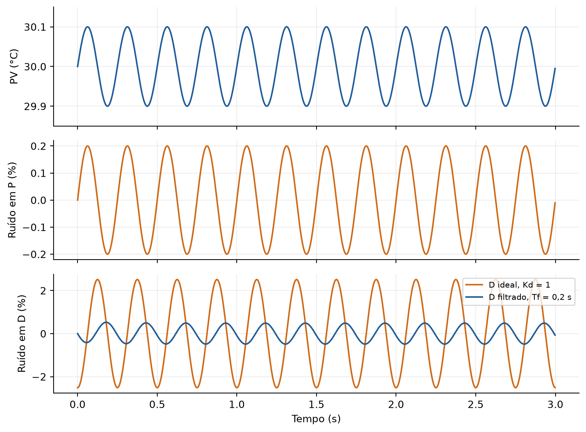

O gráfico usa ruído senoidal de 4 Hz e derivada sobre PV. O filtro com Tf = 0,2 s reduz o comando oscilante. Ainda é necessário tratar a qualidade da medição, filtrar adequadamente e escolher uma frequência de amostragem compatível. Simplesmente amostrar mais rápido não elimina o ruído; amostrar devagar demais pode ocultá-lo ou produzir aliasing.

### 4.7 Por que PI é mais comum na indústria?

Em muitas malhas de processo, PI é a escolha mais comum: corrige o erro constante e evita a sensibilidade adicional da derivada às variações rápidas da medição. Tem menos parâmetros para ajustar e costuma oferecer desempenho suficiente em aplicações de vazão, pressão e outras variáveis de processo.

A ISA registra que controladores P+I são os mais frequentes na prática e relaciona o menor uso de D, entre outros motivos, à sensibilidade a ruído. Isso não significa que D seja inútil. Há processos em que uma medição adequada e uma derivada filtrada, bem ajustada, melhoram o transitório. O critério é o benefício observado na planta, não a obrigação de usar todos os termos do nome PID.

---

## 5. Comparação final e sequência para o laboratório

| Aspecto | P | PI | PID com D filtrado |
|---|---|---|---|
| Informação usada | erro atual | erro atual e área passada | erro, área e velocidade |
| Memória do controlador | não | integral | integral, filtro D e PV anterior |
| PV final com SP = 40 °C | 30 °C com Kp = 2 (erro de 10 °C) | tende a 40 °C, se estável | tende a 40 °C pela ação I |
| Principal cuidado | erro permanente e ganho alto | windup, estabilidade e Ts | ruído, filtro, sintonia e Ts |

**Ordem de cálculo em cada amostra:** leia PV e calcule o erro; atualize a integral pela área do intervalo (I = I + Ki·e·Ts); calcule D se habilitado; avalie a saturação e o anti-windup; forme a soma usando os estados aceitos; limite e aplique a saída; preserve os estados para a próxima chamada. Na primeira chamada, inicialize I e D e use PV atual como medição anterior.

Para a prática, comece pelo P e confirme o equilíbrio de 30 °C. Adicione I e acompanhe P diminuindo enquanto I sustenta a potência. Depois provoque saturação na simulação e observe o windup. Só então adicione D e compare o comportamento com medição limpa e ruidosa.

Registre SP, PV, erro, P, I, D, comando antes do limite e saída aplicada. Um potenciômetro permite testar as contas; a avaliação de malha fechada exige que uma planta física ou simulada responda à saída do controlador.

## Referências e reprodução

- ISA, [Fundamentals of PID Control](https://www.isa.org/intech-home/2023/june-2023/features/fundamentals-pid-control): ações P/I/D, sensibilidade de D ao ruído e uso frequente de PI em processos industriais.
- MathWorks, [Anti-Windup Control Using PID Controller Block](https://www.mathworks.com/help/simulink/slref/anti-windup-control-using-a-pid-controller.html): saturação, acúmulo integral e técnicas de proteção.
- Åström e Murray, [PID Control — Feedback Systems](https://www.cds.caltech.edu/~murray/FBS/PID_Control.html): fundamentos, implementação prática e limitações do controle PID.

A planta, os parâmetros e os exemplos numéricos são didáticos e foram construídos para esta aula. As tabelas contínuas usam soluções analíticas; as tabelas discretas usam saída mantida e atualização exata do modelo da planta. Os arquivos CSV acompanham as trajetórias discretas, com valores sem arredondamento. O script gerar-aula.py reproduz as figuras, as tabelas e o PDF a partir deste Markdown. A apresentação mantém página A4, margens e tipografia compatíveis com o modelo das aulas existentes.
